# The wood: region design (paper)

Draft 2, 2026-10-18. The top-down half of the region loop (`STUDIO.md`): implementers greybox the rooms from this doc,
and persona bots and reviewers check the build against it. It follows `docs/design/core.md`, `world.md`,
`journey.md` and `creatures.md`, and is checked against `docs/research/metroidvania-craft.md` §8. Scene 1
(`wood-hatch`) is kept as built. Where this doc changes a number from those docs, §11 says so and why. Matt said
"don't ask, decide", so every call is made here and the big ones are listed at the end for his veto.

**Draft 2** answers paper review 1 (`reviews/wood-paper-1.md`) and uses the lamp lab's real lure numbers
(`memory/lures.md`). Every reach number below was measured in the sim (headless probes on `step`, the way
`tests/unit/glide.test.ts` does it), not taken from a straight line. What changed:
- The hub well moved into an alcove off the walkway. Glade 2's climb-out now comes up through the hub floor and
  carries on up the hub's up-shaft.
- The pogo is taught as a ladder.
- R8 is split into `wood-hawkers` and `wood-lantern`, and the second hawker is cut. That makes 13 rooms.
- The glide gaps were re-derived from real trajectories. W4 and ledge M are gone, and gaps 2 and 3 are wider.
- The Weaver is rebuilt: spokes only in P1, a smaller pull, three ring flames on a retry, and half-arena swings with
  the safe spot opposite.
- The wall-jump ladder escalates: broken faces, a rest ledge, and flat rooms in between.
- R1–R5 reopen with wall jump.
- Tatter walks; the glimpse happens in the hub; the relit flame sits on the critical path.
- The leaks from §4 of the review are closed.

**Units.** "R6" means room 6 in the §3 table. Px, a 64 px grid, a screen is 1920×1080. Room coordinates are local (x
right, y down, y = the top of a floor). The wood's kit has no double jump and no dash.

**Measured reach** (default tuning, run speed 9.6 px/f, x past the lip when her feet are this far below launch):

| Drop below launch | 0 | 128 | 192 | 256 | 384 | 448 | 512 | 640 | 832 |
|---|---|---|---|---|---|---|---|---|---|
| Walk off, no wings | | 141 | 170 | 198 | 256 | 285 | 314 | 371 | 458 |
| Jump at the lip, no glide | 486 | 544 | 573 | 602 | 659 | 688 | 717 | 774 | 861 |
| **Walk-off glide** (jump already held, wings open at the lip) | | 348 | 486 | 623 | 908 | 1045 | 1193 | 1468 | 1890 |
| **Jump-glide** (jump at the lip, held) | 486 | 622 | 760 | 897 | 1182 | 1319 | 1467 | 1742 | 2164 |

- The jump-glide rises over a hump first: 189 px above launch at x +100, a peak of 276 at x +250, back to launch
  height at x ~470. After that it runs 53 / 121 / 169 / 212 / 260 px below launch at x +500 / 600 / 700 / 800 / 900.
- The walk-off glide is 22 / 113 / 204 / 295 / 386 below launch at x +100 / 300 / 500 / 700 / 900.
- Every glide gap below is built so that the plain jump misses by ≥ 100 and the glide it asks for makes it by ≥ 150.
- **Wall kick across a shaft**: kick off face A, hold jump and toward face B. She meets B 253 / 273 / 229 / 172 /
  109 / 52 px *higher* than the kick for shaft widths 256 / 384 / 512 / 640 / 768 / 896. On one wall alone she
  climbs ~230 px a kick. There is **no cling**: a slide ramps from 2.5 to 6.5 px/f (about 700 px in 2 s).
- **Pogo**: 125 px up. **Standing forward cut**: snuffs a flame up to 120 px from her body centre (not at 140).
- **Jump-cut** (jump held, forward cut in the rise): a wick 200–300 px over the floor goes out from 60–140 px to
  one side in 3–6 of 9 cut timings, and **she is never caught**. A lantern gives 3–5 of 9, never caught. At 180 px
  to the side it misses.

**Lures** (`memory/lures.md`, tuned in the lab):

| | Wick | Lantern |
|---|---|---|
| Radius / core | 240 / 40 | 360 / 52 |
| Pull (edge → core) | 0.15 → 1.9 | 0.2 → 2.3 |
| Swirl | 0.5 | 0.6 |
| Hits / moths | 1 / 5 | 2 / 10 |

- **Beating free**: 3 presses of jump or attack. The throw is 14 px/f outward plus 7 up, bent toward the held
  direction (0.8), then 50 frames of grace.
- **Snuff**: 9 frames of hitstop, 1 health back.
- **Lanterns are static in the sim today.** The swing in this doc waits for the path-follow block, and every lantern
  room works without it.
- The Weaver's heart is a new great-lamp row: R 700 in P1–P2 and 1100 in P3, core 72, pull 0.2 → 2.3, 3 hits.

---

## 1. The wood's job

The wood teaches the game. In 35–45 minutes it turns a newborn moth who can only run, jump and cut into a flyer
who glides, climbs, pogos and reads lamps and predators. It does this in the one place she'll ever think of as safe:
close, dark and old, with the moon above the canopy. Its arc is **left behind → finds the lights are the problem →
grows wings and claws → puts out the first great lamp**. The region ends when its sky clears for the first time, and
a small warm light she has seen once before relights a flame in her path and flies off toward the valley. The three
feelings it must deliver:

1. **"I want to catch them."** The pull of the swarm leaving without her, kept alive by every cloud of moths she frees.
2. **"Light is a trap, the dark is mine."** Every lit room is tense, every dark room is a breath, and every snuff
   turns the first kind of room into the second.
3. **"My wings are getting stronger."** Glide by minute 6 and claws by minute 19. Claws reopen places already seen:
   the hub's shaft at once, then the high wicks of R3 and R4 and the hollow back into them.

---

## 2. Beat sheet and intensity

Minute marks are a first-timer's (the first-timer agent as the reference player), on the expected route (hawkers
before the well; see §3 for the other order), with 1–2 deaths at the old burrback and 1–3 at the Weaver. Intensity
runs 0–10: 1 is resting at a moon patch, 5 is a normal lit room, and 9 is the Weaver's last phase.

| Min | Room | Beat | Int. | Kind |
|---|---|---|---|---|
| 0:00 | 1 hatch | Fade up, the cocoon row, break out (control by 8 s) | 1 | |
| 0:10 | 1 hatch | The swarm overhead, the run, **the promise gap** (glide's lock) | 3 | |
| 0:30 | 2 chase | Off the branch's end after the swarm, then the downhill chase | 4 | set piece 1 |
| 1:00 | 2 chase | **The vista**: the swarm pours down into the valley's lamps. **Title over the moon** | 2 | vista |
| 1:20 | 2 chase | Stragglers peel off the river and dive over the lip; she follows them down | 2 | |
| 1:30 | 3 wicks | **First lamp**: the stragglers circle a wick; a jump across the dip is pulled in, caught, beaten free (the cocoon's input). A dead moth lies below. High up, another wick by a hanging trunk she can't climb (**wall jump's first lock**) | 4 | first catch |
| 2:15 | 3 wicks | **First snuff** from a root knob: hitstop, the dark blooms, 5 moths fly with her | 5 | |
| 3:00 | 4 burrow | **First predator** under a wick. It notices her only in its light. A down cut on its braced shell bounces her (**pogo intro**) | 5 | |
| 4:15 | 4 burrow | **The seed-case gap**: a low root roof, two hard seed-cases, and the only way over is to pogo them. A miss lands on a floor | 5 | pogo, safe |
| 4:45 | 4 burrow | **First moon patch, Tatter already resting there.** A wick glows on a high shelf (wall jump and glide) | 1 | rest |
| 5:15 | 5 glade | Drop down the hollow and land in moonlight: **glide** ("Hold jump to glide") | 2 | glade 1 |
| 6:00 | 5 glade | The only way out is a long glide over the chasm, unpulled | 4 | |
| 6:30 | 6 glidewalk | A safe glide over a floor, the first glide wick on the landing | 4 | |
| 7:30 | 6 glidewalk | A high line through a wick's pull, or a low line under it | 5 | |
| 8:45 | 6 glidewalk | Test: a thorn branch over the jump's hump, thorns below; the low line onto a burrback's ledge | 6 | |
| 9:45 | 6 glidewalk | **Rotten bark** on the critical path, and right after it a second, in the floor, hiding a wick | 3 | secret |
| 10:15 | 7 hollow | **The hub.** Patch, Tatter. **The firefly's glimpse** in the canopy gap overhead: it hangs a glow-cap on a real branch and leaves | 1 | rest, story |
| 11:15 | 8 hawkers | **First hawker** at a wick over a flat, safe floor. A dark half with a secret | 5 | |
| 13:15 | 9 lantern | **First lantern** (2 hits), with only a burrback below | 5 | |
| 15:00 | 9 lantern | The broken-face shaft: freed moths fly up it, and she can't | 2 | lock |
| 15:30 | 7 hollow | Back to the hub, under the root shelf to the alcove, down the well (one way) | 1 | |
| 16:00 | 10 well | **The old burrback** (mini-boss): only a pogo on its braced shell hurts it | 7 | mini-boss |
| 19:00 | 10 well | **Glade 2: wall jump**. Climb out (a rest ledge halfway) | 2–3 | glade 2 |
| 19:45 | 7 hollow | Up through the hub floor's grate and **straight on up the shaft she couldn't climb**: the crown wick, and the glow-cap she saw hung | 3 | payoff |
| 21:30 | 8 → 9 | East through the dark rooms she cleared (a flat walk) | 1 | |
| 22:30 | 9 lantern | The broken-face shaft: kick, glide across, catch the other face | 5 | |
| 23:30 | 11 climb | Broken faces and thorn bands, a lantern bending the crossings, a hawker at the top wick | 7 | test |
| 26:30 | 11 climb | **The look back** above the canopy: the hatching tree far off under the moon. Patch | 1 | vista, rest |
| 27:00 | 12 web | **The orb web** strung across a wick; the weaver runs to where she touches it. Cut it from outside | 6 | |
| 30:45 | 12 web | The approach: dark, silk thick on the trunks, warm light through them. Patch at the door | 1 | rest |
| 31:00 | 13 grove | **The Weaver**, P1: glide to the ring flames between the spokes | 6 | boss |
| 32:00 | 13 grove | P2: drops that swing half the arena; get to the far side and up a face | 8 | |
| 33:00 | 13 grove | P3: lunges on the floor, pogo the abdomen, then the heart | 9 | |
| 33–37 | 13 grove | Retries: patch to door in under 15 s, and a 30 s P1 on a retry | 7–9 | |
| 37:00 | 13 grove | **The great lamp goes out**: the first sky clear, 60 moths, +1 max health, the silk curtain falls. **A small warm light relights an old husk in the chimney ahead of her** | 3 | set piece 2 |
| 37:30 | 13 grove | Climb the chimney, snuff the relit flame in the climb. At the top she sees the firefly leave over the edge | 4 | |
| 38:00 | 13 grove | Patch at the canopy edge. **Tatter walks up out of the chimney behind her** and sits. The exit vista: the valley, a flicker blinking, the mountain | 2 | vista |
| 39:00 | → valley | A long glide off the edge, down into the valley | 2 | |

```
Intensity, first run (one column = one minute)
 9 |                                 #  #
 8 |                                ## ##
 7 |                ###     ##      #####
 6 |        ##      ###    ### ### ######
 5 |   ##  ### #### ###   #### ### ######
 4 |  ### #### #### ###   #### ### ######
 3 |# ### #### #### ### # #### ### #######
 2 |########## ########## #### ### ########
 1 |#######################################
   +---------------------------------------
    0    5    10   15   20   25   30   35
```

There are three rising waves, each ending in a rest. The opening (0–10) peaks at the glide test. The middle
(10–20) peaks at the old burrback, then dips through the crown payoff and the flat walk east. The climb to the boss
(22–38) runs through the wall-jump test, the web and the Weaver. **Novelty:** the hatch (0), the vista (1), pull
and Caught (1.5), the snuff (2.2), the burrback and the pogo (3), the seed-cases (4.2), glide (5.2), the high/low
line (7.5), rotten bark (9.7), the hub and the firefly (10.2), the hawker (11.2), the lantern (13.2), the old
burrback (16), wall jump (19), the broken face (22.5), the look back (26.5), the web (27), the Weaver (31) and the
relight (37). That is one every ~2 minutes, with the longest gap 27 → 31.

---

## 3. Room graph

Thirteen rooms, twelve new, about 52 new screens of area (the hatch adds 10, mostly empty depth). That is more than
world.md's ~32 because tall rooms count their empty air. Every room is ≤ 6 screens except R6 (6.5: three glide
gaps and a return bough). There are seven moon patches. Ids are forever.

```mermaid
flowchart LR
  H["1 wood-hatch"] -->|drop| C["2 wood-chase: vista + title"]
  C -->|drop| K["3 wood-wicks"]
  K <--> B["4 wood-burrow: patch P1"]
  B -->|hole| G1{{"5 wood-glade: GLIDE, P2"}}
  G1 -->|glide| GW["6 wood-glidewalk"]
  GW -->|rotten bark| HUB(("7 wood-hollow: HUB, P3"))
  HUB <--> HK["8 wood-hawkers"]
  HK <--> LN["9 wood-lantern"]
  HUB -->|alcove well, one way| WL["10 wood-well: old burrback"]
  WL --> G2{{"glade 2: WALL JUMP, P4"}}
  G2 -->|wall, grate opens from below| HUB
  HUB -.->|wall: up-shaft| CR["hub crown: wick, glow-cap, stub"]
  LN -->|wall: broken face| CL["11 wood-climb: P5 at top"]
  CL --> WB["12 wood-web: approach, P6"]
  WB --> AR[["13 wood-grove: the Weaver"]]
  AR -->|silk falls, chimney| ED["canopy edge: P7"] -->|long glide| V(["valley rim"])
  GW -.->|wall: return bough| G1
  G1 -.->|wall: hollow shaft| B
  CR -.->|fling or DJ + glide| PG["postgame lamps"]
```



| # | id | Screens (px) | Purpose | Exits | Gates | Lamps | Creatures | Patch | Secrets / later | Visible but locked |
|---|---|---|---|---|---|---|---|---|---|---|
| 1 | `wood-hatch` (built) | 10 (7424×2816) | Who she is, what she wants, how she moves | S drop | none | none | none | | | **The promise gap** (glide) |
| 2 | `wood-chase` | 5.9 (6400×1920) | Flow and the chase; the vista and the title | N in, S out | one way down | none | none (the swarm) | | T3: a Moonflight lamp over the vista (later, data) | The valley's lamps across the gulf |
| 3 | `wood-wicks` | 4.0 (3840×2176) | Pull, Caught and snuff by consequence | N in, E | N is one way in | W1, W2; W-hi3 (wall jump) | none | | | W-hi3 by the hanging trunk |
| 4 | `wood-burrow` | 3.9 (4480×1792) | The blade against things: first predator, pogo intro and the required pogo | W, S hole | hole is one way down until wall jump | W3; W-hi4 (wall jump + glide) | burrback (4 hp) | **P1** (Tatter) | | W-hi4 on the high shelf |
| 5 | `wood-glade` | 3.2 (2880×2304) | Glade 1; glide's lock room | N, E | glide to leave; wall jump back up the hollow and the east trunk | none | none | **P2** | | |
| 6 | `wood-glidewalk` | 6.5 (5760×2368) | Glide: safe → combine → test; the secret language | W, E | glide gaps; rotten bark; return bough by wall jump | W4, W5, W6; W-pocket (secret) | burrback (5 hp) | | floor pocket | |
| 7 | `wood-hollow` (hub) | 6.0 (3840×3248) | Rest, choice, the story beat, the lock board | W, E, S (alcove well), grate | well one way; up-shaft and grate by wall jump; far branch by fling or DJ + glide | W-crown; L-gap + W-ff (postgame) | none | **P3** (Tatter) | stubs: canopy log (T3+), drowned-roots wall (T2) | Up-shaft and its glow; the grate's moonlight; W-ff burning on the far branch |
| 8 | `wood-hawkers` | 2.5 (3200×1600) | Hawker intro over a flat, safe floor | W, E | none | W7; S1 (secret) | hawker | | S1 | |
| 9 | `wood-lantern` | 2.5 (3200×1600) | First lantern; the broken-face lock and the combine | W, N shaft | wall jump | L1; DJ wick (postgame) | burrback | | | The shaft, with moths flying up it; the DJ ledge |
| 10 | `wood-well` | 3.0 (3840×1600) | Mini-boss (pogo combine), glade 2, the wall-jump lock room | N well in, N grate out | well walls refuse kicks; root gate | W8 | **old burrback** | **P4** | | |
| 11 | `wood-climb` | 2.5 (2048×2560) | Wall jump test; the look back | S, E (top) | wall jump | L2, W10; S2 (risk niche) | hawker | **P5** | S2 | |
| 12 | `wood-web` | 4.7 (4480×2176) | The orb web; the quiet approach | W, E (arena door) | wall jump (capped trunk) | W9; S3 (secret); DJ wick (postgame) | orb web + weaver | **P6** | S3; stub: fallen log south | DJ ledge |
| 13 | `wood-grove` | 5.3 (4736×2304) | The Weaver; set piece 2; the exit vista | W, E (valley) | arena locks; silk curtain | great lamp (5 ring flames + heart); W-relit | **the Weaver** | **P7** (Tatter walks in) | | |

**Order at the hub.** The hub floor runs unbroken from the west door to the east arch, and the well sits in a dark
alcove under the entry's root shelf. Taking it means turning back on purpose. So the expected route is hawkers →
lantern → (the lock) → well. Well-first still works: the old burrback's pogo exam is already taught in R4, and
wall jump's lock was seen at 1:30 in R3, so its lead time is ≥ 13 min in either order. After glade 2 she comes up
through the hub floor at the foot of the up-shaft (the far-side shortcut, opened from below), and the crown is one
climb away.

**Loops and shortcuts.**
- **The glade-2 loop:** hub alcove → well (one way) → pit → glade → climb-out → **grate in the hub floor, opened
  from below** → the up-shaft. The grate is then a drop straight into P4.
- **The return to R1–R5** (optional, with wall jump, ~5 min round trip from the hub; offered, never required):
  1. R6's **return bough**: kick up the trunk at R6's east end, walk the canopy bough west, drop onto R6's entry.
  2. Into R5 at Z, then kick up R5's east trunk and kick-glide west to the glade floor.
  3. Climb the **hollow shaft** up through the hole into R4. W-hi4 is there, and W3 if it was missed.
  4. West into R3: W-hi3, and W1 if it was missed. Back the normal way: R4's hole, R5's glide, R6.

  Nothing in R1–R4 can be missed for good.
- **The return from the boss door to the hub**: a fall down R11 (~3 s), the R9 shaft, then walking through R9 and R8,
  about 50 s.
- **Stubs** (scenery only: no light, no ledge, no map marker): the canopy log in the crown roof (T3+), the seeping
  root wall at the back of the hub's well alcove (T2 drowned roots, which opens from the marsh side), and a fallen
  log heading south off the web hall's floor (an unassigned slot). T2 hooks to add in data later: the dash thorn run
  (R11's top shelf) and the Shroud glass lamp (inside the drowned-roots cave).

**World placement** (world px, top-left; every seam lines up on these):

| Room | x, y | Room | x, y | Room | x, y |
|---|---|---|---|---|---|
| 1 hatch | 0, 0 | 6 glidewalk | 21824, 8064 | 11 climb | 37184, 6208 |
| 2 chase | 5760, 2816 | 7 hollow | 27584, 7168 | 12 web | 39232, 5952 |
| 3 wicks | 11264, 4736 | 8 hawkers | 31424, 8768 | 13 grove | 43712, 4800 |
| 4 burrow | 15104, 4608 | 9 lantern | 34624, 8768 | | |
| 5 glade | 18944, 6400 | 10 well | 27584, 10416 | | |

Forward is always east, so the migration line (which points at the great lamp until it is out, then at the exit)
never points backward. For tech: the hatch's exit fires at `at` 1790, 1026 px above its south edge, so `enterRoom`
places her at the top of `wood-chase` with her velocity kept.

**Where a first-timer gets lost, and what pulls them back within 2 minutes:**

| Where | The risk | Pull-back (cheapest first) |
|---|---|---|
| R4 seed-case gap | Not knowing a down cut bounces | She has just bounced off the burrback's braced shell. A miss costs ~6 s (a floor and root steps back up). Moths drift up between the seed-cases |
| R5 glade exit | A tapper never opens the wings | The item line says "hold". A catch costs nothing. After 2 catches render plays the wings-twitch acting cue on the lip |
| R7 hub, first visit | Four ways out | The arch glows gold, Tatter faces it, the alcove is behind and under her. The glimpse pulls the eye up to the canopy gap (a lock, not a route) |
| R9 east end | A dead end at the shaft (before wall jump) | L1's moths fly up the shaft ("up, later"). It's 35 s back to the hub, where the alcove's moonlight is the only new thing |
| R12 web | Not knowing the web can be cut | One sector near the entry is already slack and cut. W9's trapped moths struggle in the strands |
| R13 P2 | Standing on the near side as the swing comes | The thread tell draws the whole danger arc on the floor band for 45 frames, and the safe side is always the far one |

---

## 4. Teaching the abilities

The ladder from world.md §6, room by room. Failure costs climb with the step.

| Step | Glide | Wall jump | Pogo |
|---|---|---|---|
| 0. Lock | 0:10, R1: the promise gap | 1:30, R3: W-hi3 by a hanging trunk. 4:45, R4: W-hi4 on a high shelf. 10:15, R7: the up-shaft. 15:00, R9: the broken-face shaft | (a verb from the start) |
| 1. Intro / glade | R5: she lands in the moon shaft, so it can't be skipped. "Your wings have dried. Hold jump to glide" plus the glyph | R10 glade 2. "Your claws have hardened. Jump at a wall to climb" plus the glyph | R4: a down cut on the burrback's braced shell bounces her for free. A 192 px root step at its patrol's end makes a hop over its ram fall onto the shell |
| 2. Lock room | R5: the only way out is 960 px of chasm with a 512 drop. A jump makes 717 ✗, a walk-off glide 1193 ✓, a jump-glide 1467 ✓. The chasm is a catch with no cost. No lamp pulls on this glide | R10: the well's walls refuse kicks, and the climb-out is the only way | R4 seed-case gap (required, safe): a root roof 288 over the floor caps the jump, two hard seed-cases sit 290 apart, and a miss lands on a floor 256 below |
| 3. Safe | R6 gap 1: 800 px with a 448 drop over a safe floor. Jump 688 ✗, walk-off 1045 ✓, jump-glide 1319 ✓. W4 waits on the landing | R10 climb-out: 1472 px, two kickable faces, a rest ledge at the halfway point. It carries on up the hub's up-shaft to the crown (optional) | |
| 4. Combine | R6 gap 2: 1024 / 512. The jump-glide's line meets W5's pull (caught, beat free holding right, land); the walk-off line passes under it | R9 broken face: the west face is kickable, then a 320 px thorn band. Kick across the 512 shaft (she meets the east face ~229 higher), carry on up it | R10: the old burrback. While it's braced, only a pogo on its shell hurts it (forward cuts clang) |
| 5. Test | R6 gap 3: 1024 / 512. A thorn branch hangs over the jump's hump, so the jump-glide hits it and only the walk-off glide passes under. Thorns below, a burrback's ledge beyond | R11: two broken faces with alternating thorn bands, L2's field bending the crossings in the middle third, the hawker's dive lane over the top third | The Weaver's P3: the abdomen takes only pogos |
| 6. Look back | W-hi4 in R4 needs glide too. The return bough's drop into R6 shows the ladder from above | The crown wick ~1 min after the key. Then (optional) the return to R1–R5: W-hi3, W-hi4, the hollow | |

Glide's lock comes ~5 min before its key, not 10, because glide arrives at minute 5 (§11, decision 7). Wall jump's
first lock comes 17 minutes ahead (13 on the well-first route), and its first payoff ~1 minute after.

---

## 5. The lamp verb: introduction and escalation

| Idea | Where | How the player learns it |
|---|---|---|
| Lamps pull moths in (demonstration) | R2 → R3 | The stragglers peel off the river, dive over the lip and circle W1 before she reaches it |
| The pull | R3, W1 | W1 hangs 240 over the shelves, over a 256 px dip, spin −1. Measured: **5 of 5 run-up jumps across the dip are caught**, so no special row is needed. A walker only feels a drag (max 2.4 px/f, which she outwalks) |
| Caught and beat free | R3, W1 | Three presses, the same input as the cocoon. The throw is steered by the held direction. The dip has a floor and a dead moth on it |
| The snuff | R3, W2 | A 64-wide, 24 px root knob stops her and the drag. W2 hangs at chest height 112 px from her body centre (measured reach 120). 9-frame hold, the loudest beat |
| Light means noticed | R4 | The burrback ignores her in the dark and notices her in W3's light |
| A snuff scatters guarders | R4, W3 | W3 hangs 200 px up. A jump-cut snuffs it in 3–5 of 9 timings and is never caught. The burrback curls and sleeps |
| The pull as a choice of line | R6, W5 | The high line meets the pull, the low line passes under it |
| A snuff on a pass | R6 (W5, W6) | A cut while gliding. The flame box (20 half-size) plus 110 of reach |
| A heavier flame | R9, L1 | 2 hits from a platform, jump-cuts (3–5 of 9 per cut). It swings once the path block exists |
| A pogo off a flame | R9, L1 (optional), R13 heart | A down cut on a flame bounces her and counts as a hit |
| A pull against walls | R11, L2 | Kick-glides across the shaft get bent by its field |
| Light makes a trap of something else | R12, W9 | The web hangs in the light because moths come to it. The pull drags her toward the hub where the weaver waits |
| Pulls from every side | R13 | Five ring flames, then the heart |

**Escalation: wick → lantern → overlapping fields → the grove.** Wicks with no threat (R3), then a wick with a
ground guarder (R4), then wicks on glide lines (R6). Then the lantern with an old creature (R9), the lantern plus
walls and a wick above it (R11, the fields just touch), a lamp plus a creature's trap (R12), and finally the ring and
the heart (R13). Every lamp is snuffable, and none is a required fling point, so core's permanence rule holds.

---

## 6. Encounters

**Creature ladder** (introduce alone near a safe floor, then pair with a lamp, then with a second kind; never a new
creature and a new lamp kind in the same room):

| Creature | Intro | Develop | Twist | Conclude |
|---|---|---|---|---|
| Burrback | R4: alone under W3, 4 hp, a long safe floor | R6: on T4 after a glide landing, 5 hp | R9: under the first lantern | R10: the old burrback |
| Hawker (the lampwing's sim on the dragonfly look) | R8: alone at W7 over a flat safe floor, 3 hp | R11: at W10 in the climb's top third (dodge by moving on, which on a wall means kicking away) | | (valley) |
| Orb web + weaver | R12: one web, one wick, a safe floor | | | R13: the Weaver |
| Old burrback | R10: mini-boss, 10 hp, a 260 px ram, two braces in a row (a feint). **While braced only a pogo lands** (forward cuts clang); after a wall stun (90 f), cuts land. As a mini-boss it ignores the lit rule (the pit is its den) | | | |
| Firefly | R7: the glimpse (4 s, a path and a slow pulse, no hitbox) | | | R13: the relight |

**Density** (threat points: burrback 1, hawker 1.5, web + weaver 2, old burrback 4; lint at ≤ 1.5 a lit screen):

| Room | Light | Threats | Points / lit screen |
|---|---|---|---|
| 1, 2 | dark | none | 0 |
| 3 | lit (teaching) | none | 0 |
| 4 | lit west, dark east (patch) | burrback | ~0.5 |
| 5 | dark (glade) | none | 0 |
| 6 | lit | burrback | ~0.3 |
| 7 | dark (hub) | none | 0 |
| 8 | lit west, dark east | hawker | ~1.2 |
| 9 | lit | burrback | ~0.6 |
| 10 | pit (mini-boss), glade dark | old burrback | (boss) |
| 11 | lit shaft, dark top | hawker | ~0.9 |
| 12 | lit hall, dark approach | web + weaver | ~0.7 |
| 13 | boss, then the dark edge | the Weaver | (boss) |

Lit and dark alternate, and a still, dark, safe moment is at most 3 rooms apart. No creature is in sight of a moon
patch. No door opens inside a pull field or a notice range.

### The Weaver (greybox spec)

The first major boss is a lesson with **one exam a phase**: P1 tests glide, P2 reading and moving (wall kicks to
stay up), P3 pogo. Goals: a first-timer survives 60 s on the first attempt, a clear takes ~2.5 minutes, and a retry
reaches P3 in ~75 s.

**Arena** (inside `wood-grove`, local x 0–2176, y 1088–2304; the camera locks to this rect at zoom ~0.88 so that all
of it is on screen; if the camera has no zoom, trim it to 1920×1080 inside the walls):
```
 y1088 ═══════════════════════ canopy ═════════════════════════
       ║  pivotW     C1┃   (3)    pivotC    ┃C2   pivotE ║ silk  ║
       ║              ┃(2)·   ╲  │  ╱   ·(4)┃           ║curtain║→ chimney
       ║              ┃     spokes(HEART)    ┃           ║1344-  ║
 1728  ║  (1)·        ┗━                   ━┛      ·(5) ║ 1600  ║
 1920  ║     ═══B1═══                      ═══B2═══     ║       ║
 2176 →╚════════════════════ floor ═════════════════════════════╝
   west trunk x0-128 (entry at floor)            east trunk x2048-2176
```
- Floor y 2176, x 128–2048, flat. The west trunk's east face and the east trunk's west face are kickable.
- Hanging columns C1 (x 576–672) and C2 (x 1504–1600) run from the canopy down to y 1728, both faces kickable.
  One-way branches B1 (448–800) and B2 (1376–1728) sit at y 1920.
- The **heart** hangs at (1088, 1536). The **ring flames** are wick rows at ring-1 (320, 1792), ring-2 (832, 1408),
  ring-3 (1088, 1216), ring-4 (1344, 1408) and ring-5 (1856, 1792). Reach: rings 1 and 5 by a jump-cut from the
  branch ends (≤ 140 px to the side); rings 2 and 4 from the column faces (a kick toward them); ring 3 by a
  kick-glide from a column top.
- **The P1 web is spokes only**: one strand from the heart to each ring flame, and nothing between neighbours. No
  strand crosses an approach to a ring flame. Touching a spoke is Caught, gentle (no bite).

| Phase | Exam | What happens | Tells and timings (60 Hz) | Ends |
|---|---|---|---|---|
| **P1: the ring** (~50 s first time, ~30 s on a retry) | glide | The weaver sits on the heart. She snuffs the ring flames; each snuff drops its spoke and gives 1 health back. The heart pulls with R 700 (the floor's outer thirds and both trunks are outside it). Caught in the heart's core, the weaver's eyes go hunt colour and count down. **On a retry only rings 2–4 burn**; rings 1 and 5 stay husks | Bite after 60 frames held at the heart, 1 damage, then she is thrown out | The last ring flame. The spokes fall, the weaver climbs into the canopy (2 s, harmless) |
| **P2: the drops** (~40 s) | read the arc, move, kick up a face | Three drops in order, from pivots over x 448, 1728, then 1088. Each starts with the thread tell: a pale arc drawn on the floor band showing the whole swing. The weaver drops to one end of its arc (thread ~1010 px, ±40°: it sweeps x pivot ± 650, and the ends rise ~240), swings through to the other end and back to the bottom, then hangs winded. **Each swing covers half the arena, and the safe side is always opposite**: the far trunk or the far column. The columns' feet (1728) are above the band's highest point (~1860), so a face is safe while she keeps kicking (one wall is enough, ~230 px a kick; a plain slide from a column top lasts ~110 f) | Tell 45 f, drop 18 f, swing 60 f (123 f in all, enough to cross ~1000 px and kick once). Winded 90 f (open: 2–3 cuts), or cut its thread and it falls stunned for 120 f. Contact 1 | 3 hits taken |
| **P3: the floor** (~45 s) | pogo | The heart's pull grows to R 1100. The weaver hunts the floor: a lunge (rears up with flashes quickening 30 f, then 240 px at 10 px/f), then lies winded with its abdomen up for 60 f. Front cuts glance off its fangs, and **only a pogo on the abdomen lands**. Between lunges it skitters up a trunk and drops back on a short thread (shown first, 30 f). After 3 pogos it flees into the canopy for good | Lunge tell 30 f; winded 60 f | The heart lowers to (1088, 1792), unguarded. 3 hits (a pogo on the flame counts) and it goes out |

- **Fairness:** the whole arena is on screen, nothing attacks from off screen, nothing hits during the re-form, every
  attack has a punish window, and every tell reads with the sound off. A death re-forms her at P6, under 15 s from
  the arena, and on a retry P1 is the three-flame version. There are no pits.
- **Ending (set piece 2):** input held ≤ 3 s. The heart dies, the wood's sky clears, all 60 moths burst out (the ring
  flames' moths had fed the heart), and the count crosses the first health milestone (§8). The silk curtain on the
  east trunk falls. A small warm light darts in through the opening and relights **an old glow-cap husk halfway up
  the chimney** (`wood-grove:wick-relit`); five freed moths are pulled back into it. Flags `wood-weaver-down`,
  `wood-relit`.
- **Fallback** (only if a real attempt fails): cut P2 (P1 → P3); the web stays a fixed graph.

---

## 7. Room specs

Approximate dimensions, main floors, gaps with measured reach, lamps, creatures, the critical path (CP), optional
paths, camera. Snap to the 64 grid and keep the margins. Every room gets a `purpose` tag in data, and `edgeKick:
false` unless a spec says otherwise (room edges are never a climb).

**Terrain the sim doesn't have yet** (needed by these specs):
- **Thorns**: a hazard rect, 1 pip and back to the last safe ground.
- **Seed-cases**: non-solid hit targets that never break, so a down cut always bounces. They behave like a pod with
  `blocks`.
- **Rotten bark**: a breakable solid, 3 hits; a floor panel takes down cuts.
- **The grate**: a one-way floor that opens from below.
- **The silk curtain**: a solid cleared by a flag.

### 1 `wood-hatch` (built, kept)
As built (`memory/rooms.md`): 7424×2816, exit `drop` on the south edge, x 6144–7424, `at` 1790. It leads into
`wood-chase` once stage 1 lands.

### 2 `wood-chase`: the chase, the vista and the title (6400×1920; purpose: set piece)
```
y 0   [N in: x 384-1664]
 704  ═══A══════════════╗       (A reaches 2048: a run off the hatch's end lands on it)
 832                    ║  ═══B════════╗
 960                                   ╚═C══════  (twig line, one-ways y 768 over C)
1024                                         gap ═══D═══════╗
 896                                                        ╚═V═══════|lip 5760  VISTA
1920 ═══════ catch (x 256-5056, y 1600+) ═══════════════════════[S out: 5760-6400]
```
- A (256–2048, y 704) → gap 256, drop 128 → B (2304–3200, y 832, rolling) → step down 128 → C (3200–3840, y 960) →
  gap 320, drop 64 → D (4160–5056, y 1024) → step up 128 → V (5056–5760, y 896). Every gap ≤ 320, every step ≤ 128.
  No thorns, no pips. A fall between boughs is a catch.
- **The vista**: a camera lift from x 5000. On V the camera holds ~2 s (input free after 1 s), the swarm pours into
  the valley's lamps (far layer), and **LAMPFALL** appears over the moon. About 8 stragglers break off and dive over
  the lip.
- **Everything east of the lip is the south exit** (5760–6400). A jump off V carries ≤ 720 px (drop 512) and lands
  in the exit, so there is no loop and no catch at the lip.
- Time: 30–60 s.

### 3 `wood-wicks`: pull, Caught, snuff (3840×2176; purpose: teach)
```
y 0   [N in 256-896]                  ┃hanging trunk 1600-1664 (to y 704)
 352   shaft (she falls ~900)  (W-hi3)·┃
 720                   (W1)· spin -1
 918                                       (W2)·
 960  ══L═══════════╗dip╔══M══════════▌knob (1984-2048)
1120                ╚═══╝ (dead moth)    ╲ step 192
1152                                      ══N═══════════════[E out]
```
- She falls in and lands on L (128–1152, y 960), dark. W1's field is 300+ px away.
- **W1** at (1280, 720), spin −1, 240 over the shelves, over a dip (1152–1408, floor 1120). Measured: 5 of 5 run-up
  jumps caught. A walker falls into the dip and walks out.
- M (1408–2048, y 960) ends in a **root knob 64 wide, 24 tall** (1984–2048): she stops against it, and so does the
  drag. **W2** at (2072, 918), 112 px from her body centre at the knob (measured reach 120). Hop the knob, then drop
  192 to N (2048–3840, y 1152). E exit at N, floor level.
- **W-hi3** (wall jump) at (1408, 352). A trunk hangs from the canopy at 1600–1664 down to y 704, 256 over M: she can
  touch it but can't climb it. With wall jump: kick up its west face to ~400, kick west into the field, cut. Her jump
  apex over the dip (y ~690) stays ~340 px from it, so it never interferes with W1.
- CP: L → W1 → M → W2 → N → E. Camera: ease toward a flame inside its field.

### 4 `wood-burrow`: the blade against things (4480×1792; purpose: teach + rest)
```
 512                                                  ══H══(4416 trunk ┃)
 704                              (W-hi4)·
 768-864                 ▓▓▓▓ root roof ▓▓▓▓                          ┃ kickable
1144             (W3)·                                                ┃ west face
1152                     ▄root▄ ·seed· ·seed· ═══F3══[P1]═Tatter═hole═┃
1280 [W]══F1════╗        step  (3008)  (3296)                    ↓ S (4096-4352)
1344            ╚══F2══ burrback 1408-2560═╝ safe floor 1408 below the gap
```
- F1 (0–1216, y 1280), dark → F2 (1216–2816, y 1344). **W3** at (1984, 1144), 200 up (a jump-cut works in 3–5 of 9
  timings and is never caught). Burrback `burr-first` (4 hp, guards W3) patrols 1408–2560. A **root step** (2624–2816,
  top 1152) at the patrol's east end: drop on the burrback from it, or hop its ram, and land on the braced shell (a
  free bounce).
- **The seed-case gap** (2816–3456, level with the step's top, 1152): a root roof at 768–864 (288 over the gap) caps
  any jump to ~200 px of rise, which is too short to cross 640. Seed-cases hang at (3008, 1152) and (3296, 1152),
  290 apart. Hop, down-cut, bounce 125, drift, down-cut, land on F3. Below is a safe floor (1408) with root steps
  back up to F2. A miss costs ~6 s.
- F3 (3456–4480, y 1152). **P1** at 3776 with Tatter. The **hole** (4096–4352) is the south exit to R5. W3's freed
  moths fly into it.
- **W-hi4** (wall jump + glide) at (3136, 704), over the root roof. The trunk at 4416–4480 hangs from y 192 to 1024
  (128 over F3) with a kickable west face. With wall jump, climb it to shelf **H** (3904–4416, y 512), then
  jump-glide west: 768 across, 192 down, and a jump-glide carries 760 before the pull takes her. She lands on the
  root roof and walks off. Seen from P1 at 4:45.
- With wall jump the hole opens from below (R5's hollow is climbable). Until P1 is touched, a fade re-forms her at
  R3's landing.

### 5 `wood-glade`: glade 1, glide's lock room (2880×2304; purpose: glade)
```
y 0  [N in 256-512]
      ║hollow║ 192-576, walls kickable (wall jump: the way back up)    ┃east trunk 2816-2880
      ↓ (she falls ~1600 into moonlight)                              ┃(to y 1920, kickable)
1664 ══glade floor══[P2]══(moon shaft)══╗lip 1408                     ┃
2176                                              ══Z══ 2368-2880 ════[E out 1920-2176]
2240 ......... catch (x 1408-2368) ..........
```
- She lands at 256–512 **inside the moon shaft**. The bask (3 s), glide and the item line follow, so it can't be
  skipped. **P2** is here.
- Lip (1408, 1664) → Z (2368–2880, y 2176): gap 960, drop 512. Jump 717 ✗ (243 short), walk-off glide 1193 ✓, jump-glide
  1467 ✓. **No lamp in the room.** The chasm is a catch back to the lip.
- With wall jump: kick up the **east trunk** from Z (its foot is 256 over Z) to ~1200, then kick-glide west. That
  carries ~1000 px at the kick's height and ~380 more down to the glade floor. The **hollow** (walls at 192 and 576)
  climbs 1664 px to the hole into R4.
- Camera: frame the moon shaft while she basks; on the lip, look ahead east so that Z is on screen.

### 6 `wood-glidewalk`: the glide ladder (5760×2368; purpose: teach → test; 6.5 screens for three gaps and the bough)
```
  32  ═══════ return bough (high over E0) ═══════╗
 192                                             ╚═══ return bough (rolling) ══════════════╗
 512 [W]═E0═╗                                        ┃T-ret 5632-5696 (kick, to y 1728)
 860        ╲ gap1 800       ·(W4)  (W5)·spin 1
 960         safe floor 1408 ══T2══╗              ▓▓ thorn branch (3798-4198, 1176-1272)
1472   (root steps up to E0)       ╲ gap2 1024 ═══T3═══╗     (W6)·
1984                    thorns 1920                    ╲ gap3 1024 ════T4═══▌bark▐═▒▒═┃═[E]
2240                                    thorns 2240                    burrback  pocket
```
- **Safe:** E0 (0–576, y 512) → gap 800, drop 448 → T2 (1376–1984, y 960). Jump 688 ✗, walk-off 1045 ✓, jump-glide
  1319 ✓. Below is a safe floor (576–1376, y 1408) with root steps (≤ 192) back to E0. **W4** at (1920, 760) on T2
  is glide's first lamp: a jump-cut, or a tug at the end of a long jump-glide (harmless over T2).
- **Combine:** T2 lip 1984 → T3 (3008–3648, y 1472): gap 1024, drop 512. Walk-off 1193 ✓, jump-glide 1467 ✓, jump 717
  ✗. **W5** at (2434, 860), spin 1: measured, the jump-glide is caught; beating free while holding right lands her at
  +1515 (T3). The walk-off passes under untouched and lands at +1192. Thorns at y 1920 under the gap.
- **Test:** T3 lip 3648 → T4 (4672–5760, y 1984): gap 1024, drop 512. A **thorn branch** (3798–4198, y 1176–1272,
  underside 200 over T3) hangs over the jump's hump. Measured, the jump-glide hits it (1 pip, back to T3); the
  walk-off glide passes ~240 under it and lands at +1193 (4841). Thorns at 2240 below. **W6** at (5120, 1784) with
  burrback `burr-ledge` (5 hp, guards W6) patrolling 4992–5248, so the landing at ~4841 is clear.
- **Rotten-bark wall** (5376–5440, y 1600–1984) on the CP: spores drift from its seams, W6's freed moths slip through,
  3 cuts. **Right after it, a rotten-bark floor panel** (5456–5552) breaks with down cuts into a pocket holding
  **W-pocket**: the language used once more, a few metres on.
- **Return bough** (wall jump): trunk T-ret (5632–5696) hangs from 256 to 1728 (256 over T4: touchable, and walked
  under to the exit), with kickable faces. At its top the rolling bough runs west at y 192 and rises to y 32 over
  E0 (448 up, so it can't be jumped onto from E0, and the jump hump from E0 clears it by ~24). It ends over E0:
  drop down. E exit at T4, floor level (1728–1984).
- Time: 3:00–4:30.

### 7 `wood-hollow`: the hub (3840×3248; purpose: hub + rest + story)
```
 400 (W-ff)·                                      ▓ canopy log (T3 stub)
 512 ═far branch═╗   (L-gap)· spin 1      ══crown shelf═════(W-crown)·═══
 640  (kick:false)   canopy gap (open)    ║up║ 1856-3840
                                          ║sh║ 2560-2944, kickable
2624 [W]══root shelf══╗                   ║af║
2688  alcove: ▓roots(T2) [well]  ╲        ║t ║
2880          (dark, moonlit) ╚═══[P3]═Tatter═══▒grate▒══════════[E arch]
```
- She enters from R6 onto a **root shelf** (0–960, y 2624) and drops 256 to the floor (960–3840, y 2880). The floor
  is unbroken to the east arch. **P3** at 1280 with Tatter, facing the arch.
- **The well alcove**: under the shelf (256–960, floor 2880, roof 2688), dark, with moonlight welling up from **the
  well** (384–640, the south exit, one way). The drowned-roots stub seeps at the alcove's back wall.
- **The glimpse** (first visit, on reaching P3): the camera looks up through the canopy gap (input free, 4 s). A small
  warm light hangs **W-ff** on the far branch, pulses slowly twice and darts away (`wood-firefly-glimpse`). W-ff then
  burns overhead all region as a lit lock.
- **The up-shaft** (2560–2944, kickable both sides) rises 2240 to the crown shelf (1856–3840, y 640) and **W-crown**
  at (3392, 448). At its foot, **the grate** (2560–2944) shows glade 2's moonlight. It opens from below when she
  climbs out of R10, and she carries straight on up.
- **The canopy gap** (768–1856, open to the floor). **L-gap** (lantern, spin 1) at (1280, 512). The far branch
  (256–768, y 512, `kick: false`) holds W-ff. From the crown lip: 1088 to the branch's end and 128 up, so no glide
  (it needs a drop) and no jump. Double jump + glide (apex 176, then ~1190 px) or a fling reaches it, both in Tier 1's
  postgame. **Measured leak check**: a jump from the crown lip into L-gap, then beating free toward the branch,
  reached it in 0 of 5 timings with spin 1 and 2 of 5 with spin −1. So spin 1 is required, and the breaker bot must
  confirm 0 over a full sweep. If it doesn't, raise the branch to 448 and move it 128 west. `edgeKick: false`, and
  every face around the gap is `kick: false`.
- Camera: rest framing at P3, the glimpse look-up, a vertical look-up under the shaft, a vista lift on the crown.

### 8 `wood-hawkers`: the hawker (3200×1600; purpose: teach)
```
 800        hawker home (1024, 800), radius 160
 968        (W7)·                                 (dark half)
1280 [W]═══════════ flat safe floor ═══════════════▌S1 bark▐══════[E]
```
- A flat floor (y 1280) the whole way. **W7** at (1024, 968), 312 up (a jump-cut works in 5–6 of 9 timings).
  Hawker `hawk-first` (3 hp, guards W7) notices her only in W7's light (R 240). Snuff W7 and it leaves.
- The east half (1800–3200) is dark: the alternation and a breath. **S1**: a rotten-bark panel in a root mound
  (2400–2464, floor level), with an alcove holding a wick.
- Time: 1:30–2:30.

### 9 `wood-lantern`: the first lantern and the broken face (3200×1600; purpose: teach + lock + combine)
```
  0                                                ║shaft 2560-3072 [N out]
 480                                         thorn ▲║   ║ east face kickable 960-0
 640 ══DJ══(wick)  (kick:false stalk)          band▲║   ║
 704              (L1)·                   (west face)║   ║ slick (kick:false) 1280-960
 960          ════P═════ (1024-1536)    kickable ║   ║
1280 [W]═══ burrback 768-1856 ═════════════════════════════════╝
```
- Floor y 1280. Root steps (160 each) up to platform **P** (1024–1536, y 960). **L1** (lantern) at (1280, 704), 256
  over P: jump-cuts from P (3–5 of 9 timings each, never caught), 2 hits. Burrback `burr-lantern` patrols the floor
  under P (headroom 320). No hawker.
- **The east shaft** (2560–3072, 512 wide) climbs 1280 to R11. It is a **broken face**:
  - the west face is kickable 1280–800, then a 320 px thorn band (800–480);
  - the east face is slick from 1280 to 960, then kickable 960–0.

  Kick up the west face, then kick-glide across (she meets the east face ~229 higher, about y 570), then up the east
  face. Before wall jump it is the lock, and L1's moths fly up it.
- **DJ ledge** (192–448, y 640) with a wick: 320 over P (a jump is 48 short, a double jump reaches it), on a slick
  stalk. It is ≥ 2000 px from any kickable face, so wall jump + glide can't reach it.
- Time: 2:00–3:30 the first time, ~1:00 through the shaft later.

### 10 `wood-well`: the old burrback and glade 2 (3840×1600; purpose: mini-boss + glade)
```
y 0  [N in: well 384-640]                                 [N out: hub grate 2560-2944]
     ║slick║ (kick: false)                                 ║climb-out ║
 704 ╚═════╩═══ rock roof ══════════════╗                  ║  ▬ rest  ║ ledge at 736
 992                        (W8)·        ║ moon shaft       ║          ║
1248                                ═ledge═                ║          ║
1472 ═══ pit floor 0-2048 ═ old burrback ▌gate▐═[P4]═glade══╝          ║
```
- The well drops ~1400 into the pit. She lands at 384–640. The old burrback sleeps at x 1600 and wakes over 60
  frames (rim to hunt colour, uncurl); it never strikes on her landing. Camera lock on the pit (0–2048 × 704–1600).
- **Old burrback** (§6): pogo its braced shell, or bait its ram into the west wall or the root gate for a 90-frame
  stun and cut it then.
- **W8** hangs at (1984, 992), 480 over the pit floor: out of reach in the fight. When the old burrback dies the root
  gate (2048, 1216–1472) opens, and a root ledge behind it (2112–2304, y 1248) puts W8 in jump-cut reach (256 up,
  ~128 to the side).
- **Glade 2** (2048–2560): moon shaft, **P4**, the wall-jump item line.
- **The climb-out** (2560–2944, both faces kickable) rises 1472 with a **rest ledge** at 736. At the top she pushes up
  through the hub's grate (`wood-grate-open`) and the up-shaft carries straight on.
- A fade in the pit re-forms her at P3, 15 s from the well. Not a softlock.

### 11 `wood-climb`: the wall-jump test and the look back (2048×2560; purpose: test + vista)
```
 640 ║ shaft ║═══top shelf═══════[P5]═══════════════[E out 384-640]
1000 ║ (W10)·║ hawker home (256, 1100): dive lane over the top third
1280 ║▲      ║   ← east face: thorn band 1600-1280
1600 ║ (L2)· ║   middle third: L2's field bends every crossing
1920 ║      ▲║   ← west face: thorn band 2240-1920; S2 niche at 2080
2560 ╚[S in]═╝ shaft 0-512 (faces at 0 and 512)
```
- One 512 shaft (it lines up with R9's), climbing 1920 to the top shelf, with alternating broken faces:
  - lower third: the west face kickable, with a thorn band 2240–1920 above it; the east face kickable 2240–1600;
  - middle third: **L2** (lantern, spin −1) at (256, 1600), whose field (R 360) covers the shaft, so every
    kick-glide across is bent; the east face has a thorn band 1600–1280, and the west face is kickable 1920–1000;
  - top third: **W10** at (256, 1000) (spin 1; its field and L2's just touch) with hawker `hawk-climb` (home (256,
    1100)) diving across the shaft. Dodge by kicking away.
- **S2** (risk line): a 64 px niche in the west thorn band at y 2080 with a wick. Kick-glide into it.
- Top shelf (512–2048, y 640): **P5** at 1600, no Tatter. **The look back**: a camera lift over the canopy, the
  hatching tree far off west under the moon. E exit at the top.
- Time: 2:30–4:00.

### 12 `wood-web`: the orb web and the approach (4480×2176; purpose: teach + rest)
```
 640                                           ══DJ══(wick)
 896 [W]═entry═╗          ╭──web r640──╮
1024           ║S3▐      │    (W9)    │      ╔cap╗══approach══[P6]══[E door]
1344           ║bark    │   weaver    │      ║trunk 3200 (kickable to 1024 only)
1600           ╚═══ hall floor 768-3200 ═══════╝   ↓stub log
```
- Entry ledge (0–768, y 896) → drop to the hall floor (768–3200, y 1600), safe all the way.
- **The orb web**: a disk of radius 640 centred on **W9** (1984, 960), anchored to the canopy, two root columns and
  floor stakes. It fills the hall from y 320 to the floor. Touching it is Caught (a creature's Caught): the weaver
  runs out at 5 px/f and bites after a 24-frame count, 1 damage. Cuts from outside sever strands, and the weaver
  senses touches, not cuts.
  - CP: **cut the lower-west sector** (~6 cuts) to open a doorway at floor level. One sector near the entry already
    hangs cut.
  - Options: snuff W9 (the weaver disperses and the web goes dark and harmless), or glide through an outer cell.
- **S3**: a rotten-bark panel in the hall's west wall (768–832, y 1088–1344), one kick up, with an alcove under the
  entry ledge holding a lantern.
- The trunk at 3200 is kickable from the floor to 1024 and **capped there with an overhang**. It climbs 576 to the
  approach shelf (3328–4480, y 1024).
- **The approach**: dark, quiet, silk thick on the trunks. **P6** at 4096, no Tatter. The arena door is the E exit,
  floor level.
- **DJ ledge** (3584–3840, y 640, slick faces): 384 over the shelf (a double jump reaches it). The capped trunk stops
  a kick-glide.

### 13 `wood-grove`: the Weaver and the canopy edge (4736×2304; purpose: boss + exit)
- **Arena** at x 0–2176: §6. The camera locks until `wood-weaver-down`.
- **Chimney**: the silk curtain on the east trunk (y 1344–1600) opens onto a chimney (2176–2560, kickable both
  faces). It climbs ~960 to the edge shelf (2560–4736, y 640). **W-relit** hangs at (2368, 1100), mid-chimney: its
  field covers the chimney, so she is pulled or caught in the climb and snuffs it there (critical path). As she tops
  out, the firefly crosses the frame and leaves over the edge.
- **The edge**: **P7** at 3200. While she rests, **Tatter walks up out of the chimney** (insects climb bark) and sits
  beside her: her victory opened its road. The **exit vista** (camera lift): the valley below and the mountain
  larger than at the title. One flicker lamp far off blinks the firefly's rhythm (three short, one long). E exit at
  the shelf's end: a long glide down into the valley's arrival room.

---

## 8. Collectibles and completion

| Lamp id | Room | Kind | Moths | When | How |
|---|---|---|---|---|---|
| `wood-wicks:wick-caught` | 3 | wick | 5 | CP | cut after beating free, or on the way in |
| `wood-wicks:wick-first` | 3 | wick | 5 | CP | from the root knob |
| `wood-wicks:wick-high` | 3 | wick | 5 | optional (wall jump) | kick off the hanging trunk |
| `wood-burrow:wick-burr` | 4 | wick | 5 | CP | jump-cut over the burrback |
| `wood-burrow:wick-high` | 4 | wick | 5 | optional (wall jump + glide) | from shelf H |
| `wood-glidewalk:wick-landing` | 6 | wick | 5 | CP | on T2 |
| `wood-glidewalk:wick-line` | 6 | wick | 5 | CP | the high line's pull |
| `wood-glidewalk:wick-ledge` | 6 | wick | 5 | CP | on T4 with the burrback |
| `wood-glidewalk:wick-pocket` | 6 | wick | 5 | secret | rotten-bark floor |
| `wood-hollow:wick-crown` | 7 | wick | 5 | optional (wall jump) | top of the up-shaft |
| `wood-hollow:lantern-gap` | 7 | lantern | 10 | postgame (fling) | fling anchor, or a skilled cut |
| `wood-hollow:wick-firefly` | 7 | wick | 5 | postgame (fling / DJ + glide) | the glow-cap from the glimpse |
| `wood-hawkers:wick-hawk` | 8 | wick | 5 | CP | jump-cut |
| `wood-hawkers:wick-bark` | 8 | wick | 5 | secret | rotten bark, dark half |
| `wood-lantern:lantern-hall` | 9 | lantern | 10 | CP | 2 jump-cuts from P |
| `wood-lantern:wick-high` | 9 | wick | 5 | postgame (DJ) | from P |
| `wood-well:wick-pit` | 10 | wick | 5 | CP | from the ledge behind the gate |
| `wood-climb:lantern-shaft` | 11 | lantern | 10 | CP | cuts from kicks |
| `wood-climb:wick-niche` | 11 | wick | 5 | risk line | thorn niche |
| `wood-climb:wick-top` | 11 | wick | 5 | CP | past the hawker |
| `wood-web:wick-web` | 12 | wick | 5 | CP-adjacent | the web's hub |
| `wood-web:lantern-bark` | 12 | lantern | 10 | secret | rotten bark, west wall |
| `wood-web:wick-high` | 12 | wick | 5 | postgame (DJ) | from the approach |
| `wood-grove:great` | 13 | great (5 ring + heart) | 60 | CP | the Weaver |
| `wood-grove:wick-relit` | 13 | wick (story) | 5 | CP | in the chimney |

**Totals:** 25 lamps.

| | Lamps | Moths | Running total |
|---|---|---|---|
| Critical path | 14 (12 small for 70, the great lamp 60, the relit wick 5) | **135** | 135 |
| First run's optional lamps and secrets (both high wicks, the pocket, the crown, S1, S2, S3) | 7 | 40 | **175 reachable on the first run** |
| Postgame (fling and double jump) | 4 | 25 | **200**, the Tier 1 wood total |

The map shows a lamp once it has been on screen, plus a per-region "unseen" count. **Nothing on the first run can be
missed for good** (§3, the return).

**Secrets** (all paying in moths, one language): the rotten bark is drifting spores and 3 cuts. It is taught on the
CP in R6 and reused at once in R6's floor pocket, then in S1 (R8) and S3 (R12). S2 is a visible risk line. The high
wicks and the crown are visible locks opened by wall jump.

**First health milestone: at 110 moths** (§11 decision 3). A critical-path player has ~70 before the Weaver and
crosses 110 in the great lamp's burst, with 20 moths of margin. An explorer who takes every optional lamp before the
boss (110) gets the pip just before the Weaver: the reward for exploring arrives when it is useful. Each snuff gives
1 health back, so the ring flames heal her in P1.

---

## 9. Metrics targets for the playtest harness

Personas (`memory/playtest-harness.md`): naive, explorer, speedrunner, cautious, plus the first-timer agent. "Lost"
is the harness's (no progress for 10 s, counted in full). Rows follow the expected route. A room the route enters
twice has two rows, and the harness sums them.

| Room (visit) | Time (first-timer) | Max lost | Deaths | First-run lamps (naive / explorer) |
|---|---|---|---|---|
| 1 hatch | 0:20–0:45 | 0:10 | 0 | none |
| 2 chase | 0:30–1:00 | 0:15 | 0 | none |
| 3 wicks | 1:00–2:00 | 0:30 | 0 | 2/3 / 3/3 (the high wick on the return) |
| 4 burrow | 1:30–3:00 | 0:30 | 0–1 | 1/2 / 2/2 |
| 5 glade | 0:45–1:30 | 1:00 (tapper) | 0 | none |
| 6 glidewalk | 3:00–4:30 | 0:45 | 0–1 (2–4 pips) | 3/4 / 4/4 |
| 7 hollow (first) | 0:45–1:30 | 1:00 | 0 | 0/1 / 1/1 |
| 8 hawkers | 1:30–2:30 | 0:30 | 0–1 | 1/2 / 2/2 |
| 9 lantern (to the lock, and back) | 2:20–4:10 | 1:00 | 0–1 | 1/1 / 1/1 |
| 10 well | 3:00–5:00 | 0:30 | 1–2 | 1/1 / 1/1 |
| 7 hollow (crown) | 0:45–1:30 | 0:30 | 0 | |
| 8 → 9 (walk east and the shaft) | 1:25–2:30 | 0:30 | 0 | |
| 11 climb | 2:30–4:00 | 0:45 | 0–1 | 2/3 / 3/3 |
| 12 web | 3:00–4:30 | 1:00 | 0–1 | 1/2 / 2/2 |
| 13 grove (fight, chimney, edge) | 5:00–9:00 | 0:30 | 1–3 | 2/2 / 2/2 |
| **Region** | **27–47 min, median ~38** | **≤ 2:00 anywhere** | **3–7** | **naive ≥ 13 of 21 first-run lamps; first-timer ≥ 16; explorer 21/21** |

Also:
- The speedrunner finishes in < 12 min and the explorer (with the R1–R5 return) in 50–60.
- The naive bot reaches the hub in ≤ 12 min. It is the wayfinding check for the guided opening, and it can't do
  bosses.
- No deaths in rooms 1–3. Deaths sit at the peaks (R10, R11, R13).
- Backtracking ≤ 3 min on the expected route. The return from the boss door to the hub is ≤ 60 s.

---

## 10. Exit criteria, and what we cut first

**The wood is done in grey when:**
1. **The run finishes with no softlock and no skipped gate.**
   - The explorer bot and the first-timer agent go from the hatch to the valley glide, and the symbolic world check
     finds no softlock.
   - The breaker bot finds no first-run skip of: R5's lip, the hub's well, up-shaft, grate and far branch (with the
     full jump × beat-timing sweep at L-gap), R9's shaft, R10's well walls and root gate, R12's capped trunk, the
     three DJ ledges, the arena lock and the curtain.
   - Reported skips are allowed if no softlock follows.
2. **Nobody is lost for long:** no first-timer persona is lost for more than 2 minutes anywhere, or 60 s at the hub.
3. **The timing holds:** the median first-timer run is 35–45 minutes, each row is inside its §9 range ± 30%, and
   deaths sit where the curve peaks.
4. **Every ability is taught before it is tested.**
   - Every room has a purpose tag.
   - Wall jump's lock comes ≥ 8 min before its key on both routes.
   - Glide, wall jump and the pogo each run the §4 ladder in the rooms named.
   - Every lamp kind and creature is met alone before it is paired.
5. **The bosses are fair.**
   - The Weaver passes the replay test. A first-timer survives ≥ 60 s on the first attempt, the median is 1–3
     deaths, a retry reaches P3 in ≤ 90 s, and the run back is < 15 s.
   - The first-timer beats the old burrback in ≤ 3 attempts.
6. **The layout lints pass**: doors into the dark, no creature in sight of a patch, threat ≤ 1.5 a lit screen, every
   dead end pays, and every glide gap passes the trace overlay with the margins in "Measured reach" at the top.
7. **The postgame is honest.** The postgame count is only claimed once the valley's landing has a way back up to
   R13's edge (tier honesty, world.md §3.7), so this is an exit criterion for the valley doc too.
8. **Matt plays it and says it's fun.**

**Cut first if it runs long** (in order; each keeps the region whole):
1. Weaver P2 (two phases, P1 → P3).
2. The chase's length (a short ordinary descent). The vista and the title stay.
3. The R1–R5 return (the bough, R5's trunk, the high wicks). W1 and W3 then have to be forced: W1 over the dip's
   exit lip, W3 on the step.
4. S2 and the R6 floor pocket.
5. The relit wick's moths. The relight stays as a picture.
6. The crown's postgame lamps move to the valley's double-jump list.

Never cut: the first catch, the first snuff, the seed-case gap, both glades, the hub, the Weaver's P1 and P3, the
vista and the title, the glimpse and the relight.

---

## 11. Big decisions made (for Matt's veto)

1. **Thirteen rooms, twelve new.** R8 is split so that the hawker and the lantern each arrive alone (review problem
   3, Matt's call). The second hawker is cut. The approach stays the dark end of the web room, and the edge stays
   part of the grove.
2. **25 lamps and ~200 moths in the wood**, up from world.md's 10 lamps and ~115. The core loop is the lamp, secrets
   must be lamps, and both abilities need lamps to reopen. Lamps are parameter rows, so the cost is layout time.
3. **First health milestone at 110 moths, not ~140.** It lands for everyone in the great lamp's burst, and for an
   explorer just before the Weaver. Veto keeps 140: explorers then cross it at the Weaver, and others in the
   valley.
4. **The great lamp's ring flames are part of it.** Their moths feed the heart and burst out together.
5. **The Weaver tests one thing a phase,** with spokes only in P1, a heart of R 700 until P3, three ring flames on a
   retry, and P2 swings over half the arena with the safe side always opposite. There is no cling: a face is safe
   only while she kicks.
6. **The exit gate is a silk curtain** that falls with the Weaver, not world.md's "the pull drags her off the edge".
   The valley doc owns the landing and the way back up.
7. **Glide's lock comes ~5 min before its key.** Glide comes at minute 5 (core), so the 10-minute rule can't hold.
   Glide's back payoff (W-hi4) needs wall jump too.
8. **The hub's far-side shortcut is the grate at the foot of the up-shaft** (glade 2's climb-out). There is no
   boss-to-hub drop: the boss door is ~50 s from the hub.
9. **The pogo is an ability ladder**: the burrback's shell (free), the seed-case gap (required, safe, minute 4), the
   old burrback (only pogos while braced), then the Weaver's P3. No pip can be lost before minute 3.
10. **The soft order at the hub stays, but steered.** The well is in a dark alcove you turn back into, so
    hawkers-first is the natural route. Well-first still keeps every ladder honest, because wall jump's first lock
    is R3's high wick at 1:30.
11. **R1–R5 reopen with wall jump** (R6's return bough, R5's east trunk and hollow, two high wicks). It is an optional
    ~5 min trip with nothing missable left behind.
12. **One secret language:** rotten bark, taught on the CP in R6 and reused at once in R6's floor.
13. **Tatter appears at P1, P3 and P7 only**, and walks to each. At P7 it walks up the chimney after her victory
    opened the way. It is not at the glades, P5 or P6.
14. **The firefly's glimpse happens at the hub, on the real branch,** so its glow-cap is a lock that burns overhead
    all region. **The relit flame is in the chimney** she has to climb, so re-snuffing it is the critical path.
15. **Lanterns are designed static** until the path-follow block exists. The swing is welcome later, and no room
    depends on it.
16. **The wood runs ~38 minutes at the median** (35–45 target). journey.md's 45–60 isn't the target.
