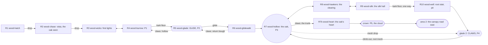

# The wood: region design

Draft 3, 2026-10-18. The top-down half of the region loop (`STUDIO.md`): builders greybox the rooms from this doc, and
persona bots and reviewers check the build against it. It follows `docs/design/core.md`, `world.md`, `journey.md` and
`creatures.md`.
- **Part A** (area 1, the wood floor) is rewritten from the director's redesign
  (`regions/wood-area1-director.md`), which owns its reasoning.
- **Part B** (area 2, the high wood) is kept from draft 2 and the rescope, with notes on what moved into it.
- The changelog is at the end.

Matt: no sunk cost. Stale material is deleted, not kept beside the new.

## The wood in two areas (~70 minutes)

| Area | Rooms | Median | Abilities | Peaks | Hub | Toy |
|---|---|---|---|---|---|---|
| **1. The wood floor** | R1–R10 and **R7b** (the oak's heart) | ~31 min critical path, ~35 with finds | glide ~0:05, claws ~0:27 | the chase and vista 0:01, the old burrback ~0:24, the trunk climb ~0:30 | the hollow oak (R7) | **the trap's throw** (a lamp that catches her and throws her) |
| **2. The high wood** | from the crown: the canopy road east over R8 and R9, R15 boughs, R16 knot (its hub), R12 web, R13 grove and the canopy edge; optional R17 gallery | ~35 min | ***Gust*** ~1:06 | the web gauntlet ~0:48, the Weaver ~1:00 and the relight | the knot (R16) | bounce caps, crumbling bark, orb webs |

**Area 1 ends at the crown** (the cloud lifts off, and Tatter climbs up), and **area 2 starts at the crown**. Moved from
area 1 to area 2 in draft 3:
- bounce caps;
- the lantern and its 2-hit, swinging ladder;
- the canopy line (E-high, W-canopy, `dang-canopy`, R9's window).

R11 `wood-climb` is merged into R7b.

**Units.** "R6" means room 6 (Part A's table). Px, a 64 px grid, a screen is 1920×1080. Room coordinates are local (x
right, y down, y = the top of a floor). The wood's kit has no double jump and no dash.

**Measured reach** (default tuning, run speed 9.6 px/f, x past the lip when her feet are this far below launch):

| Drop below launch | 0 | 128 | 192 | 256 | 384 | 448 | 512 | 640 | 832 |
|---|---|---|---|---|---|---|---|---|---|
| Walk off, no wings | | 141 | 170 | 198 | 256 | 285 | 314 | 371 | 458 |
| Jump at the lip, no glide | 486 | 544 | 573 | 602 | 659 | 688 | 717 | 774 | 861 |
| **Walk-off glide** (jump already held, wings open at the lip) | | 348 | 486 | 623 | 908 | 1045 | 1193 | 1468 | 1890 |
| **Jump-glide** (jump at the lip, held) | 486 | 622 | 760 | 897 | 1182 | 1319 | 1467 | 1742 | 2164 |

- The jump-glide rises over a hump first: 189 px above launch at x +100, a peak of 276 at x +250, back to launch
  height at x ~470. After that it runs 53 / 121 / 169 / 212 / 260 px below launch at x +500 / 600 / 700 / 800 / 900.
- The walk-off glide is 22 / 113 / 204 / 295 / 386 below launch at x +100 / 300 / 500 / 700 / 900.
- Every glide gap below is built so that the plain jump misses by ≥ 100 and the glide it asks for makes it by ≥ 150.
- **Wall kick across a shaft**: kick off face A, hold jump and toward face B. She meets B 253 / 273 / 229 / 172 /
  109 / 52 px *higher* than the kick for shaft widths 256 / 384 / 512 / 640 / 768 / 896. On one wall alone she
  climbs ~230 px a kick. There is **no cling**: a slide ramps from 2.5 to 6.5 px/f (about 700 px in 2 s).
- **Pogo**: 125 px up. **Standing forward cut**: snuffs a flame up to 120 px from her body centre (not at 140).
- **Jump-cut** (jump held, forward cut in the rise): a wick 200–300 px over the floor goes out from 60–140 px to
  one side in 3–6 of 9 cut timings, and **she is never caught**. A lantern gives 3–5 of 9, never caught. At 180 px
  to the side it misses.

**Lures** (`memory/lures.md`, tuned in the lab):

| | Wick | Lantern |
|---|---|---|
| Radius / core | 240 / 40 | 360 / 52 |
| Pull (edge → core) | 0.15 → 1.9 | 0.2 → 2.3 |
| Swirl | 0.5 | 0.6 |
| Hits / moths | 1 / 5 | 2 / 10 |

- **Beating free**: 3 presses of jump or attack. The throw is 14 px/f plus 7 up, exactly along the held direction
  (8-way; outward from the flame only when nothing is held), then 50 frames of grace for that lure and for every
  core the throw passes through (feel review r1, 3834228). A catch needs her moving inward, or 4 frames in the core.
  Measured since: W1 → M 17 of 17, W5 → T3 8 of 8 holding right.
- **To build** (core §3, the director's essential 1): the throw becomes a launch that letting go of jump never cuts,
  and while she is caught its arc shows along the arrow.
- **Snuff**: 9 frames of hitstop, 1 health back.
- **Lanterns are static in the sim today.** They are area 2's now (the swing waits for the path-follow block).
- The Weaver's heart is a new great-lamp row: R 700 in P1–P2 and 1100 in P3, core 72, pull 0.2 → 2.3, 3 hits.

---

# Part A. Area 1: the wood floor (draft 3, from the director's redesign)

Source: `docs/design/regions/wood-area1-director.md` (5e31bee), which owns the reasoning: the diagnosis, the
references and the reviewers' questions. This part turns it into the build spec. Two builders are rebuilding the
rooms from the director doc now, so **the room files own exact coordinates**. Positions below are kept-build numbers
where a room is kept, and intent where it is rebuilt.

**Removed in draft 3** (stale; git history has them, 8e68f22 and earlier):
- the old §1–§10 for R1–R10;
- R14 `wood-caps` and the hub's cap climb;
- the seed-cases;
- the R9 lantern and the broken-face shaft;
- the mid-air thorn branch;
- the hub's alcove well and its lid;
- W-hummock;
- R6's critical-path bark wall;
- the canopy line;
- R11 `wood-climb`, now merged into R7b.

## A1. The area's job

**Through-line: up, back to the sky.** She is left behind by the swarm and falls into the wood after its stragglers.
The wood floor is a dark bowl under a roof she can't get through, and the firefly's lights sit scattered across it.
In the bowl's lowest point stands **the great hollow oak**, open inside all the way up to a ring of moonlight at its
crown. **The way out is up the inside of the oak.** Every moth she frees flies there and spirals up and out, but
her claws are too soft for its walls. The area is about getting up that trunk.

**Arc: wonder → smallness → wings → competence → the dark → claws → release.** It ends where it began, with a swarm
leaving, but this time she sends it off herself, with Tatter beside her. A first-timer should be able to tell the
area back in one sentence: "I fell into the wood and had to climb the big tree to get out, freeing moths on the way."

**The three feelings** (the wood's, unchanged):
1. **"I want to catch them"**: the stragglers, then the cloud at the crown.
2. **"Light is a trap, the dark is mine"**: now a level rule (A5).
3. **"My wings are getting stronger"**: glide, then claws. The oak's walls slide at 10:30 and hold at 27:00.

**Five set-ups and payoffs** (the director's §2):

| Set-up | Payoff |
|---|---|
| The crown ring, seen from the vista (1:20) and the hub floor (10:30) | She stands in it (32:00) |
| Every freed cloud flies up the oak; the moth-stone's carving shows it | The crown cloud is every moth she freed, sized by the count |
| The firefly hangs W-ff inside the trunk (10:30) | W-ff is the climb's last throw, and she snuffs it (29:30) |
| Tatter can't climb (10:30) | She cuts the hanging root, and Tatter climbs up beside her (32:30) |
| The lamp throws her (2:00 on) | The valley's Fling: "in the wood the trap throws you; in the valley you throw yourself" |

## A2. Beat sheet and intensity

First-timer minutes, *est.* (the director's calibration): ~31 on the critical path, ~35 with the finds a
first-timer takes. Intensity runs 0–10.

| Min | Room | Beat | Int. |
|---|---|---|---|
| 0:00 | R1 hatch | Cocoon, the swarm leaves past the moon, Tatter's failed hop, the run | 1–3 |
| 0:40 | R2 chase | The fallen-trunk run. W-cave behind the landing (find) | 4 |
| 1:20 | R2 chase | **The vista** (held beat, ≤ 150 f). Three layers: the valley's lights with the swarm breaking up, **the oak and its crown ring**, and the stragglers peeling down. **Title.** She drops over the lip | 2 |
| 1:45 | R3 first lights | The stragglers circle W1. **Caught, thrown up onto M** (the fast line), or the dark dip (the slow line). A jump-cut frees them. The dead moth. W2 from the knob. W-hi3 by the hanging trunk (claws' first lock) | 4 |
| 3:00 | R4 burrow | The **juvenile beetle**: 2 cuts. The adult under W3 notices her in the light; snuff and it sleeps | 5 |
| 4:00 | R4 burrow | **The gap wick**: caught and thrown right onto F3 (aim matters), or the dark floor and the root tunnel. P1, Tatter ahead | 5 |
| 4:30 | R4 burrow | **The bark floor** over the hole: three down-cuts, each one bounces her, and on the third it breaks | 4 |
| 5:00 | R5 glade | Glide. W-alcove under the lip (find) | 2 |
| 6:00 | R6 glidewalk | Gap 1, safe: walk off under the root roof | 4 |
| 7:30 | R6 | Gap 2: **caught at W5, thrown, wings open** (fast), or a walk-off glide under the pull (slow) | 5 |
| 8:30 | R6 | Gap 3: glide through the edge of W6g's pull, or get caught and thrown toward T4. Thorns on the floor only | 6 |
| 9:30 | R6 | T4: the adult beetle under W6. Snuff on the pass and land in the dark, or fight. The oak's west door fills the frame | 6 |
| 10:00 | R7 hollow | **The question.** P3, the moth-stone. Tatter under the trunk, looking up. **The glimpse**: the firefly hangs W-ff on the trunk's inner wall and darts out through the crown. Kicks slide. One way on: the east arch | 1–2 |
| 11:30 | R8 clearing | Hawker A at W7 over the hummocks: tell, step aside, cut in the stall | 5 |
| 13:30 | R8 | **Caught is prey**: the throw gap with hawker B diving at the orbit. Beat free early, aim out of its lane. Slow line: the root tunnel | 6 |
| 15:00 | R8 | The bark mound hides the **moonlit hollow** (quick wings, find) | 3 |
| 15:30 | R9 silk hall | **The dangler alone** over a cut spot on a safe floor | 5 |
| 17:00 | R9 | A throw line beside a dangler's silk | 6 |
| 18:00 | R9 | **The composition**: beetle on the floor, dangler over the only cut spot, one wick. One snuff sends both | 7 |
| 19:30 | R9 | The dead end, a bark floor like R4's. She cuts down | 3 |
| 20:00 | R10 root stair | Dark ledges west, glide gaps, two lit pockets with danglers over the landings | 4–5 |
| 22:00 | R10 | **The pogo-wick**: drop and down-cut, snuff and bounce to the next ledge | 5 |
| 23:00 | R10 | **The window**: the old beetle asleep on a carpet of wings, the moon column beyond. P-chute | 3 |
| 24:00 | R10 pit | **The old burrback** (as built in 5cbd0a7) | 8 |
| 26:30 | R10 glade 2 | The moon column falls onto her: **claws**. P4. The climb-out (rest ledge) | 2–3 |
| 27:00 | R7 | Up through the root mesh. Tatter turns to watch. The walls hold | 3 |
| 27:30 | R7b heart | Lower third: faces, the rest-ledge wick, a dangler from a knot-hole | 6 |
| 29:00 | R7b | Middle third: **caught by W-ff, thrown across** the thorn band (or kick-glide through its bend); snuff it from the far face | 7 |
| 30:00 | R7b | Upper third: the hawker hunting the crown wick dives across the shaft | 8 |
| 31:00 | Crown | **P5**, the look-out (held beat): west to the hatching tree, east to the valley. Cut the root | 2 |
| 32:00 | Crown | **The cloud lifts off** east. **Tatter climbs the fallen root** and sits beside her. East along the canopy: area 2 | 1 |

```
Intensity, first run (one column = one minute)
 8 |                        ##    #
 7 |                  #     ##   ##
 6 |        ##   ##  ##     ##  ###
 5 |   ##  ###  ### ###  ## ##  ###
 4 |  ### ####  ### ### ### ##  ###
 3 |# ### ####  ############## ####
 2 |########## #####################
 1 |#################################
   +---------------------------------
    0    5    10   15   20   25   30
```
Four acts: the fall (0–6), the floor (6–20), the roots (20–27), the climb (27–33). Each rises, and the peaks are the
pit and the trunk, never a teaching room. No stretch of the critical path goes more than 3 minutes without a threat,
except the glade, the hub and glade 2's rest.

## A3. Room graph

Eleven rooms: R1–R10 plus R7b. R14 and R11 are gone, and R9 is rebuilt as `wood-silk`. No player saves exist yet,
so the R9 id can change; `wood-lantern`, `wood-caps` and `wood-climb` are retired, never reused.



**Three layers:**
- **Canopy:** R1, R2, then the crown.
- **Floor:** R3–R9 and the hub, sloping down east to the oak.
- **Roots:** R10, under the hub and the east floor.

The moon is always east-north-east. Inside the oak the moon column falls straight down from the crown, through the
hub and the root mesh, onto glade 2. `content/world.json` is the source of truth for placement. R7b sits above the
hub, with its shaft continuing the hub's up-shaft, and the crown at world y ~4.7k (R3's floor height).

| # | id | Purpose | Lamps (CP / find) | Creatures | Patch | Locks seen |
|---|---|---|---|---|---|---|
| R1 | `wood-hatch` | Wonder and the want | none | none | | the promise gap |
| R2 | `wood-chase` | The destination: the vista shows the oak | find: W-cave | none | | the crown ring |
| R3 | `wood-wicks` | The light grabs you and throws you | CP: W1, W2; find: W-hi3 (claws) | none | | W-hi3 |
| R4 | `wood-burrow` | The blade against things; light means seen | CP: the door wick, W3, the gap wick; finds: W-pocket, W-hi4 (claws + glide) | juvenile beetle, beetle | P1 (Tatter) | W-hi4 |
| R5 | `wood-glade` | Wings | find: W-alcove | none | P2 | |
| R6 | `wood-glidewalk` | The lamp joins the glide | CP: W5, W6g, W6; finds: W4, the floor pocket | beetle | P-t3 | the oak's door |
| R7 | `wood-hollow` | The question | none (W-ff burns overhead in R7b) | none | P3 (Tatter), moth-stone | the walls; the crown |
| R8 | `wood-hawkers` | Being caught is being prey | CP: W7, the throw wick; find: the moonlit hollow | hawker ×2 | P-dark | |
| R9 | `wood-silk` | The dangler, then the predators together | CP: the dangler's wick, the throw wick, the pair wick; postgame: a DJ wick | dangler ×2, beetle | | |
| R10 | `wood-well` | The dark under everything, the threshold | CP: pocket wicks ×2, the pogo-wick; find: W8 | dangler ×2, **old burrback** | P-chute, P4 | the window |
| R7b | `wood-heart` | Everything at once, going up; release | CP: the ledge wick, W-ff, the crown wick; find: the bark knot; postgame: the crown lantern (Fling) | dangler, hawker | P5 (crown) | |

**Loops:**
- **The big loop** is the area itself: hub → east floor → down R9's bark floor → west through the roots → under the
  oak → up the root mesh into the hub → up the trunk. She circles around and under the place she first stood.
- **The shortcut**: once she has climbed through it, the root mesh drops from the hub to P4.
- **The optional return west** (claws, ~4 min): R6's return bough → R5's east trunk and hollow → R4 (W-hi4, plus W3
  if missed) → R3 (W-hi3, plus W1 if missed). Its moths join the crown cloud, so the finds have a picture.

**Stubs** (scenery: no light, no ledge, no marker): the drowned-roots wall moves from the cut alcove to the roots
under the hub (R10's west hall). The canopy log stays in the crown's roof.

**Lost-risk and pull-back:**
- **The hub:** it has one way on (the arch), and the glimpse names the goal.
- **R8's throw gap:** the root tunnel is always there. A throw that fails lands on thorns, which cost 1 pip and send
  her back to the near ledge.
- **R9's dead end:** freed moths fly west while nothing goes east. The bark floor is the R4 move, so the floor
  itself is the clue.
- **R10:** the window shows the peak ahead of time.

## A4. Teaching ladders

| | Lock / intro | Safe / develop | Combine / twist | Test / conclude |
|---|---|---|---|---|
| **Lamp: caught, thrown, snuffed** | R3: W1 catches her (measured 17 of 17). The throw lands her on M holding right, or back west holding nothing (free) | R4: the gap wick, where aim matters. R6 gap 2: throw, then open the wings, the longest line in the area | R8: hawker B dives at the orbit. R9: the throw line passes a dangler's silk | R7b: throws are the road up, and the last one is W-ff's |
| **Glide** | R5: the glade (unchanged) | R6 gap 1: 800 / 448 walk-off under the root roof | R6 gap 2: throw plus glide. Gap 3: a glide bent by W6g's edge (pull ×0.6 on a gliding body) | R10's stair: dark glide gaps whose landings are lit only by danglers' wicks. R7b: kick-glides bent by W-ff |
| **Claws** | Locks: R3's hanging trunk (1:45), and the oak's walls by hand (10:30) | Glade 2 (26:30). The climb-out has two faces and a rest ledge | Through the hub: the lock she stared at is now the road | R7b: faces, thorn bands, a throw where a face ends, a hawker over the top third |
| **Pogo** | R4: down-cut the bark floor (each cut bounces her, a miss costs nothing). Optional: a down-cut flame or a braced shell | R10: the pogo-wick (required, safe; a miss lands on a floor) | The old burrback: while braced, only the pogo hurts it | (area 2: the Weaver's P3) |

Two notes on these ladders:
- **Lead times:** the claws' first lock comes ~25 minutes before the key, and the trunk lock is met by hand 16
  minutes before.
- **The pogo:** it is never a required skill check before minute 20. The seed-case gap is cut.

## A5. The lamp verb and the light/dark rule

**Light is the fast line, the dark is the slow line.** Every critical-path room with a lamp also has a dark way: a
lower floor, a root tunnel, a longer climb. The dark way is safe, slower and pays nothing. This one rule does three
jobs:
- it makes the lamp the critical path for anyone who moves fast;
- it meets core's permanence rule, because a snuffed lamp never strands her;
- it turns the old hard gates into a choice of risk.

**The throw lamp can't be snuffed until she has used it** (it sits beyond reach from the near side). So at a throw
lamp she faces its hunter, and the snuff from the far side is the reward. **Freed moths fly to the oak** along each
room's migration line, never into the HUD counter (core §3).

## A6. Encounters

**One predator for each moment of the lamp verb** (creatures.md rule 8):

| Predator | Real detail | It punishes | Placed |
|---|---|---|---|
| **Beetle** (burrback; the juvenile and the old one are rows of it) | Ground beetles eat the moths that fall under lights | landing and walking | in the light's pool, on a throw's or glide's landing |
| **Dangler** | Spiders drop on silk where moths circle | stopping to snuff | over the cut spot |
| **Hawker** | Dragonflies hunt the circling at dusk | being caught | in the air around a throw lamp; it dives at the orbit |

**Escalation** (~16 instances on the critical path, plus the mini-boss). Every predator on the critical path must be
able to bite a player who takes the fast line.

| Step | Where | What |
|---|---|---|
| 1. Fodder | R4 | The juvenile beetle (2 hp, no brace, a short ram) |
| 2. One predator, one lamp | R4, R8 west, R9 west | Beetle under W3; hawker A over the hummocks; the dangler alone |
| 3. On a moving line | R6 T4, R8 east, R9 | Beetle on a glide landing; hawker B at the throw lamp; a dangler beside a throw line |
| 4. Two, one lamp | R9 | Beetle on the floor plus a dangler over the cut spot |
| 5. In the dark | R10 stair | Danglers in the only lit pockets, over glide landings |
| 6. The exam | R10 pit | **The old burrback** as built (5cbd0a7: 2×, an earned window, pogo on the brace). It ignores the lit rule |
| 7. Everything, going up | R7b | A dangler on the rest ledge, W-ff as the road, a hawker across the shaft |

**What has to be built** (the director's §5, essential):
1. The throw is a launch, no longer cut by letting go of jump, and its arc shows while she is caught.
2. Freed moths fly to the oak, and the crown cloud is sized by the count.
3. The juvenile beetle as a tuning row.
4. The hawker's prey rule: it starts its tell at once when she is caught in its lamp's light, and aims at the orbit.

## A7. Room specs

### R1 `wood-hatch` (kept; 0:00–0:40)
As built. Fixes:
- The trunk in front of the second gap reads as a wall, so push it behind the play plane or darken it.
- Give the cocoon one visible prompt.

### R2 `wood-chase` (kept; 0:40–1:40)
As built: the fallen-trunk run, two real drops, the lookout V2, and W-cave in the trunk hollow. The vista is a held
beat on V2 (≤ 150 f) framing three layers: the valley's lights with the swarm, **the oak with its crown ring** in the
hollow below, and the stragglers. Everything east of the lip is the south exit.

### R3 `wood-wicks`, "the first lights" (reworked; 1:40–3:00)
- **The stragglers circle W1** (1280, 720, spin −1) over the dip. The dip's far wall is too tall to climb from the
  dip floor.
- **The fast line:** jump at W1 from L, caught (17 of 17). Beat free holding right and the throw lands her on M.
  Holding nothing throws her back west, at no cost.
- **The slow line:** the dip floor runs on east under M to root steps that come up at the knob, ~6 s longer.
- **The first snuff:** a jump-cut on W1 from M frees the stragglers. The dead moth lies in the dip.
- W2 from the knob is kept as a standing cut.
- The hanging trunk and W-hi3 (claws' first lock) are kept, and so is the root knot landmark.

### R4 `wood-burrow` (reworked; 3:00–5:00)
- **The juvenile beetle** under a small wick by the door: 2 cuts, no brace (the crawlid slot).
- **The adult** under W3 (brace, the amber shell). It notices her only in W3's light. A jump-cut from the root step
  snuffs W3 and the adult curls up asleep: the room's centre.
- **The gap:** the seed-cases are cut. A wick hangs over the gap with no creature near it. Caught and thrown right,
  she lands on F3: the throw's second use, where the aim matters.
  - The slow line is the dark lower floor (1472), with a low root tunnel east under F3 to steps up.
- **P1**, with Tatter ahead of her.
- **The bark floor over the hole** is the way down. Three down-cuts from a hop, each one a bounce (the pogo, learnt
  where a miss costs nothing). The third breaks it and she falls into the glade.
- Finds: W-pocket behind the door bark (kept), and W-hi4 from shelf H (claws + glide, kept for the return).

### R5 `wood-glade` (kept; 5:00–6:00)
As built: the bask, glide, the lip over the chasm (960 / 512), and W-alcove under the lip. The east trunk and the
hollow are climbable with claws (the return).

### R6 `wood-glidewalk` (reworked; 6:00–10:00)
- **Gap 1 (safe):** the walk-off under the root roof (kept: 800 / 448, the rungs, the gap1 camera zone). W4 on T2
  stays as a find.
- **Gap 2:** the high line is caught at W5 and thrown, and her wings open: throw plus glide reaches T3 (8 of 8
  holding right). The low line is a walk-off glide under the pull.
- **Gap 3:** the thorn branch is cut. **W6g** hangs over the gap so that a glide passes through the edge of its pull
  (a gliding body takes ×0.6). Steer through the bend, or get caught and throw out toward T4. Thorns on the floor
  only.
- **T4:** the adult beetle under W6. Snuff W6 on the pass and land in the dark with the beetle asleep, or land in its
  light and fight. From T4, the oak's west door fills the frame.
- The CP bark wall is cut (bark now means "a way down / something behind"). The floor pocket is kept as a find.
- P-t3, the return bough and T-ret are kept.
- The firefly sign under gap 1 moves to the trunk's foot (R7).
- Fix: the one-held-input crossing via W5's slingshot (feel r2 #6).

### R7 `wood-hollow`, the hub, "the hollow oak" (reworked; first visit 10:00–11:30, second 27:00)
- She enters at floor level from R6. The **alcove well and its lid are cut**, and so are the cap climb (B1–B3, NW)
  and the canopy-gap far branch.
- **P3** and **the moth-stone** (moved from R14): it draws the area on the map, with the roots faint below. Its
  carving shows moths climbing a tree.
- **Tatter** sits under the trunk, looking up.
- **The glimpse** (a held beat; flag `wood-firefly-glimpse`): the camera looks up the trunk. A warm light hangs
  **W-ff** on the trunk's inner wall about two thirds up (in R7b), pulses twice, and darts out through the crown. W-ff
  then burns overhead all through act 2.
- **Firefly sign 1**: a ring of picked glow-cap stumps at the trunk's foot.
- The trunk's walls slide when she kicks: the lock, met by hand. The **root mesh** in the floor (one-way, `noDrop`)
  glows with moonlight from below.
- **One way on: the east arch.** This is Dirtmouth, not a crossroads. Every freed cloud in the area flies in and
  spirals up the trunk.
- **Second visit:** she comes up through the mesh, and Tatter's look-up turns to watch her. The walls hold, and the
  up-shaft leads into R7b. After that the mesh is a drop back to P4.

### R8 `wood-hawkers`, "the hawkers' clearing" (reworked; 11:30–15:30)
- **West half:** hawker A at W7 over the hummocks, a safe floor. W-hummock is cut. Its strike (34–40 f) teaches the
  tell: step aside, cut it in the stall.
- **East half, the throw gap:** a wick high over a thorn-floored gap, hunted by hawker B.
  - The fast line: get caught. While she orbits, B tells and dives at the orbit. Beat free before the strike and aim
    the throw out of its lane onto the far ledge. Snuff the wick afterwards from the far ledge with a jump-cut, and B
    leaves.
  - The slow line: a dark root tunnel under the gap (no lamps, ~15 s longer).
- **Find:** the dark half's bark mound now hides the **moonlit hollow** (quick wings: beat free in 2 presses) in
  place of W-bark. It pays straight away, since every later throw lamp and hawker is easier.
- P-dark is kept. The open ceiling stays: area 2's canopy road crosses above.

### R9 `wood-silk`, "the silk hall" (replaces `wood-lantern`; 15:30–19:30)
A tall hall with silk hanging from the canopy into the light.
- **The dangler alone:** a wick over a knob-like cut spot on a safe floor. The thread shows first, then it drops on
  the spot she must stand on. Step back, let it drop, cut it while it hangs, or snuff from a jump.
- **The throw line:** a throw wick whose best line passes beside a dangler's silk. Wait out its drop, or take the
  dark floor under it.
- **The composition** (on the critical path): an adult beetle in the light's pool, a dangler over the only cut spot,
  one wick. One snuff sends both away.
- **Firefly sign 2** in the dark half: a half-hung string of glow-caps.
- **The dead end:** a bark floor like R4's, which takes plain down-cuts from standing, each one a bounce. Her freed
  moths go west, and nothing goes east. It drops her into R10's stair (one way).
- Postgame: one DJ wick on a high ledge in the hall (a slick stalk, ≥ 800 px from any face she can kick off). The
  open ceiling stays for area 2.

### R10 `wood-well`: the root stair, the pit, glade 2 (reworked; 20:00–27:00)
- **The root stair** (the chute, kept): dark ledges stepping down west with glide gaps, and **two lit pockets**, each
  a wick with a dangler over its landing.
- **The pogo-wick** (new; required, safe): a wick hung just under a ledge's lip, so the natural way on is to drop and
  down-cut. It snuffs and bounces her to the next ledge. A miss lands on a floor below.
- **The window:** a gap in the roots where the camera holds a beat. Below, the old burrback sleeps on a carpet of
  wings. Past it, the moon column lands on glade 2.
- **P-chute** at the pit door: a death costs a short walk.
- **The pit:** the old burrback as built, sealed to the roof, with the gate floor to roof.
- **Glade 2:** the moon column falls the whole height of the trunk. "Your claws have hardened." P4. W8 behind the gate
  (find).
- **The climb-out:** both faces and a rest ledge, up through the root mesh into the hub. The west hall holds the
  drowned-roots stub.

### R7b `wood-heart`, "the oak's heart" (new; ~2048 × 2600 above the hub; 27:30–31:00)
The hub's up-shaft continues into it.
- **Lower third:** two kickable faces and a rest ledge with a small wick. A dangler drops from a knot-hole onto the
  ledge's cut spot.
- **Middle third:** **W-ff** on the inner wall, with a thorn band on the near face above it. The way on is to be caught
  by W-ff and **thrown across** to the far face's holdable band, or to kick-glide across through its bend. Then snuff
  it from the far face: the glimpse's payoff and the area's last throw.
- **Upper third:** the open crown. A **hawker** hunts the crown wick and dives across the shaft while she kicks.
- Find: a bark knot with a wick. Postgame: the **crown lantern** burns across the crown gap (Fling).
- **The crown:**
  - **P5** and the held look-out: west to the hatching tree, east to the valley.
  - **The hanging root:** one cut and it falls down the trunk.
  - **The cloud:** every moth she freed circles the crown, sized by the count, and lifts off east.
  - **Tatter** climbs the root and sits beside her.
  - She can't follow the moths up. She goes east along the canopy road (area 2).

## A8. Finds and completion

| Kind | Area 1 |
|---|---|
| Critical-path lamps (19 wicks, 95 moths) | W1, W2, the door wick, W3, the gap wick, W5, W6g, W6, W7, R8's throw wick, R9's three, R10's two pockets and the pogo-wick, R7b's ledge wick, W-ff, the crown wick |
| Optional lamps (9 wicks, 45 moths) | W-cave, W-pocket, W-hi3, W-hi4, W-alcove, W4, R6's floor pocket, W8, R7b's bark knot |
| Postgame (15 moths) | the crown lantern (Fling, 10) and R9's DJ wick (5) |
| Other finds | the moth-stone (hub), two firefly signs (the trunk's foot, R9's dark half), the moonlit hollow (R8, quick wings) |

**First-run total: ~140 moths.** The crown cloud is the player's own count, and that is the finds' meaning. The first
health milestone stays a fixed count (110). A player who takes about three of the finds crosses it in the trunk
climb, so it lands with the cloud. A critical-path player crosses it in area 2's first lamps. Bots must snuff ≥ 9
critical-path lamps.

## A9. Metrics targets

| | Target |
|---|---|
| First-timer, critical path | 28–34 min (~35 with finds) |
| Wall jump | 25–28 min |
| Critical-path snuffs (every bot persona) | ≥ 9 |
| Longest critical-path stretch with no threat | ≤ 3 min (only the glade, the hub, glade 2) |
| Tries for anything before 6:00 | ≤ 3 |
| Each critical-path predator | bites a fast-line bot at its moment (beetle at a landing, dangler at a cut spot, hawker while she is caught) |
| Lost | ≤ 2 min anywhere, ≤ 60 s at the hub |
| Deaths | in the pit and the trunk, none in R1–R3 |

**Per-room targets** (first-timer; read by the playtest harness, `tools/playtest/targets.ts`; rows in route order for
`--chunk a..b`). The times come from the director's minute marks (A2), with roughly ±30% ranges. `wood-hollow` is
one row covering both visits: 1:30 the first time and 0:30 coming up through the mesh. `wood-heart` includes the
crown. Lamps are critical path / optional finds.

| room | target | lost | deaths | lamps | minutes (A2) |
|---|---|---|---|---|---|
| `wood-hatch` | 0:30–0:55 | 10 s | 0 | 0 / 0 | 0:00–0:40 |
| `wood-chase` | 0:45–1:20 | 15 s | 0 | 0 / 1 | 0:40–1:40 |
| `wood-wicks` | 1:00–1:45 | 30 s | 0 | 2 / 1 (return) | 1:40–3:00 |
| `wood-burrow` | 1:30–2:40 | 30 s | 0–1 | 3 / 2 | 3:00–5:00 |
| `wood-glade` | 0:45–1:20 | 60 s | 0 | 0 / 1 | 5:00–6:00 |
| `wood-glidewalk` | 3:00–5:00 | 45 s | 0–1 | 3 / 2 | 6:00–10:00 |
| `wood-hollow` | 1:30–2:40 | 60 s | 0 | 0 / 0 | 10:00–11:30, 27:00–27:30 |
| `wood-hawkers` | 3:00–5:00 | 45 s | 0–1 | 2 / 0 (+ the hollow) | 11:30–15:30 |
| `wood-silk` | 3:20–5:50 | 60 s | 0–2 | 3 / 0 | 15:30–20:00 |
| `wood-well` | 5:00–9:00 | 45 s | 1–3 | 3 / 1 | 20:00–27:00 |
| `wood-heart` | 4:00–7:00 | 45 s | 1–2 | 3 / 1 | 27:30–33:00 |

Reviewers also answer the director's 13
experience questions (director §7) from a first-timer's video or journal and their own play.

## A10. Exit criteria, and what we cut first

Area 1 is done in grey when all of these hold:
1. The bots and the first-timer agent finish with no softlock and no skip of the pit's gate, the mesh or the trunk.
2. A9's targets hold.
3. The one-sentence test passes for a first-timer.
4. The light/dark rule holds in every critical-path room with a lamp (a dark way exists, is slower, and pays nothing).
5. **Matt plays it and says it's fun.**

**Cut first if it runs long:**
1. The optional return west (then force W1 and W3 onto the path).
2. R9's throw-line beat.
3. R10's second lit pocket.
4. R7b's bark knot.

**Never cut:** the oak's question, the throw as the critical path, the window, the pit, W-ff's throw, Tatter's root,
the crown cloud.

## A11. Decisions (area 1)

The director's calls are adopted whole. Mine on top of them:
1. **R9 becomes `wood-silk`**, and the ids `wood-lantern`, `wood-caps` and `wood-climb` are retired, never reused.
2. **R7b `wood-heart` is a room of its own** above the hub, so the hub stays a ~6-screen room.
3. **The drowned-roots stub** moves to R10's west hall, since the alcove is gone. journey.md's drowned-roots escape
   now breaks out up through the root mesh into the hub.
4. **Postgame hooks in area 1:** the crown lantern (Fling) and one DJ wick in R9. The old canopy-gap far branch, its
   L-gap and R9's lantern-room DJ ledge are gone.
5. **The first health milestone stays at 110** and is no longer promised at the Weaver's burst. Where it falls depends
   on the finds (A8).

---

# Part B. Area 2: the high wood (kept from draft 2; rewritten when its chunk starts)

**Moved here from area 1 in draft 3** (the director's §3):
- **Bounce caps** become area 2's toy, with a full ladder.
- **The lantern** gets its 2-hit, swinging ladder here: a lantern on the canopy road (the old climb's L2), then the
  boughs' swinging lantern.
- **The canopy line** is area 2's first route east from the crown, over R8 and R9 (which become a look back from
  above): E-high, W-canopy, `dang-canopy`, R9's window. R8 and R9 keep open ceilings for it.
- **R11 `wood-climb`** is merged into R7b. Its wall-jump test and look back are area 1's now. Where the outline below
  says "R11's thorn niche", read R7b's thorn band, or a niche on the canopy road.

The first health milestone (110) is no longer promised at the Weaver's burst (A8). The specs below are draft 2's and
predate the rescope's R15–R17. They stand until area 2's chunk iteration rewrites them.

**Area 2 in outline** (the rescope's, kept): R15 `wood-boughs` (crumbling bark bridges above the canopy line, the
**bombardier** on a ledge spitting arcs across them, a swinging lantern); R16 `wood-knot` (the area's hub: P5, a
moth-stone, Tatter, three exits: the web hall, the optional R17 gallery with a sign and a hollow, and the landing
of the edge drop); the **web gauntlet** in R12 (the orb web, a bombardier behind it and a dangler composed, Nine
Sols' gauntlet before the boss); glade 3 (**Gust**) in the open moonlight at the canopy edge after P7; and **the
edge drop**, one way back into the knot, past Gust's first old payoffs (R11's thorn niche, the web hall's high
strands). Area 2 holds ~20 lamps.


### 12 `wood-web`: the orb web and the approach (4480×2176; purpose: teach + rest)
```
 640                                           ══DJ══(wick)
 896 [W]═entry═╗          ╭──web r640──╮
1024           ║S3▐      │    (W9)    │      ╔cap╗══approach══[P6]══[E door]
1344           ║bark    │   weaver    │      ║trunk 3200 (kickable to 1024 only)
1600           ╚═══ hall floor 768-3200 ═══════╝   ↓stub log
```
- Entry ledge (0–768, y 896) → drop to the hall floor (768–3200, y 1600), safe all the way.
- **The orb web**: a disk of radius 640 centred on **W9** (1984, 960), anchored to the canopy, two root columns and
  floor stakes. It fills the hall from y 320 to the floor. Touching it is Caught (a creature's Caught): the weaver
  runs out at 5 px/f and bites after a 24-frame count, 1 damage. Cuts from outside sever strands, and the weaver
  senses touches, not cuts.
  - CP: **cut the lower-west sector** (~6 cuts) to open a doorway at floor level. One sector near the entry already
    hangs cut.
  - Options: snuff W9 (the weaver disperses and the web goes dark and harmless), or glide through an outer cell.
- **S3**: a rotten-bark panel in the hall's west wall (768–832, y 1088–1344), one kick up, with an alcove under the
  entry ledge holding a lantern.
- The trunk at 3200 is kickable from the floor to 1024 and **capped there with an overhang**. It climbs 576 to the
  approach shelf (3328–4480, y 1024).
- **The approach**: dark, quiet, silk thick on the trunks. **P6** at 4096, no Tatter. The arena door is the E exit,
  floor level.
- **DJ ledge** (3584–3840, y 640, slick faces): 384 over the shelf (a double jump reaches it). The capped trunk stops
  a kick-glide.

### 13 `wood-grove`: the Weaver and the canopy edge (4736×2304; purpose: boss + exit)
- **Arena** at x 0–2176: the Weaver spec below. The camera locks until `wood-weaver-down`.
- **Chimney**: the silk curtain on the east trunk (y 1344–1600) opens onto a chimney (2176–2560, kickable both
  faces). It climbs ~960 to the edge shelf (2560–4736, y 640). **W-relit** hangs at (2368, 1100), mid-chimney: its
  field covers the chimney, so she is pulled or caught in the climb and snuffs it there (critical path). As she tops
  out, the firefly crosses the frame and leaves over the edge.
- **The edge**: **P7** at 3200. While she rests, **Tatter walks up out of the chimney** (insects climb bark) and sits
  beside her: her victory opened its road. The **exit vista** (camera lift): the valley below and the mountain
  larger than at the title. One flicker lamp far off blinks the firefly's rhythm (three short, one long). E exit at
  the shelf's end: a long glide down into the valley's arrival room.


### The Weaver (greybox spec)

The first major boss is a lesson with **one exam a phase**: P1 tests glide, P2 reading and moving (wall kicks to
stay up), P3 pogo. Goals: a first-timer survives 60 s on the first attempt, a clear takes ~2.5 minutes, and a retry
reaches P3 in ~75 s.

**Arena** (inside `wood-grove`, local x 0–2176, y 1088–2304; the camera locks to this rect at zoom ~0.88 so that all
of it is on screen; if the camera has no zoom, trim it to 1920×1080 inside the walls):
```
 y1088 ═══════════════════════ canopy ═════════════════════════
       ║  pivotW     C1┃   (3)    pivotC    ┃C2   pivotE ║ silk  ║
       ║              ┃(2)·   ╲  │  ╱   ·(4)┃           ║curtain║→ chimney
       ║              ┃     spokes(HEART)    ┃           ║1344-  ║
 1728  ║  (1)·        ┗━                   ━┛      ·(5) ║ 1600  ║
 1920  ║     ═══B1═══                      ═══B2═══     ║       ║
 2176 →╚════════════════════ floor ═════════════════════════════╝
   west trunk x0-128 (entry at floor)            east trunk x2048-2176
```
- Floor y 2176, x 128–2048, flat. The west trunk's east face and the east trunk's west face are kickable.
- Hanging columns C1 (x 576–672) and C2 (x 1504–1600) run from the canopy down to y 1728, both faces kickable.
  One-way branches B1 (448–800) and B2 (1376–1728) sit at y 1920.
- The **heart** hangs at (1088, 1536). The **ring flames** are wick rows at ring-1 (320, 1792), ring-2 (832, 1408),
  ring-3 (1088, 1216), ring-4 (1344, 1408) and ring-5 (1856, 1792). Reach: rings 1 and 5 by a jump-cut from the
  branch ends (≤ 140 px to the side); rings 2 and 4 from the column faces (a kick toward them); ring 3 by a
  kick-glide from a column top.
- **The P1 web is spokes only**: one strand from the heart to each ring flame, and nothing between neighbours. No
  strand crosses an approach to a ring flame. Touching a spoke is Caught, gentle (no bite).

| Phase | Exam | What happens | Tells and timings (60 Hz) | Ends |
|---|---|---|---|---|
| **P1: the ring** (~50 s first time, ~30 s on a retry) | glide | The weaver sits on the heart. She snuffs the ring flames; each snuff drops its spoke and gives 1 health back. The heart pulls with R 700 (the floor's outer thirds and both trunks are outside it). Caught in the heart's core, the weaver's eyes go hunt colour and count down. **On a retry only rings 2–4 burn**; rings 1 and 5 stay husks | Bite after 60 frames held at the heart, 1 damage, then she is thrown out | The last ring flame. The spokes fall, the weaver climbs into the canopy (2 s, harmless) |
| **P2: the drops** (~40 s) | read the arc, move, kick up a face | Three drops in order, from pivots over x 448, 1728, then 1088. Each starts with the thread tell: a pale arc drawn on the floor band showing the whole swing. The weaver drops to one end of its arc (thread ~1010 px, ±40°: it sweeps x pivot ± 650, and the ends rise ~240), swings through to the other end and back to the bottom, then hangs winded. **Each swing covers half the arena, and the safe side is always opposite**: the far trunk or the far column. The columns' feet (1728) are above the band's highest point (~1860), so a face is safe while she keeps kicking (one wall is enough, ~230 px a kick; a plain slide from a column top lasts ~110 f) | Tell 45 f, drop 18 f, swing 60 f (123 f in all, enough to cross ~1000 px and kick once). Winded 90 f (open: 2–3 cuts), or cut its thread and it falls stunned for 120 f. Contact 1 | 3 hits taken |
| **P3: the floor** (~45 s) | pogo | The heart's pull grows to R 1100. The weaver hunts the floor: a lunge (rears up with flashes quickening 30 f, then 240 px at 10 px/f), then lies winded with its abdomen up for 60 f. Front cuts glance off its fangs, and **only a pogo on the abdomen lands**. Between lunges it skitters up a trunk and drops back on a short thread (shown first, 30 f). After 3 pogos it flees into the canopy for good | Lunge tell 30 f; winded 60 f | The heart lowers to (1088, 1792), unguarded. 3 hits (a pogo on the flame counts) and it goes out |

- **Fairness:** the whole arena is on screen, nothing attacks from off screen, nothing hits during the re-form, every
  attack has a punish window, and every tell reads with the sound off. A death re-forms her at P6, under 15 s from
  the arena, and on a retry P1 is the three-flame version. There are no pits.
- **Ending (set piece 2):** input held ≤ 3 s. The heart dies, the wood's sky clears, all 60 moths burst out (the ring
  flames' moths had fed the heart), and the count may cross the first health milestone (A8). The silk curtain on the
  east trunk falls. A small warm light darts in through the opening and relights **an old glow-cap husk halfway up
  the chimney** (`wood-grove:wick-relit`); five freed moths are pulled back into it. Flags `wood-weaver-down`,
  `wood-relit`.
- **Fallback** (only if a real attempt fails): cut P2 (P1 → P3); the web stays a fixed graph.


### Area 2 lamps (draft 2's, unchanged)
`wood-web:wick-web` (CP), `wood-web:lantern-bark` (secret, 10), `wood-web:wick-high` (postgame DJ),
`wood-grove:great` (5 ring flames + heart, 60), `wood-grove:wick-relit` (CP, in the chimney). The rescope's R15–R17
add ~15 more (area 2 holds ~20 lamps).

### Area 2 decisions kept from draft 2
- The great lamp's ring flames are part of it: their moths feed the heart and burst out together.
- The Weaver tests one thing a phase: spokes only in P1, a heart of R 700 until P3, three ring flames on a retry,
  and P2 swings over half the arena with the safe side always opposite. There is no cling.
- The exit gate is a silk curtain that falls with the Weaver. The valley doc owns the landing and the way back up.
- Tatter walks up the chimney to P7 after the Weaver.
- The relit flame is in the chimney she has to climb.

---

## Changelog

### Draft 3 (2026-10-18): area 1 rewritten from the director's redesign (5e31bee)
- **Area 1 rebuilt around one place:** the hollow oak at the bottom of the bowl, and the way out up its trunk.
  - The vista shows the oak.
  - The hub asks one question: one way on, the glimpse inside the trunk, Tatter looking up, the walls sliding.
  - The area ends at the crown with the cloud of every freed moth and Tatter's root.
- **Rooms:**
  - added: R7b `wood-heart`, the trunk climb and crown;
  - rebuilt: R9 as `wood-silk`;
  - reworked: R3, R4, R6, R7, R8 and R10's stair;
  - removed: R14 `wood-caps`, the hub's cap climb, the alcove well and its lid;
  - merged: R11 `wood-climb` into R7b.
- **The core set is cut to three things:** the lamp's three moments (caught, thrown, snuffed); three predators, one
  per moment (beetle, dangler, hawker), plus the juvenile and the old beetle; and glide and claws.
  - Cut: the seed-cases, the mid-air thorn branch, W-hummock, R6's critical-path bark wall.
  - Deferred to area 2: bounce caps, the lantern, the canopy line.
- **New level rule:** light is the fast line, the dark is the slow line. Every critical-path room with a lamp has a
  slower, safe dark way.
- **The throw is the critical path** (≥ 9 critical-path snuffs for every bot). The pogo comes from bark floors, not
  from a required skill check at minute 3.
- **Removed as stale:** the old area 1 §1–§11, the old 13-room graph, beat sheet, metrics and exit criteria, and the
  old area 1 lamp table.

### Draft 2 (answers paper review 1; real lure numbers)
- The hub well moved off the walkway, and the climb-out came up through the hub floor.
- The pogo ladder.
- R8 split into `wood-hawkers` and `wood-lantern`.
- Glide gaps re-derived from real trajectories, and W4/M removed.
- The Weaver rebuilt.
- The wall-jump ladder escalates.
- R1–R5 reopen with wall jump.
- Tatter walks; the glimpse at the hub; the relit flame on the critical path.
- The review's §4 leaks closed.

### Built vs paper (greybox, 2026-10-18)
History of the build against draft 2. Rooms and rows named here may since have been cut by draft 3.

What the greybox build changed, each measured in the sim (`tests/unit/wood-rooms.test.ts`, memory/rooms.md).
Rooms built: R2–R10. R11 `wood-climb` is a stub.

| Room | Paper | Built | Why |
|---|---|---|---|
| R3 | W2 (2072, 918) | (2072, 896) | the knob sat inside its core |
| R3 | — | a shaft wall 896–1024 to y 576 (no kick) | a fall held right drifted into W1's field |
| R2 | twigs over C | one one-way 3584–4224 y 768, C to over D | short twigs trapped walkers between a missed walk-off and a missed jump |
| R5 | P2 in the shaft | P2 at x 448 | where a fall from the hole lands |
| R4 | safe floor 1408 | 1472 | a full jump climbed F3's 256 face and skipped the pogo |
| R4 | fade before P1 → R3's landing | → the burrow's door (300, 1280) | room-local re-form point; R3 has nothing that can fade her |
| R6 | root steps back to E0 | one-way rungs at 576–672 | steps toward T2 let a plain jump reach it |
| R6 | W4 (1920, 760) | (1800, 640) | at 200 up it caught the jump-glide from E0's lip and every jump from T2's lip before W5 |
| R6 | thorn branch 1176–1272 under a stem | thorns 1112–1272, no stem | a glide on after W5's throw landed on the stem's top and went on to T4 |
| R7 | shelf 2624, floor 2880 | shelf 2880, floor 3136, arch steps | the doors did not meet R6 and the hawkers |
| R7 | alcove 256–960 | 384–960 (back wall 0–384) | an explorer reaching for a floor behind the well fell in |
| R10 | gate 1216–1472, W8 (1984, 992) | gate 1088–1472, W8 (2000, 992) | a jump cleared a 256 gate; W8 out of reach from the ledge |

**Jump-cut claims hold with this doc's method** (jump held through the cut, cut in the rise, 9 timings 2–18
frames, 60–140 px to the side): W3 3.4 of 9, W4 6.0, W7 6.0, L1 4.0, none caught. An earlier test that let go of
jump at the cut and cut late (6–22 frames) read W3 at 1–2 and L1 caught; that was the test, not the room.
Still open: beaten free from W5 holding right lands on T3 in ~5 of 8 beat timings, the rest in gap 2's thorns.
(Since the stick throw, 3834228: 8 of 8.)

**Round 1 of the quality iteration** (docs/design/regions/reviews/chunk1-plan-r1.md; the impatient first-timer):

| Room | Before | Round 1 | Why (plan item) |
|---|---|---|---|
| R10 | gate 384 tall under an open roof; W8 over the pit | the pit sealed to the roof, the gate floor to roof, W8 behind it | the throw and a pogo skipped the mini-boss (1) |
| R9 | DJ ledge on a floor stalk | hung from the canopy; spawn and door clear | the stalk boxed in the west door (2) |
| R8 | wick-bark 22 px from the root post | the cavity's wick at (2920, 2560), deep in the mound | its pull dragged the westward jump short; the bark cuts put it out (2) |
| R9→R10 | the well from the hub only | R9's shaft floor drops into R10's chute; the hub's well is a lid until the climb-out | a loop: the lock and its key meet (3) |
| R7→R8→R9 | — | e-high off the crown, the canopy line east to R9's shaft window | a high route after wall jump (3, 5) |
| R2, R4, R5, R8, R9, R10 | 3 optional lamps | + W-cave, W-pocket, W-alcove, W-hummock, W-canopy, W-high (R9), W-chute | finds every 2–3 min (4) |
| R8, R9 | 3200×1600 flat boxes | 3840×2752 / 3840×2992, two levels, two lines | rooms you remember (5) |
| R2 | rolling boughs | the fallen trunk, two real drops, the trunk hollow | a landmark, real drops (5) |
| R3 | — | the root knot over W1 | a landmark (5) |
| R7 | no zones | rest (fit) and look-up zones | the hub reads as a hub (8) |
| R6 | — | the root roof over E0's lip, the gap1 zone, P-t3 | walk-off taught; rest before the test (9, 10) |
| R8 | — | P-dark | patches every ≤ 4 min (10) |
| R4 | — | seed-0 over F1; W-hi4 moved off the hops | a pogo intro where a miss is free (11) |
| R6 | thorn branch on the jump-glide's hump | over the apex, 76 clear | "hold jump to glide" teaches that arc (first-timer) |
| R8, R9, R10 | one creature under one lamp | two lamps over the hawker's lane; burrback + dangler + L1 on P; danglers over R8's canopy landing and R10's chute landing | ≥ 4 creature + terrain combinations (6) |
| R2, R5, R10 | catches at the room's foot | 200 above the foot (R5 grew 200) | the camera kept her in frame until the catch (feel r1) |
| all | labels on | `art.labels: false` (G shows them) | players saw the designer's notes (first-timer) |

| R14 | — | built: the cap stair, two danglers, three lamps, the moth-stone, the hollow, the root, the drop to R6 | rescope items 2, 3, 5, 7 |
| R7 | grate (a shortcut hole) | a one-way root mesh; a lip before the well; B1-B3 to NW | the curious first-timer's hub traps; the cap climb |
| R6, R8 | — | firefly signs (under gap 1, the dark half) | finds (4) |
| R2 | — | trigger `vista` (wood-vista) | staging: the vista once per save |

Measured (tests/unit/wood-rooms.test.ts): W7 30 of 45 jump-cuts, L1 20 of 45, W8 18 of 27; the hawker hits a runner
before she reaches W7 (1.8 s lit first); the chute to the pit 754 frames with jump-glides and no catch; the no-skip
sweep never gets west of 3584 or above the roof.

