# The wood: region design (paper)

Draft 1, 2026-10-18. The top-down half of the region loop (`STUDIO.md`): implementers greybox the rooms from this doc,
and persona bots and reviewers check the build against it. It follows `docs/design/core.md`, `world.md`,
`journey.md` and `creatures.md`, and is checked against `docs/research/metroidvania-craft.md` §8. Scene 1
(`wood-hatch`) is kept as built. Where this doc changes a number from those docs, §11 says so and why. Matt said
"don't ask, decide", so every call is made here and the big ones are listed at the end for his veto.

**Units.** "R6" means room 6 in the §3 table. Px, a 64 px grid, a screen is 1920×1080. Room coordinates are local (x right, y down, y = the top of a
floor). Reach is from `memory/movement-controller.md` with the wood's kit (no double jump, no dash): a jump rises 272
and carries ~410–470 px on the flat; comfortable steps are ≤ 192 and gaps ≤ 320. A jump off a lip carries 557 / 643 /
758 px for drops of 192 / 384 / 640, and a glide off a lip carries 763 / 1185 / 1745 / 2167 px for drops of 192 / 384
/ 640 / 832 (+141 px per extra 64 px of drop). **A glide needs a drop:** a held ground jump only opens the wings 16 px
below its launch height, so a glide gap always lands lower than it starts. Wall kicks: one wall is enough, about
230 px of height per kick. Slash reach is ~110 px. A pogo throws her about 125 px up (estimate: measure it).

**Lamp numbers are assumptions until the lamp lab (PLAN phase 0) sets them:** a wick has pull radius R 360, core 36,
1 hit, 5 moths; a lantern has R 520, core 48, 2 hits, a 256–320 px chain swinging ±25° with a ~3 s period, 10 moths.
The Weaver's great lamp has a heart of R 1100, core 72, 3 hits. Beating free takes 3 presses. If the lab moves R or
the core by more than 25%, recheck the four rooms whose layout leans on the pull: `wood-wicks`, `wood-glidewalk`,
`wood-climb` and `wood-grove`.

---

## 1. The wood's job

The wood teaches the game. In 35–45 minutes it turns a newborn moth who can only run, jump and cut into a flyer
who glides, climbs and reads lamps and predators. It does this in the one place she'll ever think of as safe: close,
dark and old, with the moon above the canopy. Its arc is **left behind → finds the lights are the problem → grows
wings and claws → puts out the first great lamp**. The region ends when its sky clears for the first time, and a
small warm light she has seen once before relights a flame behind her and flies off toward the valley. The three
feelings it must deliver:

1. **"I want to catch them."** The pull of the swarm leaving without her, kept alive by every cloud of moths she frees.
2. **"Light is a trap, the dark is mine."** Every lit room is tense, every dark room is a breath, and every snuff
   turns the first kind of room into the second.
3. **"My wings are getting stronger."** Glide by minute 5 and claws by minute 18. Each one changes how she moves
   through rooms she has already seen, and the Weaver tests all of it.

---

## 2. Beat sheet and intensity

Minute marks are a first-timer's (the first-timer agent as the reference player), with an average of 1–2 deaths at
the old burrback and 1–3 at the Weaver. Intensity runs 0–10: 1 is resting at a moon patch, 5 is a normal lit room,
and 9 is the Weaver's last phase.

| Min | Room | Beat | Int. | Kind |
|---|---|---|---|---|
| 0:00 | 1 hatch | Fade up, the cocoon row, break out (control by 8 s) | 1 | |
| 0:10 | 1 hatch | The swarm overhead, the run, **the promise gap** (glide's lock) | 3 | |
| 0:30 | 2 chase | Off the branch's end after the swarm, then the downhill chase through the canopy | 4 | set piece 1 |
| 1:00 | 2 chase | **The vista**: the canopy opens and the swarm pours down into the valley's lamps. **Title over the moon** | 2 | vista |
| 1:30 | 2 chase | A knot of stragglers breaks off and spirals down through a hole toward a glow | 2 | |
| 1:45 | 3 wicks | **First lamp**: the stragglers circle a wick; she is pulled in, caught, and beats free (the cocoon's input). A dead moth lies below | 4 | first catch |
| 2:30 | 3 wicks | **First snuff** from a root lip: hitstop, the dark blooms, 5 moths fly with her and then peel off east | 5 | |
| 3:15 | 4 burrow | **First predator**: a burrback under a wick notices her only in its light. Fight it, or snuff its wick and it curls up to sleep | 5 | |
| 4:15 | 4 burrow | **First moon patch, Tatter already resting there** | 1 | rest |
| 4:45 | 5 glade | Drop into the hollow and land in moonlight: **glide** | 2 | glade 1 |
| 5:30 | 5 glade | The only way out is a long glide over the chasm (with a wick on the way) | 4 | |
| 6:00 | 6 glidewalk | Safe glides over a floor, then a glide on a line through a wick's pull | 4–5 | |
| 7:30 | 6 glidewalk | A glide over thorns onto a ledge with a burrback under a wick | 6 | |
| 8:15 | 6 glidewalk | **A rotten-bark wall** (the secret language, here on the critical path); the freed moths slip through its crack | 3 | |
| 8:30 | 6 glidewalk | **The firefly's glimpse** through a canopy window: a warm light hangs a glow-cap and is gone | 2 | story |
| 9:30 | 7 hollow | **The hub**: the hollow oak, a patch, Tatter. A well glowing with moonlight, an arch glowing gold, a shaft up she can't climb | 1 | rest, hub |
| 10:30 | 8 hawkers | **First hawker** at a wick over a safe floor (tell, dive, stall) | 5 | |
| 12:00 | 8 hawkers | **First lantern**: a swinging flame, 2 hits, a hawker above and a burrback below | 6 | |
| 13:30 | 8 hawkers | The climbing shaft east: freed moths fly up it, and she can't. Back to the hub | 2 | lock |
| 15:00 | 7→9 | Down the well (one way) into the **old burrback's pit** (mini-boss) | 7 | mini-boss |
| 18:00 | 9 well | **Glade 2: wall jump**. Climb out a second shaft and push up through a grate into the hawker hall | 2–3 | glade 2 |
| 20:30 | 8→10 | Up the east shaft, then a chamber where a lantern swings between two walls | 5 | |
| 23:00 | 10 climb | A one-wall climb beside a thorn face, then a hawker at the top wick | 7 | |
| 25:00 | 10 climb | **The look back**: above the canopy at last, the hatching tree far off under the moon. Patch, Tatter | 1 | vista, rest |
| 26:00 | 7 crown | (Optional, via the hub's shaft) the crown wick and the canopy gap with the glow-cap she saw hung | 3 | payoff |
| 27:30 | 11 web | **The orb web** strung across a wick; the weaver runs to where she touches it. Cut it from outside | 6 | |
| 30:00 | 11 web | The approach: dark, silk thick on the trunks, warm light through them. Patch at the door, Tatter | 1 | rest |
| 31:00 | 12 grove | **The Weaver**, phase 1: glide between crossing pulls and snuff the ring of flames | 7 | boss |
| 32:00 | 12 grove | Phase 2: silk drops and swings; get up on the trunks | 8 | |
| 33:00 | 12 grove | Phase 3: lunges on the floor, pogo, then the great lamp's heart | 9 | |
| 33–37 | 12 grove | Retries (patch to door in under 15 s) | 7–9 | |
| 37:00 | 12 grove | **The great lamp goes out**: the first sky clear, 60 moths, +1 max health. **A small warm light darts in and relights one flame behind her**, then flees east. She snuffs it again | 3 | set piece 2 |
| 38:00 | 12 grove | The silk curtain has fallen. Climb to the canopy edge for **the exit vista**: the valley, a flicker blinking, the mountain bigger than at the title. Patch, Tatter | 2 | vista |
| 39:00 | → valley | A long glide off the edge, down into the valley | 2 | |

```
Intensity, first run (one column = one minute)
10 |
 9 |                                #  #
 8 |                               ## ##
 7 |                ##     ##     ######
 6 |        #    ## ##     ##  ## ######
 5 |   #   ##  #### ##   ####  ## ######
 4 |  ### ###  #### ##   ####  ## ######
 3 |# ### ###  #### ## ###### ### #######
 2 |########## ############## ### ##########
 1 |########################################
   +----------------------------------------
    0    5    10   15   20   25   30   35
```

The shape is three rising waves, each ending in a rest: the opening (0–10, which peaks at the first test glide), the
middle (10–25, which peaks at the old burrback and the thorn climb) and the climb to the boss (25–38). Each rest is a
moon patch in a dark room. **Novelty:** the hatch (0), the vista (1), pull and Caught (2), the snuff (2.5), the burrback (3),
glide (5), the secret wall (8), the firefly (8.5), the hub (9.5), the hawker (10.5), the lantern (12), the old
burrback (15), wall jump (18), the look back (25), the web (27.5), the Weaver (31) and the relight (37). That is one
every 2.3 minutes, denser early as the opening should be. The longest gap is 18 → 25, the stretch where wall jump
gets practised and tested.

---

## 3. Room graph

Twelve rooms, eleven new, about 53 new screens of area (the hatch adds 10, mostly empty depth). That is more than
world.md's ~32 because tall rooms count their empty air; every room stays within tech.md's 6-screen budget. There are seven moon
patches. Ids are forever.

```mermaid
flowchart LR
  H["1 wood-hatch"] -->|drop| C["2 wood-chase: vista + title"]
  C -->|drop| K["3 wood-wicks"]
  K --> B["4 wood-burrow: patch"]
  B -->|hole, one way| G1{{"5 wood-glade: GLIDE, patch"}}
  G1 -->|glide| GW["6 wood-glidewalk"]
  GW -->|rotten bark| HUB(("7 wood-hollow: HUB, patch"))
  HUB <--> HK["8 wood-hawkers"]
  HUB -->|well, one way| WL["9 wood-well: old burrback"]
  WL --> G2{{"glade 2: WALL JUMP, patch"}}
  G2 -->|wall| GR["grate, opens from below"] --> HK
  HUB -.->|wall| CR["hub crown: wick, fling lock, stub"]
  HK -->|wall| CL["10 wood-climb: patch at top"]
  CL --> WB["11 wood-web: approach, patch"]
  WB --> AR[["12 wood-grove: the Weaver"]]
  AR -->|silk falls| ED["canopy edge: patch"] -->|long glide| V(["valley rim"])
  CR -.->|fling or DJ| PG["postgame lamps"]
```



| # | id | Screens (w×h px) | Purpose | Exits | Gates | Lamps | Creatures | Patch | Secrets / later | Visible but locked |
|---|---|---|---|---|---|---|---|---|---|---|
| 1 | `wood-hatch` (built) | 7424×2816 | Who she is, what she wants, how she moves | S drop | none | none | none | none | | **The promise gap**: the swarm crosses, she can't (glide) |
| 2 | `wood-chase` | 5.9 (6400×1920) | Flow and the chase; the vista and the title | N in, S out (drop) | one way down | none | none (the swarm) | | T3: a Moonflight lamp above the vista (stub in data later) | The valley's lamps across the gulf, out of reach until the end |
| 3 | `wood-wicks` | 4.0 (3840×2176) | Teach pull, Caught and the snuff by consequence | N in, E | one way in | W1 caught, W2 first snuff | none | | | |
| 4 | `wood-burrow` | 3.5 (4480×1600) | First predator; light = noticed; snuff scatters | W, S hole | hole is one way | W3 | burrback (4 hp) | **P1** | | The hole: moonlight far below |
| 5 | `wood-glade` | 3.2 (2880×2304) | Glade 1 and the glide lock room | N in, E | glide to leave | W4 (optional, mid-chasm) | none | **P2** | | |
| 6 | `wood-glidewalk` | 6.0 (5760×2176) | Glide: safe → combine → test; the secret language; the firefly | W, E | glide gaps; rotten bark | W5, W6 | burrback (5 hp) | | | The firefly's glow-cap, far off (seen again from the crown) |
| 7 | `wood-hollow` (hub) | 6.0 (3840×3248) | Rest, choice, and the region's lock board | W, E, S (well) | well one way; up-shaft wall jump; crown far branch fling/DJ | W-crown (payoff); L-gap + W-ff (postgame) | none | **P3** | stubs: canopy log (T3+), drowned-roots wall (T2) | Up-shaft with a glow at the top; the canopy-gap lantern and glow-cap |
| 8 | `wood-hawkers` | 5.3 (5120×2160) | Hawker intro, the first lantern, the wall-jump lock | W, E shaft, grate in floor | shaft wall jump; grate opens from below | W7, L1, S1 (secret); DJ wick (postgame) | hawker ×2, burrback | | S1 behind rotten bark | Shaft with moths flying up it; the grate with moonlight under it; DJ ledge one jump short |
| 9 | `wood-well` | 4.7 (3840×2560) | Mini-boss, glade 2, the wall-jump lock room | N well in, N grate out | well walls refuse kicks; root gate on the boss | W8 | **old burrback** (mini-boss) | **P4** | | |
| 10 | `wood-climb` | 4.0 (2560×3240) | Wall jump: combine and test; the look back | S, E (top) | wall jump | L2, W10, S2 (risk line) | hawker | **P5** (top) | S2 thorn niche | |
| 11 | `wood-web` | 4.7 (4480×2176) | The orb web; the quiet approach | W, E (arena door) | wall jump (trunk) | W9, S3 (secret); DJ wick (postgame) | orb web + weaver | **P6** (door) | S3 behind rotten bark; stub: fallen log south | DJ ledge over the approach |
| 12 | `wood-grove` | 5.3 (4736×2304) | The Weaver; set piece 2; the exit vista | W, E (valley) | arena locks; silk curtain until the boss falls | great lamp (5 ring flames + heart), W-relit | **the Weaver** | **P7** (edge) | | |

**Loops and shortcuts.**
- **The glade-2 loop:** hub → well (one way) → pit → glade → climb-out shaft → **grate, opened from below** →
  hawker hall → hub. The grate is the region's far-side shortcut. Once open it drops straight into glade 2's patch.
  More important, it takes her out right beside the next lock (the east shaft): Dread's leash.
- **Soft order at the hub:** the hawker hall first (the craft-ideal order: hawker before wall jump) or the well
  first. Both work. Going to the well first just makes the hawker hall easier.
- **The return from the boss door to the hub** is the R10 shaft as a fast fall (~3 s) plus walking: about 50 s. That
  is under world.md's one minute, so there is no boss-to-hub drop (§11, decision 8).
- **Stubs** (scenery only: no light, no ledge, no map marker): the canopy log in the hub crown's roof (T3+ canopy),
  the seeping root wall in the hub floor's west corner (T2 drowned roots, which opens from the marsh side), and a
  fallen log heading south off the web hall's floor (an unassigned slot). T2 hooks to add in data later: the dash
  thorn run (along R10's top shelf) and the Shroud glass lamp (inside the drowned-roots cave behind the hub stub).

**World placement** (world px, top-left; exits line up on these):

| Room | x, y | Room | x, y | Room | x, y |
|---|---|---|---|---|---|
| 1 hatch | 0, 0 | 5 glade | 18944, 6208 | 9 well | 29120, 10096 |
| 2 chase | 5760, 2816 | 6 glidewalk | 21824, 7872 | 10 climb | 35904, 4696 |
| 3 wicks | 11264, 4736 | 7 hollow | 27584, 6848 | 11 web | 38464, 4440 |
| 4 burrow | 15104, 4608 | 8 hawkers | 31424, 7936 | 12 grove | 42944, 3288 |

The region runs east and down from the canopy to the hub, then climbs back up to the canopy edge over the valley.
Forward is always east, so the freed moths' migration line (which points at the great lamp until it is out, then at
the exit) never points backward. For tech: the hatch's exit fires at `at` 1790, 1026 px above its south edge, so
`enterRoom` has to place her at the top of `wood-chase` with her velocity kept, not at the raw world offset.

**Where a first-timer gets lost, and what pulls them back within 2 minutes:**

| Where | The risk | Pull-back (cheapest first) |
|---|---|---|
| R5 glade exit | A tapper never opens the wings, so the chasm keeps catching them | The glade's item line says "hold"; a catch costs nothing and returns her to the lip; after 2 catches render plays the wings-twitch acting cue on the lip |
| R7 hub, first visit | Four ways out | The arch glows gold (lamps = the road), the well glows with moonlight, Tatter sits at the patch facing the arch. Both exits are progress |
| R8 east end | A dead end at the shaft (before wall jump) | L1's freed moths fly up the shaft, which says "up, later". Walking back to the hub takes ~12 s, and the well's moonlight is the only new thing there |
| After glade 2 | Not knowing that the grate exit puts her next to the east shaft | Nothing to fix: she comes up in R8 already, and W8's moths fly up through the grate and east to the shaft |
| R11 web | Not knowing the web can be cut | Strands near the entry already hang slack and cut (a pre-cut sector shows the idea); W9's trapped moths struggle in the strands |
| R12 phase 2 | Standing on the ledges as the swing comes | The thread tell is 45 frames and the columns are the only bright vertical shapes; one death reads in the replay |

---

## 4. Teaching the two abilities

The 7-step ladder from world.md §6, room by room. Failure costs climb with the step.

| Step | Glide | Wall jump |
|---|---|---|
| 0. The lock | 0:20, R1: the promise gap, which the swarm crosses and she can't. 4:45, R5: falling into the hollow, she sees W4 glowing across a chasm | 9:30, R7: the hub's up-shaft, with the crown wick glowing at its top. 13:30, R8: the east shaft, with freed moths flying up it. Both are ≥ 8 min before the key |
| 1. Glade | R5: she lands in the shaft of moonlight (the fall from the hole ends in it, so it can't be missed or skipped). Bask, 3 s hold. Item line "Your wings have dried. Hold jump to glide" plus the glyph | R9 glade 2, behind the old burrback's root gate. "Your claws have hardened. Jump at a wall to climb" plus the glyph |
| 2. Lock room | R5: the only way out is the glide from the lip across 1088 px of chasm (drop 512). A fall into the chasm is a catch with no cost | R9: the well's walls refuse kicks (wet bark, `kick: false`). The only way out is the climb-out shaft |
| 3. Safe | R6 gap 1: 768 px with a 384 drop over a safe floor, and root steps back up (a miss costs ~8 s) | R9 climb-out shaft: two kickable walls 384 apart over the glade floor. A slip costs seconds |
| 4. Combine | R6 gap 2: the glide line runs through W5's pull. Ride it as a slingshot, or get caught, beat free and glide on. Thorns below cost 1 pip | R10 lower chamber: L2 swings between two walls and its field reaches each wall at the end of its swing. Kicks get bent and a caught kick is beaten free |
| 5. Test | R6 gap 3: a glide over thorns past a thorn-capped stump that cuts the low line, landing on a ledge with a burrback under W6 | R10 upper shaft: one wall kickable and the other all thorns, a rest nook halfway, and a hawker at the top wick |
| 6. Look back | W4 on the way out of R5 is glide's first lamp. Flavour: R6's gap 1 is dressed like the promise gap (two boughs, the swarm's haze), so the first safe glide answers the first lock | R7 crown: the up-shaft she couldn't climb at 9:30 now leads to the crown wick (≤ 10 min after the key). From R10's top, the look-back vista shows the hatching tree |

Glide's "lock ≥ 10 min before the key" can't hold when the key comes at minute 5, and its back payoff is thin (§11,
decision 7). Wall jump meets both checks.

---

## 5. The lamp verb: introduction and escalation

**Taught by consequence, never by prompt:**

| Idea | Where | How the player learns it |
|---|---|---|
| Lamps pull moths in (demonstration) | R2 → R3 | The stragglers peel off the river, spiral down through the hole and circle W1. She sees moths pulled before she is |
| The pull | R3, W1 | Walking toward W1, the ground drag tugs her. Any jump across the dip under it bends into the flame (W1 uses a stronger "teach" row so that every jump over the dip gets caught) |
| Caught and beat free | R3, W1 | She orbits the flame. Three presses free her: the same input that broke the cocoon. No threat nearby, and a dead moth on the dip floor |
| The snuff | R3, W2 | W2 hangs at chest height 112 px beyond a 24 px root lip. Standing at the lip, a forward cut reaches it, and the lip stops the ground drag pulling her over. The biggest juice in the game (8–10 frame hold), and the moths fly with her then peel off east |
| Light means noticed | R4, W3 | The burrback ignores her in the dark half of the floor and notices her the moment she steps into W3's light |
| A snuff scatters guarders | R4, W3 | Snuff W3 (a jump-cut, 240 px up) and the burrback curls up and sleeps |
| Caught isn't damage, but time is | R4, R8 | Caught at W3 while a burrback waits below; caught at L1 while a hawker tells |
| The pull as a slingshot | R6, W5 | A glide line through the field gets bent and carried (core §3's gravity assist) |
| A snuff on a pass | R6, W5/W6 | A cut while gliding past. The flame's hit box is bigger than the flame |
| A moving flame, 2 hits | R8, L1 | The lantern swings. One cut a pass, timed to the swing, from the platform under it |
| A pogo off a flame | R8, L1 (optional), R12 heart (required) | A down cut on a flame bounces her and counts as a hit |
| A pull against walls | R10, L2 | Wall kicks inside a swinging field |
| Light makes a trap of something else | R11, W9 | The web is hung in the light because moths come to it. The lamp's pull drags her toward the web's hub, where the weaver waits |
| Pulls from every side | R12 | Five ring flames and the great lamp's heart |

**Escalation: wick → lantern → overlapping fields → the grove.** Wicks alone with no threat (R3), then a wick with
one ground guarder (R4), then a wick on a glide line (R6). The lantern alone in its hall with two kinds of guard (R8),
then a lantern plus walls (R10). Then a lamp plus a creature's trap (R11), and finally six pulls at once (R12). Every
lamp in the region is snuffable, and no lamp in the wood is a required fling point, so core's permanence rule holds
everywhere: every route passes with the lamp out.

---

## 6. Encounters

**Creature ladder** (introduce alone near a safe floor, then pair with a lamp, then with a second kind; never a new
creature and a new lamp kind in the same room):

| Creature | Intro | Develop | Twist | Conclude |
|---|---|---|---|---|
| Burrback | R4: alone under W3, 4 hp, a long safe floor, nothing else in the room | R6: on a 512 px ledge with thorns behind her, after a glide landing, 5 hp | R8: below the swinging lantern, with a hawker overhead | R9: the old burrback |
| Hawker (the lampwing's sim on the dragonfly look) | R8: alone at W7 over a flat safe floor, 3 hp | R8: at L1, its dives crossing the lantern's swing | R10: at the top wick after the thorn climb (dodge by moving on) | (valley) |
| Orb web + weaver | R11: one web across one wick, a safe floor, the weaver on the hub | | | R12: the Weaver |
| Old burrback | R9: mini-boss, 10 hp, a 260 px ram, two braces in a row (a feint), and a wall stun if baited into a wall | | | |
| Firefly | R6: the glimpse (4 s, a path and a slow pulse, no hitbox) | | | R12: the relight |

**Density** (threat points: burrback 1, hawker 1.5, web + weaver 2, old burrback 4; lint at ≤ 1.5 a lit screen in the
wood):

| Room | Light | Threats | Points / lit screen |
|---|---|---|---|
| 1, 2 | dark | none | 0 |
| 3 | lit (teaching) | none | 0 |
| 4 | lit west, dark east (patch) | burrback | ~0.5 |
| 5 | dark (glade), one wick off the line | none | 0 |
| 6 | lit | burrback | ~0.3 |
| 7 | dark (hub) | none | 0 |
| 8 | lit | hawker, hawker, burrback | ~0.8 |
| 9 | pit lit (mini-boss), glade dark | old burrback | (boss) |
| 10 | lit chamber and top, dark look back | hawker | ~0.6 |
| 11 | lit hall, dark approach | web + weaver | ~0.7 |
| 12 | boss, then the dark edge | the Weaver | (boss) |

Lit and dark alternate, with a still, dark, safe moment at most 3 rooms apart (craft check 17). No creature is ever
in sight of a moon patch, and no door opens inside a pull field or a notice range.

### The Weaver (greybox spec)

The first major boss is a lesson, with **one exam per phase** (craft §5): P1 tests glide, P2 wall jump, P3 pogo.
"The weaver runs to where she touches the web" is taught in R11 and left out of the boss. Goal: a first-timer
survives 60 s on the first attempt, and a clear takes 2.5–3 minutes.

**Arena** (inside `wood-grove`, local x 0–2176, y 1088–2304; the camera locks to this rect, zoom ~0.88 so that all
of it is on screen; if the camera has no zoom, trim the arena to 1920×1080 inside the walls):
```
 y1088 ═══════════════════════ canopy ═══════════════════════
       ║     C1┃     (3)·           ┃C2      ║ silk  ║
       ║       ┃  (2)·    (HEART)   ·(4)     ║curtain║→ edge
       ║       ┃        · web ·     ┃        ║(1344- ║
 1728  ║   (1)·┗━    spokes+rims  ━┛   ·(5)   ║ 1600) ║
 1920  ║   ═══B1═══            ═══B2═══       ║
 2176 →╚═══════════════════ floor ═══════════════════════╝
   west trunk x0-128 (entry at floor)         east trunk x2048-2176
```
- Floor y 2176, x 128–2048, flat. The west trunk's east face and the east trunk's west face are kickable. The entry is
  the west edge at floor level, from the approach.
- Hanging buttress columns C1 (x 576–672) and C2 (x 1504–1600) run from the canopy down to y 1728, and both their faces
  are kickable. One-way branches B1 (x 448–800) and B2 (x 1376–1728) sit at y 1920: 256 up from the floor, and 192
  below the column feet, so a jump from a branch reaches a column face.
- The great lamp's **heart** hangs at (1088, 1536). Its **ring flames** (wick rows, 1 hit each) are ring-1 (320,
  1792), ring-2 (832, 1408), ring-3 (1088, 1216), ring-4 (1344, 1408) and ring-5 (1856, 1792). Reach: rings 1 and 5
  from the branch ends with a jump-cut; rings 2 and 4 from the column faces; ring 3 by climbing a column and gliding
  416 px across with the heart's pull dragging her down.
- **The web** is a fixed graph: spokes from the heart to each ring flame and to the columns, plus rim strands
  between neighbouring ring flames. Touching a strand is Caught.

| Phase | Exam | What happens | Tells and timings (60 Hz) | Ends |
|---|---|---|---|---|
| **P1: the ring** (60–90 s) | glide between pulls | The weaver sits on the heart. She snuffs the five ring flames. Each snuff drops that sector of the web (the picture changes) and gives back 1 health. Web Caught is gentle in P1 (no bite). The danger is the heart: its pull grows toward the centre, and if she is Caught in the heart's core, the weaver's eyes go hunt colour and count down | Bite after 60 frames of being held at the heart (time for 3 presses with margin), 1 damage, then she is thrown out | the 5th ring flame. The web falls, the weaver climbs into the canopy (2 s, harmless), and the heart's pull drops 30% |
| **P2: the drops** (~45 s) | wall jump | Three drops at fixed points (west of C1, east of C2, centre). A pale thread lowers from the canopy, then the weaver drops on it and swings a pendulum along the floor band (y 1900–2176) to the far side, then hangs winded at the bottom. The branches are inside the band, so the columns and trunks are the safe places | Thread shows 45 frames before the drop, and the weaver's spots count down overhead. Drop 18 f, swing 60 f, winded 90 f (open: 2–3 cuts), or cut its thread and it falls stunned for 120 f. Contact 1 | 3 hits taken |
| **P3: the floor** (~45 s) | pogo | The weaver hunts on the floor. It lunges (rear up, flashes quickening, 30 f; 240 px at 10 px/f), then lies winded with its abdomen up for 60 f. Front cuts glance off its fangs (`blocks`), and a pogo on the abdomen lands. Between lunges it skitters up a trunk and drops back on a short thread (shown first). After 3 pogos it flees into the canopy for good | Lunge tell 30 f; winded 60 f; relocation thread 30 f | The heart lowers to (1088, 1792) at full pull, unguarded. 3 hits (a pogo on the flame counts) and it goes out |

- **Fairness:** the whole arena is on screen, nothing attacks from off screen, nothing hits during the re-form, every
  attack has a punish window, and every tell reads with the sound off (the hunt colour and the counted flashes). A
  death re-forms her at P6 by the door, under 15 s from the arena, and the fight resets to P1 (P1 is short and heals
  her). There are no pits.
- **Ending (set piece 2):** input held ≤ 3 s. The heart dies, the wood's sky clears (the first stars), and all 60
  moths burst out together. They had circled the heart through the fight, since snuffing a ring flame only sends its
  moths in to the heart. The count crosses the first health milestone (§8). The silk curtain on the east trunk falls.
  Then a small warm light darts in from the canopy, touches the ring-1 socket (the flame by the entry, *behind* her)
  and flees east over the edge. Ring-1 is relit as `wood-grove:wick-relit` and five of the freed moths are pulled back into
  it. She snuffs it again: the Kuro beat, played rather than watched. Flags `wood-weaver-down`, `wood-relit`.
- **Fallback** (only if a real attempt fails): cut P2 (P1 → P3); and the web stays a fixed graph that falls by sector,
  never a live verlet web.

---

## 7. Room specs

Each spec is enough to greybox: approximate dimensions, the main floors, the gaps with reach checked, lamps,
creatures, the critical path (CP), optional paths, and the camera. Coordinates are approximate, so snap to the 64 grid
and keep the reach margins. Every room gets a `purpose` tag in data.

### 1 `wood-hatch` (built, kept)
As built (`memory/rooms.md`): 7424×2816, exit `drop` on the south edge, x 6144–7424, `at` 1790. Nothing changes,
except that the exit leads into `wood-chase` instead of restarting the scene once stage 1 lands.

### 2 `wood-chase`: the chase, the vista and the title (6400×1920; purpose: set piece)
```
y 0   [N in: x 384-1664]
 704  ═A═══════════╗         she lands on A, falling
 832               ║  ══B═══════╗
 960                          ══C═══════   (twig line, one-ways y 768 over C)
1024                                    gap ══D═══════╗
 896                                                  ╚═V══════(lip 5760)  VISTA
1408                                                   ══E══╗ (5248-5888)
1920 ════════════ catch (x 256-5248, y 1600+) ═════════════[S out 5888-6144]═ catch→
```
- A (256–1600, y 704) → gap 256, drop 128 → B (1856–2752, y 832, rolling) → step down 128 → C (2752–3520, y 960),
  with an optional faster twig line of one-ways at y 768 → gap 320, drop 64 → D (3840–4864, y 1024) → step up 128 →
  vista shelf V (4864–5760, y 896). Every gap is ≤ 320 and every step ≤ 128: hold right and jump at each gap and she
  never stops. There are **no thorns and no pips** in the first 2:30 (the chase's pogo thorn moves to the burrback,
  §11 decision 9). A fall between boughs is a catch.
- **Vista:** a camera vista lift from x 5000. On V the camera holds ~2 s (input free after 1 s), the swarm pours
  down into the valley's lamps across the gulf (far layer), and **LAMPFALL** appears over the moon. Then ~8 moths
  break off, dive past the lip onto the lower bough E (5248–5888, y 1408; the drop from the lip is 512) and spiral
  down past E's east end into the south exit. A jump past E falls into the end catch and comes back to V.
- Camera: the room's rolling camera (as in the hatch), fall lead on entry, and the swarm stays ahead (spline keyed to
  her x).
- Time: 30–60 s. The swarm spline and vista layer are set piece 1's cost.

### 3 `wood-wicks`: pull, Caught, snuff (3840×2176; purpose: teach)
```
y 0      [N in 384-640]
           ↓ shaft (she falls ~900)
 860                   (W1)·           stragglers circle W1
 912                                     (W2)·
 960  ══L═══════════╗dip╔══M══════════▌knob
1120                ╚═══╝ (dead moth)  ╲  step 192
1152                                    ══N══════════════[E out]
```
- She falls in and lands on L (128–1152, y 960), dark: W1's pull edge is 400+ px away.
- W1 at (1280, 860) over a dip (1152–1408, 160 deep, floor 1120), using the **"wick-teach" row** (stronger pull, R
  400) so that any jump across is caught. A dip, not a pit: a fall just walks out.
- M (1408–2048, y 960) ends in a **24 px root knob** (2016–2048) that stops the ground drag. W2 at (2160, 912), 112 px
  beyond the knob at chest height. A forward cut from the knob reaches it (110 reach plus the generous flame box)
  while her box stays ≥ 60 px outside the core.
- Hop the knob and drop 192 to N (2048–3840, y 1152). Dropping past W2 unsnuffed catches her again, which is just
  more practice. E exit at N, floor level.
- CP: L → (caught at W1) → M → snuff W2 → N → E. No creatures. Camera: ease toward a flame inside its field (cue
  focus, craft §4.4).

### 4 `wood-burrow`: the first predator, the first patch (4480×1600; purpose: teach + rest)
```
1104                     (W3)·
1152                                        ╔══F3═══[P1]══Tatter══╗hole╔═
1280 [W in]══F1═════╗                        ║   root curtain        ║    ║
1344                ╚═══F2══ burrback 1408-2880 ══╝                   ↓ S
```
- F1 (0–1216, y 1280), dark → step down 64 → F2 (1216–3072, y 1344). W3 hangs at (2112, 1104), 240 above the floor.
  Its light covers ~1750–2470. Burrback `burr-first` (4 hp, guards W3) patrols 1408–2880.
- F2 → step up 192 → F3 (3072–4480, y 1152). A hanging root curtain at 3072 keeps the patch out of the burrback's sight.
  **P1** at x 3456 under a canopy hole, Tatter already sitting there.
- The hole in F3 at 4096–4352 is the south exit: one way down to the glade, with faint moonlight from below. W3's
  freed moths fly into it.
- CP: F1 → fight or snuff → F3 → patch → hole. Until P1 is touched, a fade re-forms her at R3's landing. Camera:
  default, with a slight lift at the patch (rest framing).

### 5 `wood-glade`: glade 1 and the glide lock room (2880×2304; purpose: glade)
```
y 0  [N in 256-512]
      ↓ the hollow (she falls ~1600 in the dark, into moonlight)
1664 ══glade floor══[P2]══(moon shaft)══╗lip 1408
1760                                     ·(W4)
2048                                  ══M══ (2112-2304)
2176                                             ══Z══[E out]
2240 ............ catch (x 1408-2496) ...........
```
- She lands at x 256–512 on the glade floor (0–1408, y 1664) **inside the moon shaft**. The bask starts
  automatically (3 s), and glide and the item line are given, so it can't be skipped. **P2** is here too.
- Lip (1408, 1664) → Z (2496–2880, y 2176): gap 1088, drop 512. A jump carries ~700 ✗, a glide ~1465 ✓ (margin 379).
  The chasm floor is a catch that returns her to the lip at no cost.
- Optional ledge M (2112–2304, y 2048) with **W4** at (2080, 1760), reached by a glide from the lip (gap 704, drop
  384: jump 643 ✗, glide ✓). From M to Z: gap 192, drop 128.
- E exit at Z (span y 1920–2176). Camera: frame the moon shaft while she basks; on the lip, look-ahead east so that
  Z is on screen.

### 6 `wood-glidewalk`: the glide ladder (5760×2176; purpose: teach → test)
```
 512 [W]═E0═╗                                   (W5)·
 896        ╲ gap1 768   ═T2══╗
1280   safe floor 1344     ↑   ╲  gap2 896     ═T3══╗        (W6)·
1536   (root steps up)          thorns 1728          ╲ ▲stump  burrback
1664                                                   gap3 896 ═T4═╗
1856                                     thorns 2048            ╚═F5═▌bark▐═(window)═[E]
```
- **Safe:** E0 (0–576, y 512) → gap 768, drop 384 → T2 (1344–1856, y 896). Jump 643 ✗, glide 1185 ✓. Below is a safe
  floor (576–1344, y 1344) with root steps (≤ 192) back up to E0, and T2's west face blocks walking under it.
- **Combine:** T2 → gap 896, drop 384 → T3 (2752–3200, y 1280). **W5** at (2304, 1000): the natural glide line (2.2:1)
  passes ~80 px under its core, so the pull lifts her into it unless she steers. Thorns below (y 1728) cost 1 pip
  and return her to T2. If caught: beat free and keep jump held, which glides her out to T3.
- **Test:** T3 → gap 896, drop 384 → T4 (4096–4608, y 1664). A thorn-capped stump (3584–3712, top 1536) sits ~64 px
  under the glide line: hold the line. Thorns below. **W6** at (4352, 1440) on T4, with burrback `burr-ledge` (5 hp,
  guards W6) patrolling 4224–4544. Its lip and wary rules keep T4's west 100 px clear for the landing.
- T4 → step down 192 → F5 (4608–5760, y 1856). **Rotten-bark wall** at 5056–5120 (y 1472–1856): spores drift out of
  its seams, W6's freed moths slip through a crack, and 3 cuts break it. This is the secret language on the critical
  path, so it is seen by everyone.
- **The firefly's glimpse** at x 5248: a canopy window. The camera leans up and right, and in the far layer a small
  warm light hangs a glow-cap on a branch, pulses slowly twice and darts off (4 s, input free, flag
  `wood-firefly-glimpse`). E exit at F5, floor level.
- Time: 2:30–4:00.

### 7 `wood-hollow`: the hub (3840×3248; purpose: hub + rest)
```
 352 (W-ff)·far branch                          ▓ canopy log (T3 stub)
 512 ══════╗     (L-gap)·          ══crown shelf══════(W-crown)·══
 640       ║   canopy gap          ║up║ 1856-3840, y 640
           ║   (open to the floor) ║sh║
           ║                       ║af║ 2560-2944
2880 [W]▓roots(T2)══[P3]═Tatter═══╗well╔═══║t ║══════════[E arch]
                                  ↓ S (1792-2048)
```
- Floor y 2880 across the room. W and E exits at floor level. **P3** at x 1280, under moonlight from the crown,
  with Tatter.
- **The well** (1792–2048) is the south exit: one way down into R9, glowing with moonlight from glade 2.
- **The up-shaft** (2560–2944, 384 wide, kickable both sides) rises 2240 px to the crown shelf (1856–3840, y 640),
  with **W-crown** at (3392, 448): wall jump's payoff. Before wall jump it is seen from the floor as a glow at the
  top.
- **The canopy gap** west of the crown (768–1856), open down to the hub floor (a fall is a landing, not a catch).
  **L-gap** (lantern) hangs mid-gap at (1280, 512). **W-ff**, the firefly's glow-cap from the glimpse, sits on the
  far branch (256–768, y 512) at (512, 352). Lip to branch: 1024 wide and rising 128, so no glide (it needs a drop)
  and no single jump. Double jump + glide or a fling off L-gap reaches it, both in Tier 1's postgame. Snuffing L-gap
  early (a skilled jump-cut from the lip as its pull takes her) never strands W-ff, because double jump still reaches
  it.
- Stubs: the canopy log in the crown roof, and the seeping root wall in the floor's west corner. Scenery only.
- Camera: rest framing at P3; a vertical look-up while she stands under the shaft; a vista lift on the crown.

### 8 `wood-hawkers`: hawker, lantern, the wall-jump lock (5120×2160; purpose: teach + lock)
```
 896                                   ⊥ L1 pivot (3072)
1088                                          ══DJ══(wick)    ║shaft║
1152                                     (L1)~swing~          ║4480-║
1300               hawker (1792,1300)    hawker2 (3072,1000)  ║4864 ║
1408                                  ══P═══                  ║     ║
1480           (W7)·              step╔╝                      ║     ║▌S1▐
1792 [W]══════════════grate▒▒═══════╝═══ burrback ════════════╝     ╚═▌bark▐
```
- Entry floor (0–1024, y 1792), dark. **W7** at (1792, 1480), 312 up, so a jump-cut reaches it. Hawker
  `hawk-first` (3 hp, home (1792, 1300), radius 160) notices her only in W7's light. The floor is flat and safe.
- **The grate** in the floor at 1152–1408, with moonlight under it (glade 2): seen early, opened from below later.
- **L1**: pivot (3072, 896), chain 256, flame at rest at (3072, 1152), swinging ±25°. Platform P (2816–3328, y 1408) is
  reached by root steps of 192 at 2560–2816. The flame is 256 above P, so she cuts it on the swing (2 hits, one a
  pass). Hawker `hawk-lantern` (home (3072, 1000)) and burrback `burr-lantern` on the floor 2688–3584.
- **DJ ledge** (3712–3968, y 1088) with a wick: 320 above P (a jump is 48 px short; a double jump reaches it). It
  hangs from a slick fungus stalk (`kick: false`), so wall jump doesn't break it.
- **East shaft** (4480–4864, kickable both sides) up to R10. Before wall jump it is the lock, and L1's freed moths
  fly up it.
- **S1**: a rotten-bark panel in the east wall at floor level (4864–4928), with an alcove holding wick S1.
- CP: W7 → L1 → the shaft (after glade 2). Time: 3–5 minutes on the first visit.

### 9 `wood-well`: the old burrback and glade 2 (3840×2560; purpose: mini-boss + glade)
```
y 0  [N in: well 256-512]                                  [N out: grate]
     ║slick║ (kick: false)                                  ║climb-║
     ║ well║                                                ║ out  ║
1536 ╚═════╩════ rock overhang ════════════╗                ║shaft ║3456-3840
1984                 (W8)·                  ║   (moon shaft) ║      ║
2304 ═══ pit floor 0-2304 ═ old burrback ═══▌root gate▐═[P4]═glade═╝
```
- The well is a slick cylinder (0–768) dropping ~2300 px into the pit. She lands at x ~384. The old burrback sleeps
  curled under **W8** (1152, 1984) and wakes over 60 frames (rim to hunt colour, uncurl): it never strikes on her
  landing.
- **Old burrback**: 10 hp, a 260 px ram, two braces in a row (a feint), patrol 640–1920. A ram into the west wall or
  the root gate is the 90-frame wall stun. Its braced shell is a pogo top, as on every burrback. Camera locks to the
  pit (x 0–2304, y 1408–2560). Mini-bosses don't disperse. When it dies the root gate opens (`wood-oldburr-down`),
  and then she can snuff W8.
- **Glade 2** (2304–3456): moon shaft, **P4**, the wall-jump item line.
- **Climb-out shaft** (3456–3840, both faces kickable) rises 2304 px to a grate in R8's floor, which she pushes up
  through and opens (`wood-grate-open`). After that the grate is a hole: a fall from R8 lands at P4.
- A fade in the pit re-forms her at P3 (the hub), 15 s from the well. Not a softlock.

### 10 `wood-climb`: combine and test, the look back (2560×3240; purpose: test + vista)
```
 420                     (W10)·  hawker (1664,300)
 640 [P5]═Tatter══╗leaf╔═══top shelf═══════════════════[E out 384-640]
     look back    ║    ║
1216             ▲║    ║◄nook         ▲ = thorn face (west, kick: false)
1280         (S2)·▲    ║               ║ = kickable east face
1792             ═╩════╩═ rest shelf (896-1280)
2240                ⊥ L2 pivot (640)
2560         (L2)~swing~      lower chamber 0-1280, walls at 64 and 1280
3240 [S in 0-384]════════════════════════════
```
- She comes up from R8's shaft into the lower chamber (0–1280, walls kickable). **L2**: pivot (640, 2240), chain 320,
  swing ±30°. Its field (R 520) reaches each wall near the end of the swing. 2 hits, cut from kicks.
- Rest shelf (896–1280, y 1792) → **upper shaft** (896–1280, 1792 → 640): the west face is thorns (`kick: false`,
  1 pip, back to the rest shelf) and the east face is kickable, ~5 kicks. A nook cut into the east face at y 1216
  gives a rest.
- **S2** (risk line): a 64 px niche in the thorn face at (832–896, y 1280) with a wick. Kick off the east face and
  glide 384 across into it.
- **Top shelf** (384–2560, y 640). She arrives from the shaft in the dark. **W10** at (1664, 420), with hawker
  `hawk-top` guarding it. A leaf curtain at ~1100 hides the patch from it. **P5** at x 512 with Tatter, and the
  **look-back vista** (camera lift: the canopy below, the hatching tree far off west under the moon).
- E exit at the top. Time: 3–4.5 minutes.

### 11 `wood-web`: the orb web and the approach (4480×2176; purpose: teach + rest)
```
 640                                          ══DJ══(wick)
 896 [W]═entry═╗          ╭──web r640──╮
1024           ║S3▐      │    (W9)    │          ╔══approach══[P6]═Tatter═[E door]
1344           ║bark    │   weaver    │          ║trunk (kick)
1600           ╚═══ hall floor 768-3200 ═══════════╝   ↓stub log
```
- Entry ledge (0–768, y 896) → drop 704 to the hall floor (768–3200, y 1600), which is safe floor all the way.
- **The orb web**: a disk of radius 640 centred on **W9** (1984, 960), anchored to the canopy, two root columns and
  floor stakes. It fills the hall from y 320 to the floor, so it can't be walked under or flown over. Touching it is
  Caught (a creature's Caught: the weaver runs out along the strands at 5 px/f from the hub and bites after a
  24-frame count, 1 damage). Cuts on strands from outside sever them, and the weaver doesn't sense cuts, only
  touches. CP: **cut the lower-west sector** (about 6 cuts) to open a doorway at floor level. Options: snuff W9 (the
  weaver disperses into the canopy and the web goes dark and harmless) or glide through an outer cell (a skill line).
  One sector near the entry is already slack and cut, which shows the idea.
- **S3**: a rotten-bark panel in the hall's west wall (768–832, y 1088–1344), one kick up from the floor, with an
  alcove under the entry ledge holding lantern S3.
- East of the web: a kickable trunk (3200) climbs 576 to the approach shelf (3328–4480, y 1024): wall jump.
- **The approach**: dark and quiet, silk thick on the trunks, warm light through them. **P6** at x 4096 with Tatter.
  The arena door is the E exit at floor level.
- **DJ ledge** (3584–3840, y 640) over the approach, 384 up (a double jump reaches it), with a wick.
- Stub: a fallen log heading south off the hall floor.

### 12 `wood-grove`: the Weaver and the canopy edge (4736×2304; purpose: boss + exit)
- **Arena** at x 0–2176: §6's spec. The camera locks until `wood-weaver-down`.
- **Edge**: the silk curtain on the east trunk (y 1344–1600) opens on a chimney (2176–2560, kickable) that climbs
  ~700 to the edge shelf (2560–4736, y 640). **P7** at x 3200, with Tatter looking east. The **exit vista** (camera
  lift): the valley below and the mountain larger than at the title. A teaser for the valley (craft §2.7): one flicker
  lamp far off blinking the firefly's rhythm (three short, one long). The migration line now points out over the edge.
- E exit at the shelf's end: a long glide down into the valley's arrival room (the valley doc owns the landing, and it
  must reach a patch and later offer a way back up).

---

## 8. Collectibles and completion

| Lamp id | Room | Kind | Moths | When | How |
|---|---|---|---|---|---|
| `wood-wicks:wick-caught` | 3 | wick (teach row) | 5 | CP | snuff after beating free |
| `wood-wicks:wick-first` | 3 | wick | 5 | CP | from the root lip |
| `wood-burrow:wick-burr` | 4 | wick | 5 | CP | jump-cut over the burrback |
| `wood-glade:wick-chasm` | 5 | wick | 5 | optional | glide to the mid-chasm ledge |
| `wood-glidewalk:wick-line` | 6 | wick | 5 | CP | a cut on the glide pass |
| `wood-glidewalk:wick-ledge` | 6 | wick | 5 | CP | on T4 with the burrback |
| `wood-hollow:wick-crown` | 7 | wick | 5 | optional (wall jump) | the up-shaft |
| `wood-hollow:lantern-gap` | 7 | lantern | 10 | postgame (fling) | fling anchor, or a skilled cut |
| `wood-hollow:wick-firefly` | 7 | wick | 5 | postgame (fling / DJ + glide) | the glow-cap from the glimpse |
| `wood-hawkers:wick-hawk` | 8 | wick | 5 | CP | jump-cut |
| `wood-hawkers:lantern-hall` | 8 | lantern | 10 | CP | cuts on the swing from P |
| `wood-hawkers:wick-bark` | 8 | wick | 5 | secret | rotten bark, east wall |
| `wood-hawkers:wick-high` | 8 | wick | 5 | postgame (DJ) | from P |
| `wood-well:wick-pit` | 9 | wick | 5 | CP | after the old burrback |
| `wood-climb:lantern-chamber` | 10 | lantern | 10 | CP | cuts from wall kicks |
| `wood-climb:wick-niche` | 10 | wick | 5 | risk line | thorn niche |
| `wood-climb:wick-top` | 10 | wick | 5 | CP | past the hawker |
| `wood-web:wick-web` | 11 | wick | 5 | CP-adjacent | the web's hub |
| `wood-web:lantern-bark` | 11 | lantern | 10 | secret | rotten bark, west wall |
| `wood-web:wick-high` | 11 | wick | 5 | postgame (DJ) | from the approach |
| `wood-grove:great` | 12 | great (5 ring + heart) | 60 | CP | the Weaver |
| `wood-grove:wick-relit` | 12 | wick (story) | 5 | CP | snuff it again after the relight |

**Totals:** 22 lamps. The critical path holds **130 moths** (11 small lamps for 65, the great lamp 60, the relit wick
5). The first run's optional lamps and secrets add 30 (W4, the crown wick, S1, S2, S3), for **160 reachable on the
first run**. The postgame adds 25 (fling and double jump), for a Tier 1 wood total of **185 moths**. The map's lit
dots follow the craft fix: a lamp shows once it has been on screen, plus a per-region "unseen" count.

**Secrets** (each pays in moths, all in one language): S1 and S3 are rotten-bark walls (drifting spores, 3 cuts),
taught on the critical path in R6. S2 is a visible risk line over thorns. W4 and the crown wick are visible optional
lamps. The postgame four are visible, marked locks.

**First health milestone: at 110 moths** (moved from ~140, §11 decision 3). A critical-path player has ~65 before the
Weaver and an explorer ~95, so **everyone crosses it in the great lamp's burst**, with 15 moths of margin (three
skipped wicks). The +1 max health lands at the region's climax, beside the first sky clear. Each snuff also gives
back 1 health, so the Weaver's ring flames heal her in P1.

---

## 9. Metrics targets for the playtest harness

Personas (STUDIO.md): **naive** (hold right, jump at walls and gaps, cut when a creature or flame is near), **explorer**
(visits every exit, tries every lamp), **speedrunner** and **breaker** (hunt skips at every gate), and the
**first-timer agent** (real keys, writes down what it understood). "Lost" is time with no new room and no new lamp
seen.

| Room | First-timer time | Max lost | Deaths (first-timer) | Lamps: naive / explorer |
|---|---|---|---|---|
| 1 hatch | 0:20–0:45 | 0:10 | 0 | none |
| 2 chase | 0:30–1:00 | 0:15 | 0 | none |
| 3 wicks | 0:45–1:45 | 0:30 | 0 | 2/2 / 2/2 |
| 4 burrow | 1:00–2:30 | 0:30 | 0–1 | 1/1 / 1/1 |
| 5 glade | 0:40–1:30 | 1:00 (tapper) | 0 | 0/1 / 1/1 |
| 6 glidewalk | 2:30–4:00 | 0:45 | 0–1 (2–4 pips lost) | 1/2 / 2/2 |
| 7 hollow (first visit) | 0:30–1:30 | 1:00 | 0 | 0/1 / 1/1 (+2 postgame) |
| 8 hawkers | 3:00–5:00 | 1:00 | 0–1 | 2/3 / 3/3 (+1) |
| 9 well | 2:30–4:30 | 0:30 | 1–2 | 1/1 / 1/1 |
| 10 climb | 3:00–4:30 | 0:45 | 0–1 | 2/3 / 3/3 |
| 11 web | 2:30–4:30 | 1:00 | 0–1 | 0/2 / 2/2 (+1) |
| 12 grove | 4:00–9:00 (fight + edge) | 0:30 | 1–3 | 2/2 / 2/2 |
| **Region** | **35–45 min** (speedrunner < 12, explorer 50–60) | **≤ 2:00 anywhere** | **3–7 total** | **naive ≥ 60% of first-run lamps (≥ 11 of 18); first-timer ≥ 75%; explorer 100% (18/18, all 3 secrets)** |

Plus: **naive reaches the hub in ≤ 12 min** (it can't do the hub's choices or the bosses; it is the wayfinding check
for the guided opening). There are no deaths in rooms 1–3. Deaths cluster at the curve's peaks (R9, R10, R12), and a
death anywhere else is a design bug. Backtracking time ≤ 3 min in the whole run. The return from the boss door to
the hub is ≤ 60 s (speedrunner route).

---

## 10. Exit criteria, and what we cut first

**The wood is done in grey when:**
1. The explorer bot and the first-timer agent go from the hatch to the valley glide. The symbolic world check finds no
   softlock. The breaker bot finds no skip of a hard gate: the R5 lip, the R7 well and up-shaft, the R8 shaft, the R9
   well walls and root gate, the R11 trunk, the arena lock and the silk curtain, plus the grate and the crown's far
   branch from the wrong side. Skips it does find are reported, and they're allowed if no softlock follows.
2. No first-timer persona is lost for more than 2 minutes anywhere, and for no more than 60 s at the hub.
3. The median first-timer run is 35–45 minutes. Each room's time is inside its §9 range ± 30%. Deaths sit where the
   curve peaks.
4. Every room has a purpose tag in data. Glide's lock is seen ≥ 4.5 min before its key and wall jump's ≥ 8 min
   before; both are laddered through steps 2–5 in the rooms named in §4. Every lamp kind and creature is introduced
   alone before it is paired.
5. The Weaver passes the replay test, a first-timer survives ≥ 60 s on the first attempt with ~0 deaths in P1, the
   median is 1–3 deaths, and the run back is < 15 s. The old burrback is beaten in ≤ 3 attempts by the first-timer.
6. Every rule in §6 and §7 that can be linted is a check: doors into the dark, no creature in sight of a patch,
   threat ≤ 1.5 a lit screen, every dead end pays.
7. **Matt plays it and says it's fun.**

**Cut first if it runs long** (in order; each keeps the region whole):
1. Weaver P2 (fallback: two phases, P1 → P3). Saves the thread-drop and swing behaviour.
2. The chase's length (journey's fallback: a short ordinary descent). The vista and the title stay.
3. R8's second hawker (the lantern keeps just the burrback below).
4. S2's niche and R5's mid-chasm ledge (data, but each one is tuning time).
5. The relit wick's moths: the relight stays as a picture with no count.
6. The hub crown's postgame lamps move to the valley's double-jump list.

Never cut: the first catch, the first snuff, both glades, the hub, the Weaver's P1 and P3, the vista and the title,
the firefly's glimpse and relight.

---

## 11. Big decisions made (for Matt's veto)

1. **Twelve rooms, eleven new.** One fewer than a full ladder would want: the boss approach is the dark east end of
   the web room, and the canopy edge (the exit vista) is part of the grove room. This keeps to world.md's 12, with
   every room 2–6 screens.
2. **22 lamps and ~185 moths in the wood**, up from world.md's 10 lamps and ~115. Two reasons. Room after room, the
   core loop is the lamp, and 6 lamps reachable in 40 minutes would starve it: the old count also spent 3 of the 10
   on postgame hooks. And secrets must be lamps. Lamps are parameter rows, so the cost is layout and tuning time, not
   code. Tier 1's total grows from ~325 to ~395 if the valley is unchanged.
3. **First health milestone at 110 moths, not ~140**, so that it lands for everyone at the Weaver's great lamp burst
   (the critical path holds 130). Veto keeps 140: explorers then cross it at the Weaver, and everyone else in the
   valley's first rooms. The later milestones (280 / 550 / 800) are unchanged.
4. **The great lamp's five ring flames are part of the great lamp.** Their moths fly in to the heart and burst out
   together when it dies. That gives one big release instead of six small ones, and each ring snuff still heals.
5. **The Weaver tests one thing a phase**: glide (P1), wall jump (P2), pogo (P3). "The weaver runs to where she
   touches" moves out of the boss into the orb web room, as the craft review asked. P1 is nearly harmless: the only
   bite comes at the heart's core, so a first-timer learns the arena before it hurts.
6. **The exit gate is a silk curtain that falls with the Weaver**, not world.md's "the great lamp's pull drags her
   off the canopy edge". It is the same fiction in a form a greybox can build with one flag. The valley's arrival is
   a long glide down from the canopy edge, and the valley doc owns the landing and the way back up.
7. **Glide's lock comes 4.5 minutes before its key, not 10, and its look back is a gap dressed like the promise gap
   rather than a lamp.** Glide comes at minute 5 (core), so the craft rule can't hold. W4 on the way out of the glade is its
   first reward. A real back payoff for glide would need a loop back to R3–R4 that the descending geography can't
   afford. Wall jump meets every check.
8. **No boss-to-hub drop shortcut.** The region's far-side shortcut is the grate out of glade 2, and the boss door
   gets back to the hub in ~50 s (the R10 shaft is a fast fall). That is under world.md's minute, with no extra room.
9. **No pip can be lost before minute 3.** The chase loses its pogo thorn (craft §6.4). The pogo is learned on the
   burrback's braced shell (free bounces) and on L1's flame (optional), and it is required only in the Weaver's P3.
   The wood has no required thorn pogo.
10. **Soft order at the hub.** The hawker hall and the well can be done in either order. Players get a real choice at
    minute 10, and the grate's exit lands next to the east shaft whichever they chose.
11. **The rotten-bark wall is the game's one secret language** (drifting spores, 3 cuts). It is taught once on the
    critical path in R6, where the freed moths slip through its crack, then used for S1 and S3.
12. **The wood runs 35–45 minutes** (world.md and STUDIO.md), not journey.md's 45–60. The opening keeps journey's beats,
    but the chase is ~45 s rather than 70, because a set-piece room over 6 screens isn't worth it.
13. **The vista and the title end the chase room**, with no separate vista room. The gulf beyond the lip is a catch,
    and the way on is the stragglers' dive, which also demonstrates the pull before she feels it.
14. **The relit flame is the ring flame by the entry, behind her,** and it pulls five freed moths back in. She snuffs
    it again herself, so the Kuro beat is played: it undoes her work, and she fixes it.
15. **Tatter appears at five patches** (P1, P3, P5, P6, P7), not at the glades, which it can't reach (both glades are
    one-way drops). It is always ahead, always resting, never needed.
