# Lampfall: world map

Draft 1, 2026-10-17. The shape of the world: regions, rooms, gates, scope tiers and how the map grows. Builds on
`docs/design/core.md` (abilities, lamp kinds, completion) and `docs/design/tech.md` (big rooms placed in world
coordinates, edge exits, `save`, the symbolic progression check). Big calls are at the end with recommendations; the
doc assumes the recommendation until Matt answers. The Grove is a test bed (`test-grove`) and constrains nothing
here.

## 1. Overall shape

**The moths' road is the spine. East and up is forward.** The migration runs west to east and then up the mountain:
wood, valley, marsh, pass, cave. The way on is always east or up, and the freed moths fly that way. Anything north or
south of the spine is optional or a later addition. The valley is the one real hub: the spine crosses it, and every
other region has a door into it or a shortcut back to it.

```
  north                                                          ( CAVE )   inside the summit
    ^                                                               ^
    |                                                               |  Moonflight climb
    |   [canopy: T3+ slot]                              ( PASS ) ---'
    |          :                                       /  |  beacon
    |   ( WOOD ) ===== ( VALLEY OF LAMPS: hub ) ======'   |
    |    west,           open crossroads,     \           |  chute: one-way, opens from the pass
    |    canopy          the rim to the east   \          v  down onto the valley's east rim
    |       \                 :                 ( MARSH )  low, south-east, the river's end
    |        \           [underways: T+ slot]     /
    |         '=========== drowned roots ========'  Tier 2 shortcut, opens from the marsh side
    |
    +-----------------------------------------------------------> east (the mountain)

  ===  spine and main links      ---  one-way      :  sealed stub for a later tier
```

| Question | Answer |
|---|---|
| Linear or hub? | **A spine with a hub in the middle.** Wood and the pass/cave ends are mostly linear (story pace). The valley is a crossroads with loops, so Tier 1 already feels like a metroidvania and later regions all plug into it |
| Where backtracking happens | (1) Inside the valley: its loops cross back over themselves as fling and double jump open up. (2) Back into the wood after fling and double jump (Tier 1 postgame, ~15 min). (3) After dash and Shroud, through the drowned roots into the wood and across the valley. (4) After Moonflight, high secrets everywhere, reached quickly through the pass chute |
| Shortcuts | Each one opens from the far side the first time she reaches it (HK style), and each cuts a return trip to under a minute: the wood's boss room drops back to the wood hub, the valley's lantern lift, the drowned roots (marsh to wood), the pass chute (pass to valley) |
| How she finds the way | The freed moths follow the region's migration line. The line is staged: it points at the region's great lamp until that is out, then at the exit. Vistas show the next region. The map shows every lamp still burning. Underground (the roots, the cave) the moths alone lead |

## 2. Regions

Room = one tech.md room (2–6 screens is typical, a corridor is 1, a screen is 1920x1080). Minutes are a first-time
player's, without the secrets.

| | **Wood** | **Valley of lamps** | **Marsh** | **Pass** | **Cave** |
|---|---|---|---|---|---|
| Tier | 1 | 1 | 2 | 2 | 3 |
| Purpose | Teach the verbs: pull, snuff, glide, wall climb. Close and dark, the safest place she'll know | The open crossroads where the swarm broke apart. Lamps everywhere. Fling turns traps into launchers | Low, wet, foggy. Lamps that move and lamps the blade can't break. Learn to go dark | Vertical, cold, windy, the open moon. The climb to the beacon | The firefly's home: every kind of lamp at once, then the firefly |
| Rooms | 12 | 15 | 14 | 11 | 9 |
| Screens | ~32 | ~48 | ~42 | ~35 | ~25 |
| Minutes | 35–45 | 50–65 | 50–60 | 40–50 | 40–50 |
| Lamps (moths) | 10: 7 wick, 2 lantern, great (~115) | 15: 4 wick, 4 lantern, 6 flicker, great (~210) | 14: 4 drifter, 3 glass, 3 ember, 3 flicker, great (~230) | 11: ember, flicker, drifter, the beacon (~200) | 12: all kinds, the cave of lights (~180) |
| Hazards | thorns, pools, long drops | chasms, overlapping pull fields, flicker beats | deep water, gas drifters, light-hunting predators in the fog | wind (a flameless pull field: a parameter row, see §7), cold drops, long falls | heat, dense fields, the firefly relighting in its arena only |
| Ability | Glide (glade 1, by minute 5), Wall jump (glade 2, mid) | Fling (early glade), Double jump (boss) | Dash (early glade), Shroud (late glade) | Moonflight (after the beacon) | none (a slot) |
| Boss | The Weaver: an orb-weaver's web strung through the grove of lamps around the great lamp (creatures.md) | The Mantis under the brightest lamp (the Emperor as a mini-boss) | Bat colony under the bridge | The beacon, a lamp the size of a tree | Cave of lights, then the firefly |
| Gate in | start (the hatching branch) | the wood's great lamp out: its pull no longer drags her off the canopy edge | double jump + fling (the valley's south ledge over a lamp-lit drop) | dash + Shroud (a glass lamp seals the foot of the pass) | Moonflight (the wall-less cliff) |
| Gate out | the great lamp | the great lamp (Tier 1 ends at the marsh door vista) | the great lamp (its glass heart needs Shroud) | the beacon, then Moonflight | the ending |
| Hooks for later abilities | fling: lantern chain over the canopy gap; DJ: two high ledges; dash: thorn run (T2); Shroud: glass lamp in a root cave (T2); Moonflight: lamp above the canopy (T3) | DJ: three high ledges; dash: a flicker gauntlet (T2); Shroud: two glass fling anchors (T2); Moonflight: sky lamps over the chasm (T3) | Moonflight: a fog-top lamp (T3) | Moonflight: two cliff lamps (T3) | none (the end) |

Notes:
- **The wood** opens on the hatching branch: one room, control within 10 s, a wick over a short gap. The hub is a
  hollow oak with a moon patch and four exits (one of them a sealed stub, §5). The boss arena drops back to the hub
  as the region's shortcut.
- **The valley** is a wide bowl seen whole from the rim vista on arrival. It has three loops around a central hub
  (the old roost tree): a lantern loop to the north, a chasm loop with fling chains, and the mantis's floor under the
  great lamp to the south-east. A lantern lift opened from above links the floor to the rim. The marsh door and the pass chute's
  landing are on the east rim, visible from the start and sealed until Tier 2.
- **The marsh** is the first region underground in places (sunken root rooms), where the mountain can't be seen. It
  is the Tier 2 midpoint, so it gets the drowned roots shortcut to the wood.
- **The pass** is mostly vertical rooms (1x3 shafts, cliff faces). Its vistas are the biggest in the game. The
  chute lets her glide straight down to the valley rim once the top is open.
- **The cave** is short and dense. No backtracking hooks point into it. It ends the game.

## 3. Gating graph

```mermaid
flowchart LR
  H([Hatch: blade, pogo]) --> W1[Wood: first lamps]
  W1 --> G1{{Glade: GLIDE}} -->|glide| WH[Wood hub]
  WH --> G2{{Glade: WALL JUMP}} -->|wall| WB[[Weaver: grove of lamps]]
  WB -->|great lamp out| VR[Valley rim]
  VR -->|glide| G3{{Glade: FLING}} -->|fling| VH[Valley hub]
  VH -->|fling + wall| VB[[Mantis + great lamp]] --> G4{{DOUBLE JUMP}}
  G4 -->|DJ + fling| M1[Marsh]
  M1 --> G5{{Glade: DASH}} -->|dash| G6{{Glade: SHROUD}} -->|Shroud| MB[[Bat colony]]
  MB -->|dash + Shroud| P1[Pass] --> PB[[Beacon]] --> G7{{MOONFLIGHT}}
  G7 -->|Moonflight| C1[Cave] --> CB[[Cave of lights, firefly]] --> E([Ending])
  WH -.->|fling, DJ| WS[Wood secrets]
  VH -.->|DJ| VS[Valley secrets]
  M1 -.->|dash, Shroud: drowned roots| WS
  P1 -.->|chute| VR
  G7 -.->|Moonflight| HS[High secrets in every region]
```



Every ability has payoffs forward (the gates it opens next) and back (lamps in places already visited):

| Ability | Forward gates | Back payoffs | Lock shown before the key |
|---|---|---|---|
| Glide | the canopy drop out of glade 1; wide wood gaps | none (it comes at minute 5) | the first gap she can't cross, seen from the hatching branch |
| Wall jump | wood shafts, the boss approach | the hatching branch's high wick | the shaft under the hub, seen from its floor |
| Fling | valley chasms, the mantis arena | wood lantern chain (1 lantern) | the canopy gap lanterns in the wood, swung on but not crossed |
| Double jump | the marsh door ledge | 2 wood + 3 valley high ledges (5 lamps) | those ledges, each one jump short |
| Dash | marsh flicker corridors, instant escape from Caught | wood thorn run, valley flicker gauntlet (2 lamps, added in T2) | the flicker corridor at the valley's east rim |
| Shroud | the pass foot's glass gate, the marsh's great lamp heart | the wood root cave's glass lamp, the valley's 2 glass fling anchors (3 lamps) | glass lamps from the valley on, seen glancing the blade |
| Moonflight | the cave climb | ~6 high lamps across all regions (added in T3) | lamps visible above the canopy, the chasm and the fog |

**No-softlock rules** (checked by tech.md's symbolic world check, §5.3):
1. **Permanence.** A lamp that is a fling point on a required route is glass until Shroud. After Shroud smothers it,
   the route must pass with the kit she has by then (glide, wall, DJ, dash). This is core.md's rule, applied per room.
2. **One-way edges** (drops, chutes, shortcut doors before they open) must land somewhere that reaches a moon patch
   with the abilities she must already have to be at the top.
3. **Glades.** If a glade's entry is one-way, the ability given inside must be enough to leave.
4. **Ember lamps** never sit on a required route before dash (instant escape). Tier 1 has no embers.
5. **Moonflight rooms** keep a dark refill pocket within one full bar of every required lit stretch.
6. **Sequence breaks are allowed, softlocks are not.** A skilled fling may reach a DJ ledge early. Every ledge that
   is gated by an ability must also be leavable downward without it. Bosses can't be skipped: arenas lock.
7. **Tier honesty.** A tier's completion count only includes lamps reachable with that tier's abilities (§4).

## 4. Scope tiers

| Tier | Content | New rooms | Lamps | Bosses | Abilities | Playtime (main / 100%) |
|---|---|---|---|---|---|---|
| **1: initial** | Wood + valley. Ends at the marsh door vista as the swarm flies on | 27 | 25 (~325 moths) | 2 | 0–4 | **1.5–2 h / ~2.5 h** |
| **2** | Marsh + pass, the drowned roots and the chute, dash and Shroud secrets added to wood and valley | 25 + 3 | +30 (28 new, plus the valley's 2 glass anchors, now countable) | +2 | 5–7 | +2–2.5 h (cumulative 4–4.5 h / ~5 h) |
| **3: full game** | Cave, the firefly, the ending, Moonflight secrets everywhere | 9 + ~4 | +18 | +2 | (8 slot) | +1–1.5 h (cumulative ~5.5 h / ~7 h) |
| **Later** | See below | per pack | per pack | | 8+ | +30–60 min each |

I confirm core.md's Tier 1 (wood and valley, abilities 0–4, ~25 lamps, two bosses, 1.5–2 h). With tech.md's big
rooms that is 27 rooms, not more: fewer, fuller places.

**Later expansion** (each attaches at a stub that already exists, §5):
- **The canopy** (north of the wood): a Moonflight playground above the trees.
- **The underways** (under the valley): a dark Shroud region, root tunnels between wood, valley and marsh.
- **The deep pools** (south of the marsh): needs a marsh dive ability (slot 8+).
- **The bat roost** (a side branch of the pass): a harder boss rematch.
- **Moth trials**: Celeste-style challenge rooms with ghosts (nearly free with the deterministic sim), one per
  region hub.
- **"Call the swarm"** (core.md slot): if it ships, a pack of rooms built around it, plus hooks in old rooms.

## 5. Extensibility rules for map authors

1. **The spine never moves.** New regions and side areas attach north or south of it, or in between existing rooms
   on a branch. Changing the critical path order needs Matt.
2. **Every region has stubs.** Each region leaves 2–3 sealed exits for later: a collapsed log, a root wall, deep water
   or a glass lamp. A stub must read as scenery, not as a puzzle the player can't solve yet: no map marker, no light
   behind it, no ledge leading up to it. When a later tier opens it, the exit and its flag are added in data.
3. **Hubs carry the stubs.** Each region's hub room (moon patch and 3–4 exits) holds at least one stub, so new areas
   start from a rest point and are easy to find again.
4. **Leave space on the world plan.** Rooms are placed in world px (tech.md). Keep at least 2 screens of empty world
   space between regions and above and below the spine, so a later room never overlaps on the map. Mark the reserved
   plots in `world.json` comments.
5. **Corridors are insertion points.** A 1-screen corridor on a branch can later become a chain of rooms. Its exits
   use standard spans (side exits 4 tiles tall at floor level, top and bottom exits 4 tiles wide), so a new room
   lines up without editing the neighbours' geometry.
6. **Ids are forever.** Room, lamp, patch and flag ids are never reused or renamed (the save refers to them). A
   removed room keeps its id retired.
7. **Counts come from data.** The moth total and the lamp list are computed from the shipped rooms, never typed in.
8. **Adding hooks to old rooms is data only.** A new ability's secret in an old room is a new lamp row and maybe a
   new solid behind an existing wall. It never changes an existing required route (monotonicity: extra abilities
   never remove options).

## 6. Room design guidelines

**Sizes.** Corridor: 1 screen. Standard room: 2–4 screens (2x1, 1x2, 2x2). Set piece or hub: 4–6 screens. Boss
arena: about 1.2 screens with the camera locked. Vertical shafts: 1x2 to 1x3. Anything over 6 screens needs a reason
(tech.md budget). Reach to design around: jump 272 px, double jump +192, wall kick 272, glide sink 288 px/s at up to
634 px/s across.

**Rhythm.** Alternate lit rooms (lamps, predators, fights) with dark rooms (corridors, rest, a view). Never enter a
room inside a lamp's pull or a predator's notice range: doors open into the dark.

**Moon patches.** One every 3–5 rooms (about 4 minutes of play at most between them), one in every hub, one in
every glade, and one in the room before every boss door (core.md).

**Vistas.** Each region has an arrival vista (the whole region laid out below her and the mountain beyond), one
mid-region look back, and an exit vista toward the next region. The mountain grows larger at each one. The marsh
gets one glimpse through the fog; the cave none (the moths lead). A vista is a wide dark room with a camera lift
(tech.md `camera.vistas`).

**Readable lamps.** Every lamp in a room is visible or shown by its light spill within a few seconds of entering.
A lamp that is out of reach must look out of reach (so the player remembers it), and the map marks it.

**Teaching an ability** (HK / Ori): show the lock before the key, then glade, lock room, a three-room ladder, and a
look back.

| Step | What | Failure costs |
|---|---|---|
| 0. The lock | Earlier, she sees what she can't do yet (a gap, a shaft, a ledge one jump short) | nothing |
| 1. Glade | Bask, one item line, one glyph (core.md) | nothing |
| 2. Lock room | The only way out needs the ability | a walk back, no damage |
| 3. Safe | The ability alone, over a floor | a few seconds |
| 4. Combine | With a lamp's pull or a move she already has | one pip, back on safe ground |
| 5. Test | With predators or hazards, then a lamp as reward | a re-form at the patch |
| 6. Look back | A view of an old lock she can now open | none: it's the reward |

Per ability: glide (drop out of the glade, then a gap past a wick's pull, then a gap over thorns); wall jump (out
of the glade shaft, then a shaft with thorns on one face, then a climb with a lampwing); fling (beating free over
the pit already throws her, then a glass lantern over a floor, then a chain of two, then a chain over thorns on a
flicker beat); double jump (the arena's exit ledge, then the five old ledges); dash (the flicker corridor's off-beat,
then escaping Caught next to a predator); Shroud (land on the glass lamp below the glade, then drift through a pull
field, then slip past light hunters); Moonflight (the wall-less cliff, then dark pockets to refill between lights).

## 7. Easy-path choices

| Chose | Over | Why the fun is the same |
|---|---|---|
| A spine plus one hub | a fully interconnected web | Tier 1 feels like a metroidvania already; the story keeps its pull east and up; every new region has one obvious place to attach |
| 27 big rooms in Tier 1 | 50 small ones | Each room is a place (tech.md); fewer rooms to bring to the art bar |
| Wind as a flameless pull field | a separate wind system | One parameter row (direction, no swirl, no flame, no moths), same feel as HK/Ori gusts |
| Stubs as scenery | locked doors with keys | Nothing tantalises in a tier that can't pay it off; opening one later is a data change |
| Shortcuts that open from the far side | fast travel in Tier 1 | Tier 1 is small; shortcuts give the same "I've mastered this place" feeling. Patches in hubs are ready for fast travel later |
| Hooks added to old rooms per tier | designing all backtracking up front | Same payoff for the player; no tier ships an uncompletable lamp |
| Staged migration line (great lamp, then exit) | guide NPCs or arrows | The moths already exist; one extra polyline per region |
| The symbolic world check for softlocks | hand-playing every route | It catches the whole class of bugs in `npm run check` |

## 8. Open questions for Matt

1. **Tier 1 scope:** wood + valley, 27 rooms, 25 lamps, two bosses, 1.5–2 h, ending at the marsh door vista with a
   short postgame of double jump secrets. *Recommend:* yes.
2. **Valley as the hub** (loops, every region links back to it) rather than a straight line of regions.
   *Recommend:* yes. It gives Tier 1 real backtracking and gives every later region one place to connect.
3. **(Applied to core.md in reconciliation.)** core.md said only Shroud can smother great lamps, but the wood and valley great lamps come before Shroud.
   *Recommend:* wood and valley great lamps are put out flame by flame with the blade; from the marsh on, great lamps
   have a glass heart that needs Shroud for the last flame. (core.md would need a one-line fix.)
4. **Glass fling anchors in Tier 1.** The valley needs fling points on required routes, and core.md makes those
   glass. *Recommend:* allow two in Tier 1, drawn with moths trapped inside, left out of Tier 1's count and the map's
   lit dots until Tier 2 ships Shroud. They become the best "come back later" promise we have. The alternative is a
   non-lamp anchor, which breaks "every pull is a lamp".
5. **(Applied to core.md in reconciliation.)** **Health milestones by count, not by percentage.** core.md uses 20/40/60/80% of all moths, but the total grows
   each tier, so a percentage would move under the player. *Recommend:* fixed counts set for the full game (about
   140 / 280 / 550 / 800 of ~1,000), never taken back. Tier 1 (~325) can award the first two: the first on the
   critical path, the second for exploring it nearly fully.
6. ~~The mantis as the wood's boss.~~ **Resolved in reconciliation:** the Weaver (grove of lamps) is the wood's boss and
   the mantis the valley's, as `journey.md` and `creatures.md` have it. The table above is updated.
7. **Fast travel.** *Recommend:* none in Tier 1 (shortcuts instead); in Tier 2, travel between hub moon patches from
   the map, if playtests show return trips over ~2 minutes (as tech.md says).
