# Lampfall: world map

Draft 2, 2026-10-18 (§1–4 rescoped to an Ori-length game; draft 1 was 2026-10-17). The shape of the world: regions, rooms, gates, scope tiers and how the map grows. Builds on
`docs/design/core.md` (abilities, lamp kinds, completion) and `docs/design/tech.md` (big rooms placed in world
coordinates, edge exits, `save`, the symbolic progression check). Big calls are at the end with recommendations; the
doc assumes the recommendation until Matt answers. The Grove is a test bed (`test-grove`) and constrains nothing
here.

## 1. Overall shape

**Rescoped 2026-10-18 to an Ori-length game** (Matt: "an Ori-length game"; `quality-bar.md` §1.6, G1–G5). Draft 1
planned ~5.5 h main / ~7 h 100% over 5 regions, about 60% of Ori. Draft 2 keeps the same five regions and the same
story, and splits each region into **two or three areas** of 25–50 minutes, so the game becomes **14 areas, ~9.75 h
main and ~12.5 h for 100%**. Two stubs (the canopy and the underways) become optional areas. *Reason: G1 (9–11 h),
G2 (areas of 25–60 min in regions of 1.5–2.5 h), and Ori's ~12 main-path areas.*

**The moths' road is the spine. East and up is forward.** The migration runs west to east and then up the mountain:
wood, valley, marsh, pass, cave. The way on is always east or up, and the freed moths fly that way. Anything north or
south of the spine is optional or a later addition. The valley is the one real hub: the spine crosses it, and every
other region has a door into it or a shortcut back to it.

```
  north                                                               ( CAVE )   inside the summit
    ^                                                         12 mouth, 13 lights, 14 home
    |                                                                    ^
    |   [the canopy: optional area]                                      |  Moonflight: the wall-less climb
    |          :                                             ( PASS ) ---'
    |   ( WOOD ) ====== ( VALLEY OF LAMPS: hub ) ========'   9 scree, 10 cliffs, 11 beacon
    |   1 the floor      3 the rim, 4 the roost,  \             |
    |   2 the high wood  5 the bright floor        \            |  chute: one-way, opens from the pass,
    |      ^                   :                    \           v  down onto the valley's east rim
    |      |          [the underways: optional]    ( MARSH )   6 reedbeds, 7 fen, 8 bridge
    |      |                                           /
    |      '=========== the drowned roots ============'  the marsh's escape (up into the wood's hub),
    |                                                     then a two-way shortcut
    +-----------------------------------------------------------> east (the mountain)

  ===  spine and main links      ---  one-way      :  optional area or sealed stub
```

| Question | Answer |
|---|---|
| Linear or hub? | **A spine with a hub in the middle, and a small hub in every area.** The wood and the pass/cave ends are mostly linear (story pace). The valley is a crossroads with loops (the roost is its hub area). Every area has its own hub room (a moon patch with 3–4 exits), so each 30–45 minute area plays like a small metroidvania. *Reason: the bar's C7 (briefly unsure, never lost) and HK's Crossroads* |
| Where backtracking happens | (1) Inside each area: loops that close as its ability opens. (2) Back into the wood with fling and double jump (the canopy, the hub's lantern gap). (3) **The drowned-roots escape** at the end of the marsh surfaces in the wood's hub: a required return home that is fast (~15 min through wood and valley to the pass), and full of payoffs for dash, Fold and Shroud. (4) After Moonflight, high secrets everywhere, reached through the pass chute or fast travel. Target: backtracking 10–20% of main time (G5) |
| Shortcuts | Each one opens from the far side the first time she reaches it (HK style), and each cuts a return trip to under a minute: the wood's root mesh (the oak's floor, back down to glade 2) and the high wood's edge drop, the valley's lantern lift, the drowned roots (marsh to wood), the pass chute (pass to valley) |
| Fast travel | **From Tier 2 on: travel between the hub moon patches from the map.** Once play passes ~4 h a return to the valley must take ≤ 2 min (G5), and the shortcuts alone can't do that across five regions. *Reason: G5; tech.md §4 already planned it as a later M* |
| How she finds the way | The freed moths follow the region's migration line. The line is staged: it points at the area's goal (a glade, a great lamp), then at the exit. Vistas show the next region. The map shows every lamp she has seen and still burning, and a moth-stone shows a whole area (core §6). Underground (the roots, the cave) the moths alone lead |

## 2. Regions and areas

### 2.1 Regions

Room = one tech.md room (2–6 screens is typical, a corridor is 1, a screen is 1920x1080). Minutes are a first-time
player's main path, including in-area backtracking but not the optional finds. Rooms and lamps are estimates at the
wood's measured density (~3 minutes a room, ~20 lamps an area); the data computes the real counts (§5 rule 7).

| | **Wood** | **Valley of lamps** | **Marsh** | **Pass** | **Cave** |
|---|---|---|---|---|---|
| Tier | 1 | 1 | 2 | 2 | 3 |
| Purpose | Teach the verbs: pull, snuff, glide, pogo, wall climb, gust. Close and dark, the safest place she'll know | The open crossroads where the swarm broke apart. Lamps everywhere. Fling turns traps into launchers | Low, wet, foggy. Lamps that move and lamps the blade can't break. Learn to fall and to go dark | Vertical, cold, windy, the open moon. The climb to the beacon | The firefly's home: every kind of lamp at once, then the firefly |
| Areas (main) | 2: the floor, the high wood | 3: the rim, the roost, the bright floor | 3: the reedbeds, the fen, the bridge | 3: the scree, the cliffs, the beacon | 3: the mouth, the cave of lights, home |
| Optional areas | the canopy (north) | the underways (beneath) | | | |
| Main minutes | **70** (was 35–45) | **135** (was 50–65) | **135** (was 50–60) | **120** (was 40–50) | **110** (was 40–50) |
| Rooms (est.) | 17 (+8 canopy) | 38 (+10 underways) | 38 | 33 | 28 |
| Lamps (est.) | ~45 | ~60 | ~60 | ~50 | ~45 |
| Abilities | Glide, Wall jump, *Gust* | *Fling*, Double jump, Dash | *Fold*, *Shroud*, *Soar* | *Grip*, *Moonflight* | *Shadow dash* |
| Major boss (region climax) | the Weaver, ~1:00 | the Mantis, ~3:08 | the Colony, ~5:22 | the Beacon, ~7:45 | the Bat-eater ~9:05, the firefly ~9:35 |
| Gate in | start (the hatching branch) | the Weaver down: the silk curtain falls, then the long glide off the canopy edge | the Mantis down and the chase: the firefly flees down the valley's south ledge into the fog | dash + Shroud: a glass lamp seals the foot of the pass on the valley's east rim | Moonflight: the wall-less cliff above the beacon |
| Gate out | the canopy edge (after Gust) | the chase | the drowned-roots escape | the beacon's top | the ending |

**The wood is short for a region on purpose** (70 min, against G2's 1.5–2.5 h). It is the tutorial region, like Ori's
Sunken Glades and Hollow Grove (~50 min together) and HK's King's Pass and Crossroads to the first spell (~60 min).
With its canopy, its later returns and its back payoffs, a 100% player spends ~1.75 h in it. *Reason: the bar's §5.4
sets the wood at 50–75 min in two areas.*

### 2.2 Areas

The main path, in order. **Clock** is the first-timer's time since the hatch (one run ≈ 9:45). Signature = the
area's new terrain toy, lamp kind and creature (G7 asks for a new creature or lamp kind **and** a new toy per area).

| # | Area | Region | Min (clock) | Purpose | Signature mechanic | Ability found | Boss / set piece (clock) |
|---|---|---|---|---|---|---|---|
| 1 | **The wood floor** (hatch → the hollow oak → the roots under it → up the oak's trunk to the crown) | wood | 35 (0:00–0:35) | Teach the lamp's three moments (caught, thrown, snuffed), glide, wall jump and the pogo; the first hub, which asks one question (get up the oak) | toy: **the trap's throw** (a lamp catches her and throws her over a gap, with a dark slow way under it); terrain: rotten-bark floors, the root mesh, thorns; lamps: wick only; creatures: **juvenile beetle**, burrback, **dangler**, hawker | **Glide** 0:05; **Wall jump** 0:27 | set piece 1, the chase and the vista with the title 0:01; the old burrback (mini) 0:24; the trunk climb and the crown cloud 0:30–0:33 |
| 2 | **The high wood** (the crown → the canopy road → boughs → knot → web hall → grove → canopy edge) | wood | 35 (0:35–1:10) | Test the wood's verbs together; the first boss; leave the wood | toys: **bounce caps** (moved from area 1), broken faces, **crumbling bark**, orb webs; lamps: **the lantern** and its swinging ladder (moved from area 1); creatures: **bombardier**, orb web + weaver | ***Gust*** 1:06 | the web gauntlet 0:48; **the Weaver** 1:00 and set piece 2, the first sky clear and the relight 1:02 |
| 3 | **The rim** | valley | 45 (1:10–1:55) | Arrival: the bowl seen whole; lamps that throw; fling | toys: lantern chains, grass-stem faces; lamps: **flicker**; creatures: **toad**, **jumping spider**, **emperor hawker** | ***Fling*** 1:46 | the arrival vista 1:12; **the Emperor** (mini, fling exam) 1:52 |
| 4 | **The roost** (the valley's hub area) | valley | 50 (1:55–2:45) | The crossroads: three loops, choice, Tatter's lamp | toys: **seed wheels** (spun by Gust: switches), **thistledown rafts** (drift on wind paths); rule: flicker hunters; creatures: **mantis nymph** | **Double jump** 2:35 | Tatter's lamp 2:10 (story); set piece: **the roost climb** up the dead roost tree to its crown 2:30 |
| 5 | **The bright floor** | valley | 40 (2:45–3:25) | The valley's climax and the river | the great lamp's rising pull, lantern rings on a beat | **Dash** 3:15 | **the Mantis** 3:08; set piece 3, the river of moths 3:20; set piece 4, **the chase** begins 3:25 (escape 1) |
| 6 | **The reedbeds** | marsh | 45 (3:25–4:10) | Go low and wet; fog; learn to fall | toys: **water band**, sinking lily pads, **crust floors** (Fold breaks them); lamps: **drifter**; creatures: **pipistrelle** (sound), **frog**, **archerfish** | ***Fold*** 4:00 | the chase ends in the fog 3:30; **the Great Toad** (mini, Fold exam) 4:05 |
| 7 | **The fen** (the drowned wood) | marsh | 45 (4:10–4:55) | Go dark; learn why | toys: sunken logs, fog banks; lamps: **glass**, **ember**; creatures: **sundew**, **ghost mantis** | ***Shroud*** 4:45 | set piece 5, **the empty meadow** 4:50 (the reason) |
| 8 | **The bridge** | marsh | 45 (4:55–5:40) | The marsh's climax and the way home | sonar rings, glass anchors, the colony's dark | ***Soar*** 5:30 | **the Colony** 5:22; set piece: **the drowned roots**, rising black water up through the roots into the wood's hub 5:35 (escape 2) |
| — | Return | wood → valley | 15 (5:40–5:55) | Home visit: the wood's hub, then the valley to the east rim. Dash, Fold, Shroud and Soar pay on the way | | | the world changed on return: the wood's sky clear, its lamps dark (G9) |
| 9 | **The scree** | pass | 40 (5:55–6:35) | Cold, wind, the open moon | toys: **gusting wind fields** (a flameless pull row with a period), falling scree, ice; creatures: **raven** (bird rig), **skink**, **wolf spider** | — (Soar's playground) | set piece: **the storm crossing**, gusts on a beat with cover behind cairns 6:22 |
| 10 | **The cliffs** | pass | 40 (6:35–7:15) | Verticality; absence | toys: **frost faces** (Grip holds them), cornices, updraft columns; creatures: **nightjar** | ***Grip*** 6:40 | Tatter's empty patches 6:55 (story); **the Nightjar** (mini) 7:08 |
| 11 | **The beacon** | pass | 40 (7:15–7:55) | The climb to the biggest light | toys: **the sweeping beam** (a moving pull field), swinging arms | ***Moonflight*** 7:20 | **the Beacon** 7:45 (set piece 6) |
| 12 | **The cave mouth** | cave | 45 (7:55–8:40) | The dark galleries; the last moonlight | toys: true dark, **briar curtains** (Shadow dash passes), drips; creatures: **glow-worm curtain**, **cave bats**, **cave weta**, **small centipede** | ***Shadow dash*** 8:30 | set piece: **the wall-less climb** 8:00; the roost wakes 8:35 |
| 13 | **The cave of lights** | cave | 35 (8:40–9:15) | Everything at once | dense mixed fields; the collection | — | **the Bat-eater** 9:05 |
| 14 | **Home** | cave | 30 (9:15–9:45) | The finale and the ending | lamps the firefly relights; its own light as a pull | — | **the firefly** 9:35; set piece 7, home 9:45 |
| opt | **The canopy** | wood, north | 30 | Flight above the trees: a playground for fling, double jump, Soar and Moonflight; 100% content | updrafts, sky lamps, crumbling bark at height | 2 moonlit hollows | a moth trial; the canopy's great wick |
| opt | **The underways** | valley, beneath | 35 | Dark root tunnels between wood, valley and marsh; Fold and Shroud; a late shortcut net | crusts, glass, true dark | 1 moonlit hollow | the old toad (mini, a Great Toad variant) |

**Totals.** Main path ~9:45 (G1: 9–11 h). 100% adds the canopy (~30 min), the underways (~35), each area's back
hooks and secrets (~6 min an area, ~85 min), and the moth trials (~15): **~12.5 h** (G1: 12–14 h; G11: +25–40%).

Per-region notes (what changed from draft 1 is marked):
- **The wood** opens on the hatching branch: one room, control within 10 s, a wick over a short gap. Its two areas
  each have a hub: the hollow oak (area 1) and **the knot** (area 2, new). The boss's exit is the canopy edge, where
  the third glade gives Gust, and **an edge drop** falls back into the knot as the area's far-side shortcut.
  *Changed: two areas, Gust, the knot and the edge drop. Reason: G2, G3 (three abilities within 75 min), C6.*
- **The valley** is a wide bowl seen whole from the rim vista on arrival. The rim is the leash after fling (`metroidvania-craft.md`
  §2 item 6); the roost is the free part, with three loops around the old roost tree (a lantern loop to the north, a
  chasm loop with fling chains, and the roost tree itself, climbed as a set piece); the bright floor under the great
  lamp is the climax. A lantern lift opened from above links the floor to the rim. The marsh door and the pass chute's
  landing are on the east rim, visible from the start. *Changed: three areas; double jump moves from the Mantis to the
  roost's crown and dash from the marsh to the Mantis. Reason: G3 (a gap of ≤ 75 min) and HK's Mothwing Cloak after Hornet,
  a dash learned from the fast duellist.*
- **The marsh** is the first region underground in places (sunken root rooms), where the mountain can't be seen. It
  is the game's midpoint and its emotional trough (the meadow). It ends in the **drowned-roots escape**: the bridge
  falls with the Colony, black water rises through the roots, and she climbs out through the seeping root wall in the
  roots under the wood's hollow oak, then up through the root mesh into the hub (the stub seen from the root stair
  since minute 20). *Changed: Fold before Shroud, Soar as the Colony's reward,
  the roots as an escape. Reason: G3, G4 (≥ 2 escapes), G5 (a home visit), G9 (the world changed on return).*
- **The pass** is mostly vertical rooms (1x3 shafts, cliff faces). Its vistas are the biggest in the game. The chute
  lets her glide straight down to the valley rim once the top is open. *Changed: Grip in the cliffs, and Moonflight
  before the Beacon instead of after it, so the Beacon tests it (as journey.md set piece 6 and creatures.md §3
  already have it). Reason: G3 and one story across the docs.*
- **The cave** is dense. Its first area is the last moonlight (the shadow-dash glade under a crack in the roof) and
  the dark galleries; then the cave of lights; then home. No backtracking hooks point into it. It ends the game.
  *Changed: three areas, 110 min. Reason: G2.*

### 2.3 Peaks, creatures and finds per area

The bar's checks, per area. **Peaks** (G4: one every 30–60 min, none > 75 apart): every gap below is 10–60 minutes.
**Creatures** (C2: ≥ 3 kinds and ≥ 4 combinations per 20-minute chunk): new kinds in bold, minis and bosses in
brackets. **Finds** (C3: one every 2–3 min, ≥ 2 kinds; the shortfall 3 fix): every area holds lamps, one
moth-stone, one or two firefly signs and usually one moonlit hollow (core §6), which is four kinds of find besides
the abilities and the health milestones.

| # | Area | Peaks (clock) | Creature kinds present | Example combinations | Finds besides lamps |
|---|---|---|---|---|---|
| 1 | wood floor | chase 0:01, old burrback 0:24, the trunk 0:30 | **juvenile beetle**, burrback, **dangler**, hawker, [old burrback] | a beetle on a glide landing; a hawker diving at the caught over a throw gap; a dangler beside a throw line; beetle + dangler at one wick; danglers over lit landings in the dark; a dangler, the firefly's lamp and a hawker in the trunk | stone, 2 signs, hollow (quick wings) |
| 2 | high wood | web gauntlet 0:48, Weaver 1:00 | burrback, dangler, hawker, **bombardier**, **orb web + weaver**, [the Weaver] | a bombardier above a wall-jump shaft; crumbling bark under a dangler; the orb web with a bombardier behind it | stone, sign, hollow (keen blade) |
| 3 | rim | Emperor 1:52 | hawker, bombardier, **toad**, **jumping spider**, **emperor hawker**, [the Emperor] | a toad under a fling lantern; a jumping spider on a flicker's beat | stone, 2 signs, hollow (long gust) |
| 4 | roost | roost climb 2:30 | toad, jumping spider, emperor hawker, dangler, **mantis nymph**; flicker hunters | a nymph at a seed wheel; toads along a thistledown raft line | stone, 2 signs, hollow (wide throw) |
| 5 | bright floor | Mantis 3:08, river 3:20, chase 3:25 | nymph, toad, jumping spider, hawker, [the Mantis] | nymphs under lantern rings; a spider in the chase's relit lamps | stone, sign, hollow (second wind) |
| 6 | reedbeds | Great Toad 4:05 | **pipistrelle**, **frog**, **archerfish**, toad, [the Great Toad] | a pipistrelle over a drifter's path; an archerfish under lily pads | stone, 2 signs, hollow (quick dash) |
| 7 | fen | meadow 4:50 | pipistrelle, frog, **sundew**, **ghost mantis**, archerfish | a ghost mantis among sundews; frogs by an ember | stone, sign (and the meadow), hollow (heavy fold) |
| 8 | bridge | Colony 5:22, roots 5:35 | pipistrelle swarms, ghost mantis, frog, [the Colony] | sonar rings over glass anchors | stone, sign, hollow (drift) |
| 9 | scree | storm crossing 6:22 | **raven**, **skink**, **wolf spider**, pipistrelle | a raven at a wind-swung lantern; skinks between cairns | stone, 2 signs, hollow (night eyes) |
| 10 | cliffs | Nightjar 7:08 | raven, skink, wolf spider, **nightjar** | a nightjar's pass across a frost face | stone, sign |
| 11 | beacon | Beacon 7:45 | raven, nightjar, wolf spider, [the Beacon] | ravens in the beam | stone, sign, hollow (moon reserve) |
| 12 | cave mouth | wall-less climb 8:00, the roost wakes 8:35 | **glow-worm curtain**, **cave bats**, **cave weta**, **small centipede** | cave bats over glow-worms; a centipede on a briar wall | stone, 2 signs |
| 13 | cave of lights | Bat-eater 9:05 | all the cave's kinds, nymph, [the Bat-eater] | everything at once | stone, sign |
| 14 | home | firefly 9:35, ending 9:45 | weta, cave bats, [the firefly] | | (the ending counts every find) |
| opt | canopy | moth trial | hawker, emperor hawker, nightjar | | 2 hollows (warm heart, silent wings), sign |
| opt | underways | the old toad | toad, frog, centipede, cave bats | | hollow, 2 signs |

**Peak totals:** 6 major bosses (the Weaver, the Mantis, the Colony, the Beacon, the Bat-eater, the firefly), 5
minis (the old burrback, the Emperor, the Great Toad, the Nightjar, the old toad), 10 set pieces (the chase and
vista, the relight, the roost climb, the river, the firefly chase, the meadow, the drowned roots, the storm
crossing, the wall-less climb, home), and three staged encounters (the web gauntlet, Tatter's lamp, the roost waking): about one
peak every 30 minutes. Escapes and chases (G4: ≥ 2): the firefly chase and the drowned roots, with the opening
chase and the storm crossing as smaller ones.

**Roster growth.** 22 regular kinds (draft 1: ~20). Added: the **dangler** (a small spider that drops on silk at
lit points, the Weaver's drop rehearsed small: a weaver variant, S, because the sim exists), and the **skink** (a
squat-rig variant for the thin pass, S). Moved: the **bombardier** from the marsh to the high wood, so the wood has
a ranged threat (HK's Aspid slot) and the `spit` block is built once for it, Gust and the archerfish. *Reason: the
bar's shortfall 1 (two kinds by minute 20).* creatures.md owns the details and needs these rows.

## 3. Gating graph

```mermaid
flowchart LR
  H([Hatch: blade, pogo]) --> W1[Wood floor]
  W1 --> G1{{GLIDE 0:05}} --> WH[Hollow hub]
  WH --> G2{{WALL JUMP 0:28}} --> W2[High wood: the knot]
  W2 --> WB[[Weaver]] --> G3{{GUST 1:06}}
  G3 -->|canopy edge glide| V1[Rim]
  V1 --> G4{{FLING 1:46}} --> EM[[Emperor]] --> V2[Roost hub]
  V2 -->|fling + gust: the roost climb| G5{{DOUBLE JUMP 2:35}}
  G5 --> V3[Bright floor] --> VB[[Mantis]] --> G6{{DASH 3:15}}
  G6 -->|the chase| M1[Reedbeds] --> G7{{FOLD 4:00}} --> GT[[Great Toad]]
  GT --> M2[Fen] --> G8{{SHROUD 4:45}} --> MB[[Colony]] --> G9{{SOAR 5:30}}
  G9 -->|drowned roots, one way| WH
  WH -->|wood, then valley east rim: dash + Shroud| P1[Scree]
  P1 --> G10{{GRIP 6:40}} --> P2[Cliffs] --> G11{{MOONFLIGHT 7:20}} --> PB[[Beacon]]
  PB -->|Moonflight: the wall-less climb| C1[Cave mouth] --> G12{{SHADOW DASH 8:30}}
  G12 --> C2[[Bat-eater]] --> C3[[Firefly]] --> E([Ending])
  WH -.->|fling, DJ| CAN[The canopy]
  V2 -.->|Fold, Shroud| UND[The underways]
  P1 -.->|chute| V1
  G11 -.->|Moonflight| HS[High secrets in every region]
```



Every ability has payoffs forward (the gates it opens next) and back (places already visited). G3 asks for something
visible within 5 minutes and something old within 15:

| Ability | Forward gates | Back payoffs (within 15 min first) | Lock shown before the key |
|---|---|---|---|
| Glide | the glade's chasm; wide wood gaps | (it comes at minute 5) the burrow's high wick, with wall jump | the promise gap, seen from the hatching branch |
| Wall jump | wood shafts, the high wood | the hub's up-shaft and crown (1 min); R1–R5's high wicks | R3's high wick at 1:30; the hub's shaft |
| Gust | the canopy edge's thorn-walled wick; valley seed wheels | the edge drop into the knot: the climb's thorn niche and the web hall's high strands (~5 min) | wicks behind thorn bands from the high wood on |
| Fling | the rim's pit and chasms; the roost climb | the rim's lantern chain back up to the canopy edge; later the hub's lantern gap and the canopy | the rim's pit lantern, swung on but not crossed |
| Double jump | the bright floor; the marsh ledge | the roost's high ledges (5 min); 3 wood ledges and the canopy | ledges one jump short, from the wood on |
| Dash | the chase (instant escape from Caught as the firefly relights); marsh flicker corridors | the valley's flicker gauntlet on the east rim (~10 min) | the flicker corridor, seen from the rim |
| Fold | crust floors; the Great Toad | crusted husk lids in the valley (on the return), the underways | husk lids from the roost on |
| Shroud | the fen's glass; the Colony; the pass foot's glass gate | the valley's 2 glass fling anchors and the wood's root-cave glass lamp, on the return | glass lamps from the rim on, seen glancing the blade |
| Soar | the storm crossing; updraft columns | the roots' updraft into the hub (5 min); the valley's sky lamps over the chasm on the return | lamps high in wind, from the rim on |
| Grip | frost faces; the cliffs | slick stems and stalks in every region (via fast travel) | frost faces in the scree; slick faces since the wood |
| Moonflight | the Beacon; the wall-less climb | ~8 high lamps across all regions; the canopy's sky | lamps over the canopy, the chasm and the fog |
| Shadow dash | briar curtains; the cave of lights | briar pockets in every region (one each, seeded from Tier 1 as risk-line ends) | briar curtains at the cave mouth, and thorn-walled pockets since the wood |

**No-softlock rules** (checked by tech.md's symbolic world check, §5.3):
1. **Permanence.** A lamp that is a fling point on a required route is glass until Shroud. After Shroud smothers it,
   the route must pass with the kit she has by then (glide, wall, DJ, dash). This is core.md's rule, applied per room.
2. **One-way edges** (drops, chutes, shortcut doors before they open, the drowned-roots escape) must land somewhere
   that reaches a moon patch with the abilities she must already have to be at the top.
3. **Glades.** If a glade's entry is one-way, the ability given inside must be enough to leave.
4. **Ember lamps** never sit on a required route before dash (instant escape). Tier 1 has no embers.
5. **Moonflight rooms** keep a dark refill pocket within one full bar of every required lit stretch.
6. **Sequence breaks are allowed, softlocks are not.** A skilled fling may reach a DJ ledge early. Every ledge that
   is gated by an ability must also be leavable downward without it. Bosses can't be skipped: arenas lock.
7. **Tier honesty.** A tier's completion count only includes lamps reachable with that tier's abilities (§4).
8. **Breakables and passables are one-way safe** (new): a crust floor Fold breaks, a briar curtain Shadow dash
   passes and a frost face Grip holds must each have a way back that the kit she had before can use, or sit past a
   moon patch on the far side.

## 4. Scope tiers

Rewritten 2026-10-18 for the Ori length. Tier 1 is now **~3.5 h** (the bar's §5.4: 3–4 h), and each tier ships as a
whole story (journey.md §7 for Tier 1).

| Tier | Content | Areas | Rooms (est.) | Lamps (est.) | Bosses (+ minis) | Abilities | Playtime (main / 100%) |
|---|---|---|---|---|---|---|---|
| **1: initial** | Wood + valley. Ends on the river of moths and the beacon kindling far off; the short chase ends at the marsh fog | 5 (1–5) | ~55 | ~105 (~900 moths) | Weaver, Mantis (+ old burrback, Emperor) | 0–6: glide, wall jump, Gust, Fling, DJ, dash | **~3:25 / ~4:15** |
| **2** | Marsh + pass, the drowned-roots escape and the chute, the underways (optional), fast travel between hub patches, Tier 2 hooks added to wood and valley rooms | +6 (6–11) + underways | +71, +10 | +110, +15 | Colony, Beacon (+ Great Toad, Nightjar, old toad) | 7–11: Fold, Shroud, Soar, Grip, Moonflight | +4:30 (cumulative **~7:55 / ~10:15**) |
| **3: full game** | Cave, the firefly, the ending, the canopy (optional), Moonflight and Shadow dash hooks everywhere, the moth trials | +3 (12–14) + canopy | +28, +8 | +45, +10 | Bat-eater, the firefly | 12: Shadow dash | +1:50 (cumulative **~9:45 / ~12:30**) |
| **Later** | See below | per pack | | | | slots | +30–60 min each |

Draft 1 had 68 rooms and ~73 lamps for the whole game. This plan has **~155 main rooms and ~20 optional, and ~285
lamps (~2,800 moths)**: about 2.3x the rooms. *Reason: Ori's length comes from content, never from walking (G1, R5),
and the wood's paper shows ~3 minutes a room at the bar's density.*

**Later expansion** (each attaches at a stub that already exists, §5):
- **The deep pools** (south of the marsh): needs a marsh dive ability (a slot).
- **The bat roost** (a side branch of the pass): a harder Colony rematch.
- **Moth trials** beyond the first three: Celeste-style challenge rooms with ghosts (nearly free with the
  deterministic sim), one per region hub.
- **"Call the swarm"** (core.md slot): if it ships, a pack of rooms built around it, plus hooks in old rooms.

### 4.1 What pays for many areas (production)

At 2.3x the rooms, the cost of an area must come mostly from layout, not from new code. These shared systems are
each built once and carry every region; an area's new code budget is **one terrain toy and one creature block or
rig at most**, everything else is rows.

| System | Built for | Then carries | Status |
|---|---|---|---|
| **The lamp module and its rows** (wick, lantern, flicker, ember, glass, drifter, great) plus **flameless rows**: wind (with a period, for gusts), updraft, the beacon's sweeping beam | the wood | every area; 3 areas' signatures are just rows (scree wind, cliffs updrafts, beacon beam) | exists (lures); swing and path-follow exist |
| **Creature blocks** (`spit`, `leap`, `lash`, surface crawl, path-follow, swarm) and **7 rigs** (crawler, flyer, squat, raptor, strands, chain, bird) | `spit` for the bombardier and Gust; `leap` for the jumping spider; `lash` for the toad | 22 regular kinds, two thirds of them variant rows (creatures.md §5) | crawler, flyer, strands, sight, charge, dive, grab exist |
| **Terrain kit rows** | thorns, seed-cases, rotten bark, the grate, flag gates (exist) | bounce caps (a solid with a bounce), crumbling bark (rotten bark with a timer), crusts (rotten bark broken by Fold), frost faces (a slick face that Grip holds), briar curtains (thorns that Shadow dash passes), the water band, lily pads (crumbling, on water) | 5 exist; 7 are rows on them |
| **Ability flags and gate rows** | glide, wall jump, DJ, dash (exist) | 8 new abilities, of which Shroud (on Fold), Soar (glide numbers) and Shadow dash (dash while shrouded) are mostly parameters and flags | 4 of 12 exist |
| **The boss framework** (arena lock, phase table, cue timeline, retry, defeat flag) | the Weaver | 6 majors, 5 minis, and the set pieces' cue timelines (relight, chase, escape, storm) | exists |
| **One glade ritual** and the **moonlit hollow** (the same, smaller) | glade 1 | 12 abilities and ~12 hollows | glade exists |
| **One find framework** (moth-stone, firefly sign, hollow) on the pickup tech | the wood | every area: ~4 finds an area besides lamps | new, S |
| **Map, moth-stones and fast travel** | map v1 (exists) | every area; fast travel from Tier 2 | map exists |
| **The checks**: persona bots, the breaker bot, the symbolic world check, and lints computed from room data (purpose tags, novelty minute, finds per minute, threat density, rest spacing) | the wood | every chunk loop (`STUDIO.md`) | bots and world check exist; novelty and find lints are new |
| **Region kits** (look) | the wood kit | one kit per region, not per area: areas inside a region differ by moods and landmarks | wood kit exists; art waits for the end (`STUDIO.md`) |

**The onion at this scale.** 14 area chunks plus 2 optional ones, each built fast and iterated to the bar. The first
chunk (the wood floor) sets the room grammar and the lints, and is the slowest; each later chunk should reuse its
room kinds and checks. A region layer review follows each region, and a whole-game review follows every two
regions (`STUDIO.md`).

## 5. Extensibility rules for map authors

1. **The spine never moves.** New regions and side areas attach north or south of it, or in between existing rooms
   on a branch. Changing the critical path order needs Matt.
2. **Every region has stubs.** Each region leaves 2–3 sealed exits for later: a collapsed log, a root wall, deep water
   or a glass lamp. A stub must read as scenery, not as a puzzle the player can't solve yet: no map marker, no light
   behind it, no ledge leading up to it. When a later tier opens it, the exit and its flag are added in data.
3. **Hubs carry the stubs.** Each region's hub room (moon patch and 3–4 exits) holds at least one stub, so new areas
   start from a rest point and are easy to find again.
4. **Leave space on the world plan.** Rooms are placed in world px (tech.md). Keep at least 2 screens of empty world
   space between regions and above and below the spine, so a later room never overlaps on the map. Mark the reserved
   plots in `world.json` comments.
5. **Corridors are insertion points.** A 1-screen corridor on a branch can later become a chain of rooms. Its exits
   use standard spans (side exits 4 tiles tall at floor level, top and bottom exits 4 tiles wide), so a new room
   lines up without editing the neighbours' geometry.
6. **Ids are forever.** Room, lamp, patch and flag ids are never reused or renamed (the save refers to them). A
   removed room keeps its id retired.
7. **Counts come from data.** The moth total and the lamp list are computed from the shipped rooms, never typed in.
8. **Adding hooks to old rooms is data only.** A new ability's secret in an old room is a new lamp row and maybe a
   new solid behind an existing wall. It never changes an existing required route (monotonicity: extra abilities
   never remove options).

## 6. Room design guidelines

**Sizes.** Corridor: 1 screen. Standard room: 2–4 screens (2x1, 1x2, 2x2). Set piece or hub: 4–6 screens. Boss
arena: about 1.2 screens with the camera locked. Vertical shafts: 1x2 to 1x3. Anything over 6 screens needs a reason
(tech.md budget). Reach to design around: jump 272 px, double jump +192, wall kick 272, glide sink 288 px/s at up to
634 px/s across.

**Rhythm.** Alternate lit rooms (lamps, predators, fights) with dark rooms (corridors, rest, a view). Never enter a
room inside a lamp's pull or a predator's notice range: doors open into the dark.

**Light is the fast line, the dark is the slow line** (from the wood's area 1 redesign, `regions/wood-area1-director.md`
§3). Every lit route (a throw, a pull bending a glide, a snuff from a guarded spot) is the quick way through, and a
predator guards it. Every critical-path room with a lamp also has a dark way (a lower floor, a root tunnel, a longer
climb) that is safe, slower and pays nothing. It makes the lamp the critical path for anyone who moves. It meets the
permanence rule, because a snuffed lamp never strands her. And it turns hard gates into a choice of risk. A throw lamp
on a fast line sits out of reach from the near side, so it can be snuffed only after it has been used.

**Moon patches.** One every 3–5 rooms (about 4 minutes of play at most between them), one in every hub, one in
every glade, and one in the room before every boss door (core.md).

**Vistas.** Each region has an arrival vista (the whole region laid out below her and the mountain beyond), one
mid-region look back, and an exit vista toward the next region. The mountain grows larger at each one. The marsh
gets one glimpse through the fog; the cave none (the moths lead). A vista is a wide dark room with a camera lift
(tech.md `camera.vistas`).

**Readable lamps.** Every lamp in a room is visible or shown by its light spill within a few seconds of entering.
A lamp that is out of reach must look out of reach (so the player remembers it), and the map marks it.

**Teaching an ability** (HK / Ori): show the lock before the key, then glade, lock room, a three-room ladder, and a
look back.

| Step | What | Failure costs |
|---|---|---|
| 0. The lock | Earlier, she sees what she can't do yet (a gap, a shaft, a ledge one jump short) | nothing |
| 1. Glade | Bask, one item line, one glyph (core.md) | nothing |
| 2. Lock room | The only way out needs the ability | a walk back, no damage |
| 3. Safe | The ability alone, over a floor | a few seconds |
| 4. Combine | With a lamp's pull or a move she already has | one pip, back on safe ground |
| 5. Test | With predators or hazards, then a lamp as reward | a re-form at the patch |
| 6. Look back | A view of an old lock she can now open | none: it's the reward |

Per ability: glide (drop out of the glade, then a gap past a wick's pull, then a gap over thorns); wall jump (out
of the glade shaft, then a shaft with thorns on one face, then a climb with a lampwing); fling (beating free over
the pit already throws her, then a glass lantern over a floor, then a chain of two, then a chain over thorns on a
flicker beat); double jump (the roost crown's exit ledge, then the roost's high ledges, then the old ones); dash (the bright
floor's exit, then the chase's relit lamps, escaping Caught next to a predator); Shroud (land on the glass lamp below
the glade, then drift through a pull field, then slip past light hunters); Moonflight (the beacon's foot, then dark
pockets to refill between lights, then the Beacon). New in draft 2: Gust (a wick behind a thorn band at the canopy
edge, then a web's strands, then a hawker pushed off its dive); Fold (a crust floor under the glade, then a bounce off
a flame to a high ledge, then the Great Toad's head); Soar (the roots' updraft, then wind over a gap, then the storm
crossing); Grip (the frost face out of the glade, then a climb with cornices, then a nightjar's pass); Shadow dash (a
briar curtain out of the glade, then one with a creature behind it, then glow-worm curtains).

## 7. Easy-path choices

| Chose | Over | Why the fun is the same |
|---|---|---|
| A spine plus one hub | a fully interconnected web | Tier 1 feels like a metroidvania already; the story keeps its pull east and up; every new region has one obvious place to attach |
| Big rooms (~55 in Tier 1, ~3 min each) | twice as many small ones | Each room is a place (tech.md); fewer rooms to bring to the art bar |
| Wind as a flameless pull field | a separate wind system | One parameter row (direction, no swirl, no flame, no moths), same feel as HK/Ori gusts |
| Stubs as scenery | locked doors with keys | Nothing tantalises in a tier that can't pay it off; opening one later is a data change |
| Shortcuts that open from the far side | fast travel in Tier 1 | Tier 1 is small; shortcuts give the same "I've mastered this place" feeling. Patches in hubs are ready for fast travel later |
| Hooks added to old rooms per tier | designing all backtracking up front | Same payoff for the player; no tier ships an uncompletable lamp |
| Staged migration line (great lamp, then exit) | guide NPCs or arrows | The moths already exist; one extra polyline per region |
| The symbolic world check for softlocks | hand-playing every route | It catches the whole class of bugs in `npm run check` |

## 8. Open questions for Matt

1. **Tier 1 scope:** wood + valley, 27 rooms, 25 lamps, two bosses, 1.5–2 h, ending at the marsh door vista with a
   short postgame of double jump secrets. *Recommend:* yes. **Superseded 2026-10-18** by §4: Tier 1 is five areas, ~55 rooms, ~3.5 h.
2. **Valley as the hub** (loops, every region links back to it) rather than a straight line of regions.
   *Recommend:* yes. It gives Tier 1 real backtracking and gives every later region one place to connect.
3. **(Applied to core.md in reconciliation.)** core.md said only Shroud can smother great lamps, but the wood and valley great lamps come before Shroud.
   *Recommend:* wood and valley great lamps are put out flame by flame with the blade; from the marsh on, great lamps
   have a glass heart that needs Shroud for the last flame. (core.md would need a one-line fix.)
4. **Glass fling anchors in Tier 1.** The valley needs fling points on required routes, and core.md makes those
   glass. *Recommend:* allow two in Tier 1, drawn with moths trapped inside, left out of Tier 1's count and the map's
   lit dots until Tier 2 ships Shroud. They become the best "come back later" promise we have. The alternative is a
   non-lamp anchor, which breaks "every pull is a lamp".
5. **(Applied to core.md in reconciliation.)** **Health milestones by count, not by percentage.** core.md uses 20/40/60/80% of all moths, but the total grows
   each tier, so a percentage would move under the player. *Recommend:* fixed counts set for the full game (about
   140 / 280 / 550 / 800 of ~1,000), never taken back. Tier 1 (~325) can award the first two: the first on the
   critical path, the second for exploring it nearly fully.
6. ~~The mantis as the wood's boss.~~ **Resolved in reconciliation:** the Weaver (grove of lamps) is the wood's boss and
   the mantis the valley's, as `journey.md` and `creatures.md` have it. The table above is updated.
7. **Fast travel.** *Recommend:* none in Tier 1 (shortcuts instead); in Tier 2, travel between hub moon patches from
   the map, if playtests show return trips over ~2 minutes (as tech.md says).
   **Decided 2026-10-18:** fast travel between hub patches ships with Tier 2, because G5 requires a ≤ 2 min return
   once play passes ~4 h (§1).
